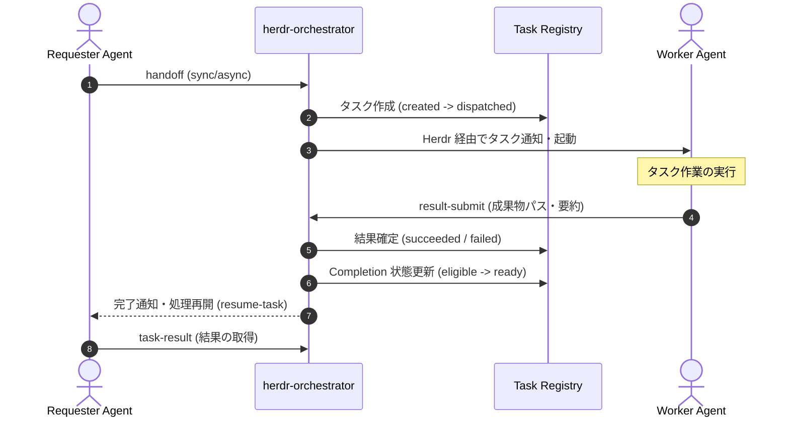

# herdr-orchestration

[](https://github.com/okinawa-systembit/herdr-orchestration/actions/workflows/ci.yml)
[](https://github.com/okinawa-systembit/herdr-orchestration/releases)

[herdr](https://herdr.dev) 上で稼働する複数の AI Agent に対し、タスクの委託（handoff）、実行結果の提出・回収、および依頼元への完了通知・処理再開を支援するオーケストレーションツールです。

> [!IMPORTANT]
> **公式 herdr との関係性**  
> 本ツールは [herdr](https://herdr.dev) 本体そのものではなく、herdr のセッション環境上で動作する**追加のオーケストレーション Skill / CLI** です。公式 herdr および公式 `herdr` Skill と併用して動作します。公式 herdr 本体の機能と混同しないようご注意ください。

---

## 目次

- [主な機能](#主な機能)
- [利用イメージ（連携フロー）](#利用イメージ連携フロー)
- [動作環境・前提条件](#動作環境前提条件)
- [インストール方法](#インストール方法)
  - [A. 通常インストール（推奨・Release 利用）](#a-通常インストール推奨release-利用)
  - [B. 開発者向けローカルインストール（Git Clone）](#b-開発者向けローカルインストールgit-clone)
- [初期セットアップ・動作確認](#初期セットアップ動作確認)
- [基本的な使い方](#基本的な使い方)
  - [A. AI Agent に指示して利用する（推奨）](#a-ai-agent-に指示して利用する推奨)
  - [B. CLI による直接操作（開発・デバッグ用）](#b-cli-による直接操作開発デバッグ用)
- [アップデート（更新方法）](#アップデート更新方法)
- [アンインストール方法](#アンインストール方法)
- [トラブルシューティング](#トラブルシューティング)
- [制限事項・注意事項](#制限事項注意事項)
- [リリース情報](#リリース情報)
- [問題報告・フィードバック](#問題報告フィードバック)
- [ライセンス](#ライセンス)
- [開発者・Agent 向けドキュメント](#開発者agent-向けドキュメント)

---

## 主な機能

- **AI Agent 間のタスク委託（handoff）**: Requester Agent から Worker Agent へ指示とコンテキストを委託します。
- **同期・非同期実行のサポート**: 結果確定まで完了待機する `sync` モードと、即時復帰する `async` モードを提供します。
- **Task Registry による状態管理**: リポジトリ外のファイルベース領域でタスクのライフサイクル（4軸状態遷移）を厳密に管理します。
- **実行結果の提出と回収**: Worker による結果登録（`result-submit`）と Requester による結果取得（`task-result`）を接続します。
- **Requester への完了通知・再開**: Worker の結果提出を契機に Requester の completion 状態を更新し、安全な処理再開を促します。
- **異常時の復旧支援**: 応答のない未確定 dispatch の安全な復旧（`reconcile-dispatch`）や completion のリセット（`reset-completion`, `recover-completion`）を備えています。
- **Repository Identity（リポジトリ識別）**: Git リポジトリごとの一意な UUID を自動管理し、マルチリポジトリ環境での決定論的エージェントルーティングを実現します。
- **人間・Agent 共通の公開 CLI**: コマンドラインツール `herdr-orchestrator` により、ターミナルから直接各操作を実行可能です。

---

## 利用イメージ（連携フロー）



---

## 動作環境・前提条件

- **対応 OS**: **Linux / WSL2（Ubuntu）**
  - ※ Windows ネイティブ環境および macOS は未検証・動作保証対象外です。
- **必要な herdr 環境**:
  - [herdr](https://herdr.dev) が稼働していること
  - 公式 **herdr** Skill（pane / agent の操作機能）が導入されていること
- **ランタイム・必要コマンド**:
  - `python3` (3.10 以上)
  - `bash` (4.0 以上)
  - `curl`
  - `tar`
  - `flock`
  - `git`
- **対象 AI Agent 製品**: Cursor, Codex, Antigravity (Agy) 等

> [!NOTE]
> **Node.js / npm の要否について**  
> 一般利用者のインストールおよび CLI の日常利用において、**Node.js や npm は不要**です（Python スクリプトおよびシェルスクリプトのみで動作します）。  
> Node.js / npm は、本リポジトリ自体の開発・自動テスト（`npm run test:orchestrator` 等）を実行する場合にのみ必要となります。

---

## インストール方法

### A. 通常インストール（推奨・Release 利用）

GitHub Releases に公開されている公式リリース tarball から直接インストールします（Git の clone は不要です）。

#### 1. 事前確認（Dry-run）

変更予定内容を事前に確認します（ファイルは変更されません）。

```bash
curl -fsSL 'https://raw.githubusercontent.com/okinawa-systembit/herdr-orchestration/main/install.sh' | bash -s -- --dry-run
```

#### 2. 本番インストール

```bash
curl -fsSL 'https://raw.githubusercontent.com/okinawa-systembit/herdr-orchestration/main/install.sh' | bash
```

- **Skill インストール先**: `~/.agents/skills/herdr-orchestration`
- **CLI シンボリックリンク**: `~/.local/bin/herdr-orchestrator`

※ `--version <tag>` で特定のバージョン（例: `--version v0.2.0`）を指定することも可能です（省略時は最新安定版が選択されます）。  
詳細なインストール仕様: [distribution-install.md](skills/herdr-orchestrator/references/distribution-install.md)

---

### B. 開発者向けローカルインストール（Git Clone）

リポジトリをローカルにクローンし、開発中の Skill ツリーをローカル環境へ配置して動作確認する場合の手順です。

```bash
# 1. リポジトリのクローン
git clone https://github.com/okinawa-systembit/herdr-orchestration.git
cd herdr-orchestration

# 2. 開発用依存パッケージのインストールと自動テスト
npm install
npm run test:orchestrator

# 3. 開発用ローカルインストール
npm run install:orchestrator-dev
```

詳細な開発者向けインストール仕様: [dev-local-install.md](skills/herdr-orchestrator/references/dev-local-install.md)

---

## 初期セットアップ・動作確認

### 1. PATH の確認

CLI リンク先（`~/.local/bin`）が環境変数 `PATH` に含まれていることを確認します。

```bash
which herdr-orchestrator
# 期待される出力例: /home/<user>/.local/bin/herdr-orchestrator
```

### 2. ヘルプ表示の確認

通常のターミナル（Herdr セッションペイン外）から実行できます。

```bash
herdr-orchestrator --help
```

### 3. Repository Identity の初期化

Orchestrator を利用する各開発 Git リポジトリのルートで実行します（Herdr ペイン外でも実行可能）。

```bash
cd /path/to/your-project-repo
herdr-orchestrator identity init
```

`.git/config` にリポジトリ固有の UUID が登録され、決定論的な識別ハッシュが発行されます。

### 4. 環境診断の実行

Herdr が起動しているペイン内で実行し、環境設定を確認します。

```bash
herdr-orchestrator doctor
```

正常であれば `HERDR_ENV=1` が認識され、診断結果の JSON が出力されます（ペイン外で実行した場合は `herdr_env: false` となり終了コード 1 が返ります）。

### 5. Codex を利用する場合の承認設定（execpolicy）

Codex Agent を利用する場合、各 Agent 製品のユーザー設定として `~/.codex/rules/default.rules` に CLI 実行ルールを追加することが推奨されます。  
設定例のテンプレートは [codex-execpolicy-snippet.rules](skills/herdr-orchestrator/install/codex-execpolicy-snippet.rules) を参照してください。

---

## 基本的な使い方

本ツールは、Herdr 上で稼働する AI Agent（Cursor、Codex、Antigravity 等）にプロンプトで指示を出し、Agent 自身に Skill を通じてオーケストレーションを実行させる運用を想定しています。

> [!NOTE]
> タスク操作を行うコマンド（`handoff`, `result-submit` 等）は、**`HERDR_ENV=1` が設定された Herdr のセッションペイン内**で実行する必要があります。

---

### A. AI Agent に指示して利用する（推奨）

利用者はチャット欄からエージェントへ自然言語プロンプトで指示を出すだけで、Skill の参照、タスク委託、結果確認を行えます。

#### 1. Skill の読み込みと環境確認

エージェントにオーケストレーション Skill を認識させ、実行環境を確認させます。

> **プロンプト例:**
>
> ```text
> herdr-orchestration スキルを読み込んで、現在の Herdr 環境でタスク委託ができるか確認してください。
> ```

- **エージェントの内部動作**:  
  Skill 定義（`SKILL.md`）を参照し、`herdr-orchestrator doctor` や `herdr-orchestrator identity show` を実行して動作環境とリポジトリ識別子を確認します。

#### 2. Worker エージェントへレビューを依頼する (handoff)

作業ブランチの変更や Pull Request のレビューを、別の Reviewer エージェントへ委託します。

> **プロンプト例（同期実行・結果待機）:**
>
> ```text
> 現在の作業ブランチの変更内容について、Reviewer エージェントへコードレビュー依頼を出してください。結果が返ってくるまで待機してください。
> ```
>
> **プロンプト例（非同期実行・即時復帰）:**
>
> ```text
> このタスクを非同期（async）で Reviewer エージェントに委託し、発行されたタスク ID を教えてください。
> ```

- **エージェントの内部動作**:  
  エージェントがタスク契約（Task Contract）を組み立て、以下のコマンドを実行して Worker を呼び出します。
  ```bash
  herdr-orchestrator handoff \
    --mode sync \
    --worker-role reviewer \
    --task-type review \
    --instruction "ブランチのコードレビューを実施してください。"
  ```
  `sync` モードの場合、エージェントは Worker の作業完了まで待機し、結果提出後に自動的にレビュー結果を報告します。

#### 3. タスク結果の確認・作業再開 (async モード時)

非同期（`async`）で委託したタスクの結果を確認させたり、後続の作業を再開させます。

> **プロンプト例:**
>
> ```text
> タスク task_example のレビュー結果を確認して、指摘事項があれば対応方針を教えてください。
> ```

- **エージェントの内部動作**:  
  `herdr-orchestrator task-result task_example` を実行して Worker の提出結果（ステータス、成果物パス、サマリー）を取得し、ユーザーへ報告します。

---

### B. CLI による直接操作（開発・デバッグ用）

ターミナルから人間が直接オーケストレーションを操作・検証する場合のコマンド例です。

#### 1. Worker へタスクを委託する (handoff)

```bash
herdr-orchestrator handoff \
  --mode sync \
  --worker-role reviewer \
  --task-type review \
  --instruction "PR #56 のコードレビューを実施してください。"
```

- `--mode sync`: Worker の結果提出が完了するまでブロッキング待機します。
- `--mode async`: タスク登録後、待機せず即座に制御を返します。

#### 2. タスクの状態を確認する

```bash
herdr-orchestrator task-status task_example
```

#### 3. Worker が実行結果を提出する (result-submit)

Worker Agent は作業完了後、タスク結果を提出します（Requester ではなく Worker が実行します）。

```bash
herdr-orchestrator result-submit task_example \
  --result-status succeeded \
  --result-ref ".review-inbox/review-response.md" \
  --summary "レビュー完了。指摘なし（GO）。"
```

#### 4. Requester がタスク結果を取得する

```bash
herdr-orchestrator task-result task_example
```

詳細なコマンド仕様・全オプション: [public-cli.md](skills/herdr-orchestrator/references/public-cli.md)

---

## アップデート（更新方法）

### 通常利用環境の更新

> [!NOTE]
> 設計書にある `herdr-orchestrator update` コマンドは**将来バージョンで提供予定の機能（現在未実装）**です。  
> 現行バージョンでは、公式配布インストーラー `install.sh` を再実行することで最新版へ安全に更新できます。

```bash
# 事前確認（Dry-run）
curl -fsSL 'https://raw.githubusercontent.com/okinawa-systembit/herdr-orchestration/main/install.sh' | bash -s -- --dry-run

# 更新実行
curl -fsSL 'https://raw.githubusercontent.com/okinawa-systembit/herdr-orchestration/main/install.sh' | bash
```

- **更新時の安全性**:
  - `flock` による排他制御が行われ、同時並行実行を防ぎます。
  - 既存環境をバックアップ退避した上でステージング経由でアトミックに配置するため、途中で失敗した場合も旧バージョンへ自動ロールバックされます。
  - Task Registry に蓄積された過去のタスク履歴データ（`~/.local/state/herdr-orchestrator/`）は更新時も保持されます。
- **更新時の注意点**:
  - タスク実行中の予期せぬ競合を防ぐため、**未完了（実行中）のタスクが存在しない状態で更新を実行してください**。

### 開発者環境の更新

リポジトリを clone している場合は、以下のように更新します。

```bash
git pull --ff-only
npm run test:orchestrator
npm run install:orchestrator-dev
```

---

## アンインストール方法

現在、自動アンインストールスクリプトは提供されていません。不要になった場合は、以下の手順で配置先を確認した上で手動削除してください。

> [!WARNING]
>
> - 未完了（実行中）のタスクが存在しないことを確認してからアンインストールを実行してください。
> - カスタムインストール先（`--dest` や `--bin-dir`）を指定していた場合は、実際の配置先を確認してください。
> - シンボリックリンクが本ツール（`herdr-orchestrator`）を指していることを確認してから削除してください。

### 1. 配置先・リンク先の確認

```bash
# インストール先ディレクトリの確認
ls -ld ~/.agents/skills/herdr-orchestration

# CLI シンボリックリンクの確認（本ツールを指しているか）
ls -l ~/.local/bin/herdr-orchestrator
```

### 2. Skill および CLI リンクの削除

```bash
# Skill ディレクトリの削除
rm -rf ~/.agents/skills/herdr-orchestration

# CLI シンボリックリンクの削除
rm -f ~/.local/bin/herdr-orchestrator
```

### 3. 永続データ・設定の清掃（任意）

- **Task Registry 永続データの削除（任意）**:  
  過去のタスクログや状態履歴を完全に消去したい場合のみ、手動で削除してください。**一度削除すると過去のタスク履歴は復元できません**（通常は保持が推奨されます）。
  ```bash
  rm -rf ~/.local/state/herdr-orchestrator
  ```
- **Agent 設定の清掃（任意）**:  
  Codex を利用していた場合は、`~/.codex/rules/default.rules` に追加した `herdr-orchestrator` 関連のルールを手動で削除してください。

---

## トラブルシューティング

| 症状                                                                   | 主な原因                                      | 確認・対処方法                                                                                                                                                                                                                                                                  |
| ---------------------------------------------------------------------- | --------------------------------------------- | ------------------------------------------------------------------------------------------------------------------------------------------------------------------------------------------------------------------------------------------------------------------------------- |
| `herdr-orchestrator: command not found`                                | PATH が通っていない / インストール未完了      | `~/.local/bin` が `PATH` 環境変数に含まれているか確認してください（`export PATH="$HOME/.local/bin:$PATH"`）。                                                                                                                                                                   |
| Agent が Skill を認識しない                                            | Skill 配置パスの不一致 / 再読み込み未実施     | `~/.agents/skills/herdr-orchestration/SKILL.md` が存在するか確認し、Agent（Cursor / Codex 等）を再起動または再読み込みしてください。                                                                                                                                            |
| `{"error": "herdr_env_required"}`                                      | Herdr ペイン外での実行                        | タスク操作コマンド（`handoff` や `task-status` 等）は、`HERDR_ENV=1` が設定された Herdr のセッションペイン内で実行してください。                                                                                                                                                |
| `{"error": "git_repository_not_initialized"}`                          | 非 Git ディレクトリでの実行                   | `identity` コマンドは Git 管理下のリポジトリ内で実行してください（`git init` を実行）。                                                                                                                                                                                         |
| `{"error": "live_agent_not_found"}` 等                                 | 宛先エージェントの未起動 / 命名不一致         | Herdr 上で対象ロールのエージェントが起動しているか確認してください。                                                                                                                                                                                                            |
| インストーラーが `Another installation... is currently running` で失敗 | 別のインストール処理の同時実行 / ロック保持中 | 別のインストール・更新処理が実行中でないか確認してください。`flock` による排他ロックは通常、保持プロセスの終了時に自動解放されます。ロックファイル（`~/.agents/skills/.herdr-orchestrator.install.lock`）が存在していること自体は正常な状態であり、安易に削除しないでください。 |

---

## 制限事項・注意事項

- **OS 制約**: WSL2（Ubuntu）を前提に設計・検証されています。Windows ネイティブ（Command Prompt/PowerShell）や macOS での動作は保証されません。
- **Herdr への依存**: 単独のタスクスケジューラではなく、Herdr のエージェントセッション管理および tmux ペイン連携を前提としています。
- **並列競合のリスク**: 同一ワークツリー内で複数の Worker Agent が同時にファイル編集を行うと競合が発生する可能性があるため、適切なブランチ運用や作業分担を推奨します。
- **バージョン表示コマンド**: 現在 CLI にバージョン番号を表示するオプション（`--version`）は未実装です。導入バージョンは GitHub Releases またはインストール時の出力で確認してください。

---

## リリース情報

- **GitHub Releases**: [https://github.com/okinawa-systembit/herdr-orchestration/releases](https://github.com/okinawa-systembit/herdr-orchestration/releases)
- **バージョン・変更履歴**: 最新バージョン、リリースノート、および破壊的変更の情報は、上記の GitHub Releases を参照してください。

---

## 問題報告・フィードバック

不具合の報告や改善提案は、GitHub Issues にて受け付けています。

- **Issue Tracker**: [https://github.com/okinawa-systembit/herdr-orchestration/issues](https://github.com/okinawa-systembit/herdr-orchestration/issues)

> [!CAUTION]
> 不具合報告時には、OS 環境、herdr バージョン、実行コマンド、エラーメッセージ、再現手順を記載してください。**API トークンや秘密鍵などの機密情報を Issue に貼り付けないよう十分にご注意ください。**

---

## ライセンス

現在、本リポジトリにライセンスファイルは設定されていません（未設定）。利用や再配布の条件等については、リポジトリ管理者まで直接お問い合わせください。

---

## 開発者・Agent 向けドキュメント

### 開発者向け

- [AGENTS.md](AGENTS.md) — リポジトリ作業ガイド・開発規約
- [docs/herdr-orchestrator-design.md](docs/herdr-orchestrator-design.md) — アーキテクチャ設計書目次
- [docs/herdr-orchestrator-implementation-index.md](docs/herdr-orchestrator-implementation-index.md) — 実装計画・フェーズ INDEX
- [dev-local-install.md](skills/herdr-orchestrator/references/dev-local-install.md) — ローカル開発インストール仕様

### Agent 向け

- [skills/herdr-orchestrator/SKILL.md](skills/herdr-orchestrator/SKILL.md) — Herdr Orchestration Skill 定義
- [skills/herdr-orchestrator/references/](skills/herdr-orchestrator/references/) — エージェント受信用リファレンス
  - [roles.md](skills/herdr-orchestrator/references/roles.md) — 論理ロール仕様
  - [handoff.md](skills/herdr-orchestrator/references/handoff.md) — タスク委託
  - [worker-receive.md](skills/herdr-orchestrator/references/worker-receive.md) — Worker 側処理手順
  - [requester-receive.md](skills/herdr-orchestrator/references/requester-receive.md) — Requester 側処理手順
  - [public-cli.md](skills/herdr-orchestrator/references/public-cli.md) — CLI コマンド仕様
- [.agents/skills/repo-review/SKILL.md](.agents/skills/repo-review/SKILL.md) — 本リポジトリ専用レビュー Skill

### 内部仕様・運用

- [distribution-install.md](skills/herdr-orchestrator/references/distribution-install.md) — 配布・更新仕様書
- [docs/herdr-orchestrator-identity-uuid.md](docs/herdr-orchestrator-identity-uuid.md) — Repository Identity UUID 仕様書
