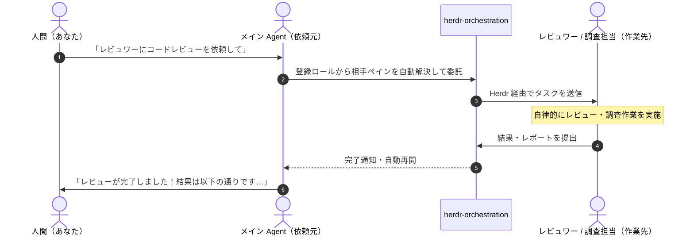

# herdr-orchestration

[](https://github.com/okinawa-systembit/herdr-orchestration/actions/workflows/ci.yml)
[](https://github.com/okinawa-systembit/herdr-orchestration/releases)

[herdr](https://herdr.dev) 上で稼働する複数の AI Agent（Cursor、Codex、Antigravity 等）をつなぎ、**チームとしての協調作業（タスク委託・結果回収・完了通知）を支援するオーケストレーションツール**です。

利用者はターミナルで複雑なコマンドを打つ必要はありません。**普段使っているチャット欄から AI Agent に自然言語で話しかけるだけ**で、エージェント同士が自律的に連携し、作業を分担して結果を報告してくれます。

> [!IMPORTANT]
> **公式 herdr との関係性**  
> 本ツールは [herdr](https://herdr.dev) 本体そのものではなく、herdr のセッション環境上で動作する**追加のオーケストレーション Skill / CLI** です。公式 herdr および公式 `herdr` Skill と併用して動作します。

---

## 目次

- [全体の流れ（利用イメージ）](#全体の流れ利用イメージ)
- [かんたん導入（インストール）](#かんたん導入インストール)
- [エージェントへの指示ガイド（自然言語での使い方）](#エージェントへの指示ガイド自然言語での使い方)
  - [1. 役割（ロール）を設定する](#1-役割ロールを設定する)
  - [2. タスクを別エージェントに配送（委託）する](#2-タスクを別エージェントに配送委託する)
  - [3. 非同期タスクの結果を確認する](#3-非同期タスクの結果を確認する)
  - [4. うまく依頼するためのキーワード・コツ](#4-うまく依頼するためのキーワードコツ)
- [よくある質問・困ったときは](#よくある質問困ったときは)
- [開発者・Agent 向け別紙（CLI 操作・詳細仕様）](#開発者agent-向け別紙cli-操作詳細仕様)
- [動作環境・前提条件](#動作環境前提条件)
- [アップデート・アンインストール](#アップデートアンインストール)
- [ライセンス・サポート](#ライセンスサポート)

---

## 全体の流れ（利用イメージ）



---

## かんたん導入（インストール）

WSL2 / Linux のターミナルで以下のコマンドを 1 行実行するだけで、必要な Skill と CLI がセットアップされます（Git clone や Node.js は不要です）。

```bash
curl -fsSL 'https://raw.githubusercontent.com/okinawa-systembit/herdr-orchestration/main/install.sh' | bash
```

- **Skill 配置先**: `~/.agents/skills/herdr-orchestration`
- **CLI リンク**: `~/.local/bin/herdr-orchestrator`

インストール後、Herdr 上のエージェントに **「herdr-orchestration スキルを読み込んで」** と声をかければすぐに利用開始できます。

---

## エージェントへの指示ガイド（自然言語での使い方）

日常的な操作はすべて、チャット欄からエージェントへの自然言語指示で行えます。

### 1. 役割（ロール）を設定する

エージェント同士が連携するために、まずどのペインが何の役割を担当するかをエージェントに設定させます。

#### どう指示すればいいの？

> **自分（現在のペイン）を登録する:**
>
> ```text
> このペインを「メイン」ロールとして登録して。
> ```
>
> ```text
> あなたをこのリポジトリの「実装担当（implementer）」として登録して。
> ```
>
> **別のペイン（相手）を登録する:**
>
> ```text
> 隣のペイン（w15:p2）を「レビュワー」ロールとして登録して。
> ```
>
> **別ワークスペースのペインを共通ロールとして登録する:**
>
> ```text
> 別ワークスペースにあるペイン w16:p1 を、どこからでも呼び出せるグローバルな「調査担当」として登録して。
> ```
>
> **登録内容を確認する:**
>
> ```text
> いまどんなロールが登録されているか教えて。
> ```

#### 指示すると裏で何が設定されるの？

1. **ロールとペインの紐付け（Role Binding）**:  
   エージェントが自身のペイン ID（`w15:p1` 等）や相手のペインを認識し、専用の設定ファイルに記録します。
2. **Herdr 画面上の表示名が自動連動**:  
   設定と同時に Herdr の画面（UI）上のペイン表示名（ラベル）が「メイン」「レビュワー」等に自動的に書き換わります。画面を見るだけでどのペインが誰か一目でわかるようになります。
3. **エージェント再起動時の自動追従**:  
   エージェントを再起動したりペイン番号が変わった場合でも、単一候補の一致条件（セッション ID 一致や 1 フォルダ 1 ロール構成での一致）を満たす場合に、安全に新しいペイン番号へ自動追従します（条件を満たさない場合や候補が複数ある場合は勝手に推測せず安全停止し、人間に確認を求めます）。
4. **ローカルロールとグローバルロール**:
   - **ローカルロール（通常）**: そのリポジトリ作業専用の役割（`メイン`, `レビュワー` 等）。
   - **グローバルロール（`--global`）**: ワークスペースを跨いで全リポジトリ共通で使える役割（`調査担当`, `チケット管理` 等）。

---

### 2. タスクを別エージェントに配送（委託）する

レビューやログ調査などを別エージェントに任せます。依頼を受けたエージェントは自前で作業を抱え込まず、相手のエージェントへタスクを配送します。

#### どう指示すればいいの？

> **結果が返ってくるのを待つ場合（同期依頼）:**
>
> ```text
> 現在のブランチの変更について、レビュワーにコードレビューを依頼して。完了まで待って結果を教えて。
> ```
>
> ```text
> 調査担当にエラーログの解析を依頼して。原因がわかるまで待機して報告して。
> ```
>
> **結果を待たずにすぐ別の作業をしたい場合（非同期依頼）:**
>
> ```text
> レビュワーにコードレビューを非同期で依頼して。完了待ちは不要なのでタスクIDを教えて。
> ```

#### 指示するとどうやって配送されるの？

1. **相手ロールの自動検索**:  
   依頼を受けたエージェントは、登録済みロール一覧から「レビュワー」「調査担当」など指示に最も適した相手を自動で見つけ出します。  
   ※もし同名ロールが複数あるなど曖昧な場合は、勝手に送らず「どちらに依頼しますか？」と人間に確認してくれます。
2. **相手ペインへのタスク伝達（稼働中エージェントへの送信）**:  
   相手ペインのエージェントが稼働中（`idle` または `done`）であることを前提として、Herdr を通じてタスク内容とコンテキストを安全に伝達します（相手エージェントが終了している場合は安全停止します）。
3. **同期と非同期の動きの違い**:
   - **同期（sync）**: 相手が作業を終えて結果を提出するまで、メインエージェントが待機します。完了すると自動で結果を取り込み、あなたに報告してくれます。
   - **非同期（async）**: タスクを相手に投げたらメインエージェントは即座にあなたへ復帰し、別の作業を続けられます。

---

### 3. 非同期タスクの結果を確認する

非同期で依頼していたタスクの進捗や結果を確認させます。

#### どう指示すればいいの？

> **結果を確認・報告させる:**
>
> ```text
> さっき依頼したレビュータスク（task_xxxxxxxx）の結果を確認して、指摘事項を教えて。
> ```
>
> ```text
> 調査タスク task_xxxxxxxx は終わった？結果を教えて。
> ```

エージェントが Task Registry から結果レポートや成果物パスを自動で読み出し、わかりやすく要約して回答してくれます。

---

### 4. うまく依頼するためのキーワード・コツ

エージェントに意図通りの動作を確実にさせるためのプロンプトのコツです。

- **本オーケストレーションを確実に使わせたいとき**:  
  「**herdr経由で**レビューを依頼して」「**ハーダーで**調査を委託して」のようにキーワードを添えると、エージェントがローカルの別スクリプトと混同せず確実に本ツールを起動します。
- **Herdr 本体の機能（ペイン操作等）を使わせたいとき**:  
  「**herdr公式で**ペインを横に分割して」「**公式herdrで**新しいエージェントを立ち上げて」のように「公式」を添えてください。公式の herdr 操作スキルが呼び出されます。
- **Herdr の公式ドキュメントを調べさせたいとき**:  
  「**公式ドキュメントで**仕様を調べて」「**herdrのドキュメントで**設定方法を確認して」のように指示すると、公式ドキュメント（`https://herdr.dev/llms.txt`）を参照して回答します。

---

## よくある質問・困ったときは

### Q. エージェントに指示しても「スキルが見つからない」と言われる

- `~/.agents/skills/herdr-orchestration/SKILL.md` が配置されているか確認してください。
- エージェント（Cursor や Codex 等）のウィンドウを再読み込みするか、チャットで「`~/.agents/skills/herdr-orchestration/SKILL.md` を読み込んで」と直接指定してください。

### Q. Codex Agent で「実行承認ダイアログ」が表示される

- **正常な安全動作です**。ロール設定（`role set`）やタスク送信（`handoff`）は環境変更を伴うため、Codex のセキュリティ機構により人間の承認を求める設計になっています。
- 承認ダイアログを出さずに Codex に完全に自動実行させたい場合は、[CLI リファレンス (public-cli.md)](skills/herdr-orchestrator/references/public-cli.md#6-codex-agent-実行承認設定-codex-execpolicy) を参照して許可ルールを追加してください。

### Q. エージェントを再起動したらロール設定はどうなる？

- 同じセッションや同一フォルダ単一ロール等の安全条件を満たす場合は自動追従するため再設定は不要です。
- もし「宛先が見つからない」と停止した場合や、同一ペインで複数ロールを兼任していて片側のみが自動追従して他方が停止した場合は、エージェントに「このペインをもう一度『メイン』として登録して」と依頼すれば再バインドされます。

### Q. 「role_binding_outdated」というエラーが出た

- 古い形式の Role Binding 設定が残っている場合に安全停止します。エージェントに「このペインを『メイン』として登録し直して」のようにロール設定の再登録を依頼してください。

### Q. エージェントが「どちらの宛先に送りますか？」と聞いてきた

- ローカルとグローバルの両方に同じ名前のロール（例: 両方に `調査`）が登録されている場合、誤配送を防ぐためにエージェントが確認を求めています。どちらのワークスペースのペインに送りたいかを伝えてください。

---

## 開発者・Agent 向け別紙（CLI 操作・詳細仕様）

ターミナルから人間が直接 CLI コマンド（`herdr-orchestrator`）を叩いて操作・検証したい場合や、エージェント向けの内部実装仕様については以下の別紙を参照してください。

- **CLI 詳細リファレンス**: [skills/herdr-orchestrator/references/public-cli.md](skills/herdr-orchestrator/references/public-cli.md)
  - 全コマンドのオプション一覧、CLI 直接操作例、環境診断、Codex 承認設定など。
- **リポジトリ開発・作業ガイド**: [AGENTS.md](AGENTS.md)
- **アーキテクチャ設計書目次**: [docs/herdr-orchestrator-design.md](docs/herdr-orchestrator-design.md)
- **クロスワークスペース・追従設計書**: [docs/herdr-orchestrator-cross-workspace.md](docs/herdr-orchestrator-cross-workspace.md)
- **エージェント受信用リファレンス**:
  - [roles.md](skills/herdr-orchestrator/references/roles.md)（論理ロール）
  - [handoff.md](skills/herdr-orchestrator/references/handoff.md)（タスク委託）
  - [worker-receive.md](skills/herdr-orchestrator/references/worker-receive.md)（Worker 受信側）
  - [requester-receive.md](skills/herdr-orchestrator/references/requester-receive.md)（Requester 受信側）

---

## 動作環境・前提条件

- **対応 OS**: **Linux / WSL2（Ubuntu）**
  - ※ Windows ネイティブ環境および macOS は動作保証対象外です。
- **必要な環境**:
  - [herdr](https://herdr.dev) が稼働していること
  - Python 3.10 以上, bash 4.0 以上, curl, tar, flock, git
- **動作確認した AI Agent**: Cursor, Codex, Antigravity (Agy) 等

---

## アップデート・アンインストール

### アップデート（最新版への更新）

未完了のタスクがない状態で、インストーラーを再実行してください。既存のタスク履歴データを保持したまま最新版へ更新されます。

```bash
curl -fsSL 'https://raw.githubusercontent.com/okinawa-systembit/herdr-orchestration/main/install.sh' | bash
```

### アンインストール

1. Skill および CLI リンクの削除:
   ```bash
   rm -rf ~/.agents/skills/herdr-orchestration
   rm -f ~/.local/bin/herdr-orchestrator
   ```
2. 過去のタスク履歴データの削除（必要な場合のみ）:
   ```bash
   rm -rf ~/.local/state/herdr-orchestrator
   ```

---

## ライセンス・サポート

- **不具合報告・フィードバック**: [GitHub Issues](https://github.com/okinawa-systembit/herdr-orchestration/issues)
- **リリース情報**: [GitHub Releases](https://github.com/okinawa-systembit/herdr-orchestration/releases)
- **ライセンス**: リポジトリ管理者まで直接お問い合わせください。
