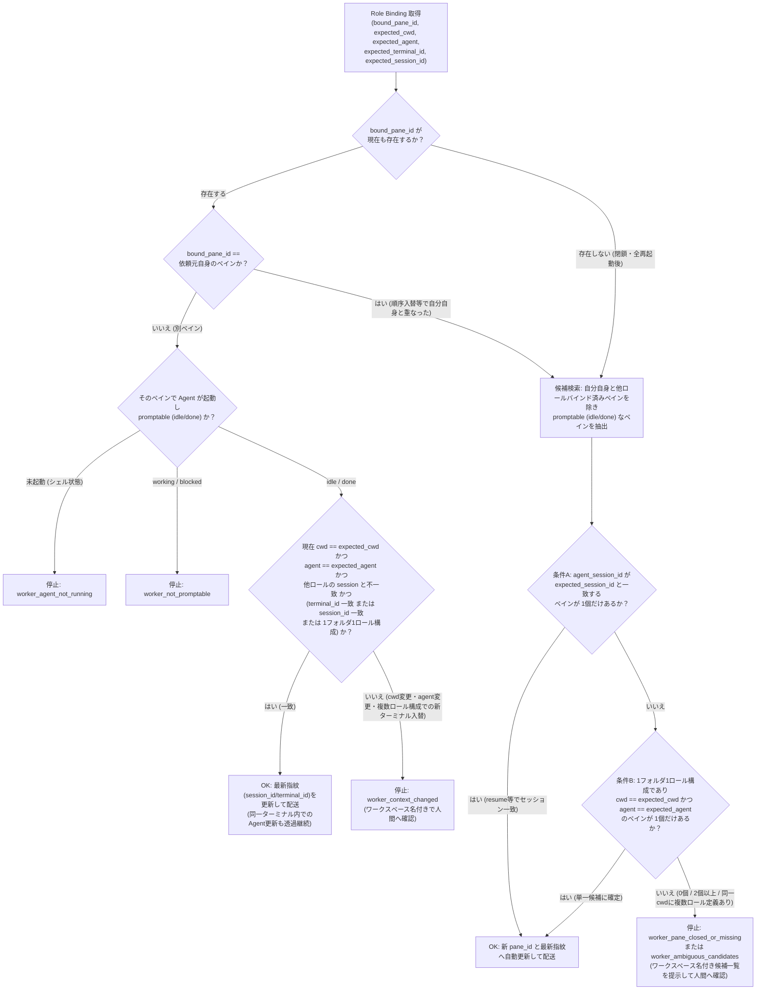

# Herdr Orchestrator ワークスペース跨ぎ配送・グローバルロール・日本語ロール名・ペイン自動追従 設計書

- **対象 Issue**:
  - [#74 — ワークスペース跨ぎ配送・グローバルロール・日本語ロール名・ペイン自動追従への対応](https://github.com/okinawa-systembit/herdr-orchestration/issues/74)（PR #75 / v0.4.0 にて実装完了・マージ済み）
  - [#151 — プロジェクトカタログと --project オプションによるプロジェクト跨ぎロール配送](https://github.com/okinawa-systembit/herdr-orchestration/issues/151)（現在設計中）
- **ステータス**: 設計中
- **関連 Issue**:
  - [#72 — herdr agent rename 依存を廃止し pane_id ベースの Role Binding 管理へ移行](https://github.com/okinawa-systembit/herdr-orchestration/issues/72)
  - [#121 — 呼び出し元ペイン判定の耐障害性向上（Codex共有デーモン汚染・Cursor環境変数欠落への対応）](https://github.com/okinawa-systembit/herdr-orchestration/issues/121)
  - [#126 — role show における Role Binding 状態の見える化と手動整理ガイドの整備](https://github.com/okinawa-systembit/herdr-orchestration/issues/126)
- **関連ドキュメント**:
  - [02-roles-and-task-contract.md](herdr-orchestrator/02-roles-and-task-contract.md#sec-4) (§4: 論理 Role と Routing Identity)
  - [03-task-registry.md](herdr-orchestrator/03-task-registry.md#sec-6) (§6: Task Registry / Canonical Schema)
  - [04-handoff-and-requester.md](herdr-orchestrator/04-handoff-and-requester.md#sec-7) (§7–8: Handoff と Requester 識別)
  - [05-completion-and-recovery.md](herdr-orchestrator/05-completion-and-recovery.md#sec-9) (§9: Completion・通知・復旧)
  - [06-results-and-workflows.md](herdr-orchestrator/06-results-and-workflows.md#sec-10) (§10–11: Result Contract と Worker Resolution)

---

<a id="sec-1"></a>

## 1. 背景と目的

<a id="sec-1-1"></a>

### 1.1 現状の課題

Issue #72 により、`herdr agent rename` 依存を廃止し `pane_id` を正本とする Role Binding 管理へ移行した。これにより、誤配送の主な原因であった「Agent 名の推測・リネーム消失」は解消された。

一方で、現行の `herdr-orchestrator` には旧来の誤配送防止策に起因する以下の制限が残っており、実運用上の障壁となっている：

1. **別ワークスペースの専任エージェントへ配送できない**:
   - 現行実装は `verify_worktree_affinity()` により、依頼元（Requester）と委託先（Worker）の `foreground_cwd` が**同一の Git worktree パス**かつ**同一の `repository_identity`（UUID）**であることを強制している。
   - そのため、社内ツール（チケット管理 MCP サーバ等）用のワークスペースに専任エージェントを配置し、プロジェクト A / B / C の各ワークスペースから共通してタスクを委譲する運用ができない。
2. **Git 無しディレクトリや複数ワークスペース分割運用で動作しない**:
   - 一時調査のためのログ資料や手順書置き場など、Git リポジトリとして初期化されていないディレクトリ（Non-Git 環境）では、`git_repository_not_initialized` や `worktree root resolution failed` で停止する。
   - また、ターミナルを広く使うために同じディレクトリを複数のワークスペース・タブに分けて開く運用や、将来的な `git worktree` 運用において、厳格すぎる Git パス一致チェックが阻害要因となる。
3. **ロール登録・指定の UX 課題（自然言語・日本語ロールへの未対応）**:
   - 既定の英単語 4 種（`design`, `reviewer`, `implementer`, `orchestrator`）しか受け付けないため、人間が英単語ロール名を記憶して指定する必要があり、「レビュワー」「ログ調査」「調査エージェント」「チケット管理」といった自然な日本語での登録・配送ができない。
4. **ペイン終了・エージェント再起動・Herdr 全再起動時の運用課題**:
   - エージェントのアップデートのために一時的に `exit` して同じペインで再起動する操作や、不要になったペインを閉じた後に誤って配送しようとしたケース、さらに Herdr 本体のアップデートのために全ペイン・全ターミナルを一度 `exit` して 1 個ずつ起動し直したケース（`pane_id` が変化するケース）を、複雑な実装を避けつつ安全に取り扱う必要がある。
   - また、状態変化や同名ロールの重複・不一致を人間へ確認する際、`w15:p2` のような内部ペイン ID だけを提示されても、人間が画面上のどのペインか即座に判別できない。
5. **複数プロジェクト連携時のグローバルロール名衝突と別名管理コスト（Issue #151）**:
   - 現行のグローバル Role Binding（`global.json`）はペイン単位でフラットにロール名を登録する設計となっている。
   - プロジェクト A とプロジェクト B で同じロール名（例: `レビュワー`、`実装担当`）を使っている場合、グローバル登録で名前が衝突するため「プロジェクトAレビュワー」のように別名登録せざるを得ず、プロジェクト A 内部の通常運用（単に「レビュワーに依頼」）や画面表示（UI ラベル）が壊れる問題が発生していた。
   - ペイン単位ではなくプロジェクト単位で公開登録し、各プロジェクトのローカルロールを自然に相互解決できる仕組みが求められている。

<a id="sec-1-2"></a>

### 1.2 目的

`pane_id` ベースの安全性を土台として、複雑な推測ロジックを避けたシンプルな規則で以下を実現する：

1. **グローバル Role Binding とエージェント自身による登録**:
   - 複数プロジェクトから共通利用できる `--global` スコープを導入し、各ペインのエージェント自身に自然言語で指示してカレントペイン（`HERDR_PANE_ID`）を登録できるようにする。
   - ローカルとグローバルの両方に同名ロール（例: `調査`）が登録されている場合は、勝手に片方へ送らず停止して**ワークスペース名主体の表示**で人間にどちらへ送るか確認する（`--scope local|global` で明示指定も可能）。
2. **日本語・自然言語ロール名（カスタムロール名）のサポート**:
   - 「レビュワー」「調査エージェント」「ログ調査」「チケット管理」等の任意の日本語・カスタムロール名の登録・配送を可能にする（固定の同義語辞書による暗黙変換は行わず、NFKC正規化後の登録名そのまま方式）。
3. **Requester–Worker 間の同一 worktree 強制の解除と、各自のコンテキスト保護・受信側本人確認**:
   - Requester と Worker が同じ Git worktree に居なければならない制約を廃止し、別ワークスペース・Non-Git フォルダ・複数ワークスペース分割運用・将来の `git worktree` でシームレスにやり取りできるようにする。
   - 一方で、「誤配送されたタスクを元に誤ったエージェントが勝手に作業を開始してしまうこと」を最も重大なリスクと位置づけ、**受信側（Worker の `task-status` / `result-submit` および Requester の `task-result` / `task-status`）で自分宛てかどうか（`pane_id`・`cwd`・ロール整合）を照合し、不一致時は受信側のチャット画面に報告して即座に作業を停止する防御機構**を設ける。
   - また、ファイル成果物（`--result-ref`）を作らないタスクでも `--summary` のみで結果提出できるようにする。
4. **登録時メタデータ（指紋）の記録と、UI 表示名に一切依存しない安全な単一候補自動追従**:
   - `role set` 時に `pane_id` とあわせてディレクトリパス（`cwd`）・エージェント種別（`agent`）・ターミナル ID（`terminal_id`）・セッション ID（`agent_session_id`）を記録する。
   - **UI 上のラベル（`pane.label` / `display_name`）は人間向けの表示専用とし、ルーティング・照合・自動追従の判定ロジックには一切使用しない。**
   - 同じペイン内でエージェントを `exit` → 再起動した場合は `terminal_id` が維持されるため透過的に継続し、ペイン閉鎖・Herdr 全再起動後に旧 `pane_id` が消滅した場合は、他ロールにバインド済みのペインを除外した上で、（A）`agent_session_id` が一致する単一ペイン、または（B）同一 `cwd` に 1 ロールしか定義されておらず `cwd` + `agent` が一致する単一ペインに絞れる場合のみ自動追従し、それ以外は**ワークスペース名主体の人間向け表示**で確認を求める。
5. **プロジェクトカタログ（`projects.json`）と `--project` によるプロジェクト跨ぎ配送（Issue #151）**:
   - 各プロジェクトをペイン単位ではなくプロジェクト単位でカタログ登録（`project register <alias>`）し、自身の `scope_id`（リポジトリ UUID / `dir_<hash16>`）と紐付ける。
   - `handoff --to <role> --project <alias>` により、相手プロジェクトのローカルロールを直接解決して配送可能とし、ペインごとのグローバル登録や改名の手間・名前衝突を完全に排除する。
   - 受信側本人確認（`recipient_verification`）においてワーカー側 `cwd` から解決したスコープも対象に含めて照合し、安全性を維持する。
   - 兼任ペインにおける `role set` 実行時にローカル UI ラベルの表示名を優先保護する。

---

<a id="sec-2"></a>

## 2. 基本設計方針

| 項目                                   | 設計方針                                                                                                                                                                                                                                            |
| -------------------------------------- | --------------------------------------------------------------------------------------------------------------------------------------------------------------------------------------------------------------------------------------------------- |
| **Role Binding のスコープ**            | **ローカル（ワークスペース/リポジトリ単位）** と **グローバル（全ワークスペース共通 `--global`）** の 2 階層をサポート                                                                                                                              |
| **解決規則と同名ロール衝突時の確認**   | ローカルとグローバルの**片方のみ**に登録されていればそちらを採用。**両方に同じロール名が登録されている場合**は勝手に決めず `worker_role_scope_ambiguous` で停止し、ワークスペース名を提示して人間に確認する（`--scope local\|global` で明示指定可） |
| **カレントペイン自動登録**             | `herdr-orchestrator role set <role> [<pane_id>] [--pane <pane_id>] [--global]` において、ペイン指定省略時は `HERDR_PANE_ID` を使用（人間が手動実行する場合。エージェント自動実行時は `--pane` 明示必須）                                            |
| **日本語・カスタムロール名**           | 暗黙の同義語変換辞書は持たず、NFKC 正規化・ASCII 小文字化（`unicodedata.normalize("NFKC", val).strip().lower()`）のみを行い、登録された日本語・英数字ロール名（例: `調査`, `レビュワー`, `ログ調査`, `チケット管理`）をそのまま保存・照合する       |
| **Requester–Worker 間の一致強制解除**  | Requester の worktree と Worker の worktree が同一であることを要求しない（クロスワークスペース配送の解禁）。ただし Task Registry には Requester の `context.worktree.path` と Worker の `worker.cwd` をそれぞれ必須記録し、各自の照合は維持する     |
| **受信側での本人確認とチャット報告**   | 受信側が `task-status` / `task-result` / `result-submit` を実行した際、呼び出し元と Task の関係（`worker` / `requester` / `observer`）に応じて照合する。宛先不一致時は即停止し、**受け取った側のチャット画面に不一致を報告して停止**する            |
| **Non-Git ディレクトリ対応**           | Git 未初期化ディレクトリでもローカル識別子（`dir_<sha256_16>`）を用いてローカル Role Binding・`handoff`・`result-submit` を実行可能とする                                                                                                           |
| **エージェント単体再起動（update等）** | 同じ `pane_id`・同じ `cwd`・同じ `agent` 種別であり、かつ `terminal_id` が登録時と同一（同じペイン内でのエージェント再起動）または `agent_session_id` が一致する場合は、確認や再登録なしで透過配送（指紋も最新値に更新）                            |
| **ペイン閉鎖・Herdr 全再起動時の追従** | 旧 `pane_id` 消滅時、他ロールにバインド済みのペインを除外した上で、① `agent_session_id` 一致の 1 ペイン、または ② 1 フォルダ 1 ロール構成で `cwd` + `agent` 一致の 1 ペインに特定できるときのみ自動更新して配送（UI ラベルは判定に一切使わない）    |
| **複数候補・不一致時の動作**           | 候補が 0 個（未起動）、2 個以上（同一ディレクトリの複数ワークスペース展開等）、同一フォルダ複数ロール構成での新ターミナル・新セッション起動、または `cwd` 変更時は送信せず停止し、人間向け識別情報で報告                                            |
| **Herdr UI ペイン表示名の自動連動**    | `role set` 時の表示名（`display_name`）を `herdr pane rename <pane_id> <display_name>` で Herdr UI 上のペインラベルに反映。**UI ラベルは人間向け表示専用であり、照合や自動追従ロジックには一切含めない**                                            |
| **人間向けのペイン表現**               | **`ワークスペース #2「tickets-mcp」の『チケット管理』（Claude Code / w16:p1）`** のように、人間が画面左サイドバーとヘッダーで見て即座に判別できる**ワークスペース名＋ロール表示名**を主役にした表記に統一する                                       |
| **Result 提出の柔軟化**                | 別ワークスペースの専任エージェント等がファイルを作らず回答できるよう、`--result-ref` 省略時は `--summary`（非空）のみでの `result-submit`（`succeeded` / `failed`）を許可                                                                           |
| **プロジェクトカタログと跨ぎ配送**     | プロジェクト単位でエイリアス（例: `プロジェクトA`）を公開登録（`projects.json`）し、`handoff --to <role> --project <alias>` により相手プロジェクトのローカルロールを直接解決・配送する（ペインごとのグローバル登録や改名・名前衝突を排除）          |
| **受信側本人確認のスコープ補完**       | ワーカーが他プロジェクトのローカルロールとしてタスクを受信した際、依頼元スコープに加えワーカー自身の `worker.cwd` から解決したスコープも含めて本人確認（ロール照合）を行う                                                                          |
| **兼任ペインのローカル UI ラベル優先** | 同一ペインがローカルロールとグローバルロールを兼任する場合、`role set` 実行時にローカルロールの表示名（`display_name`）を優先して Herdr ペインラベルに同期する                                                                                      |

---

<a id="sec-3"></a>

## 3. ロール名仕様（日本語・自然言語対応）

<a id="sec-3-1"></a>

### 3.1 ロール名の正規化（同義語変換テーブルの非採用と登録名そのまま方式）

自然言語の表現揺れを CLI 内部の固定辞書（同義語テーブル）で英語ロール名へ暗黙変換すると、辞書にある語だけが書き換わり辞書にない語がカスタムロールになるという不一致が生じる。そのため、**CLI 側では自然言語の同義語変換テーブルを持たず、登録されたロール名をそのまま保存・照合するシンプルな方式**を採用する。

- **CLI が行う文字列正規化**:
  - 入力されたロール文字列に対し、Python 標準ライブラリの **`unicodedata.normalize("NFKC", raw_role).strip().lower()`**（前後空白除去・全角英数記号の半角化・ASCII 英大文字の小文字化）の 1 ステップのみを適用する。
  - 例：
    - `role set 調査` ➔ 正規化キー `"調査"`、`display_name: "調査"`
    - `role set レビュワー` ➔ 正規化キー `"レビュワー"`、`display_name: "レビュワー"`
    - `role set Reviewer` / `role set ＲＥＶＩＥＷＥＲ` ➔ 正規化キー `"reviewer"`
    - `role set チケット管理 --global` ➔ 正規化キー `"チケット管理"`、`display_name: "チケット管理"`
- **未登録ロール指定時（`worker_role_not_bound`）の登録済みロール一覧提示**:
  - `handoff` 実行時に指定されたロールがローカル・グローバルのいずれにも登録されていない場合（かつ Pattern A 標準4ロール `design`, `reviewer`, `implementer`, `orchestrator` でもない場合）、エラー JSON に現在登録されているロール名一覧 `available_roles: {"local": [...], "global": [...]}` を含めて返す。これにより、AI エージェントや人間は固定辞書なしで現在有効な登録ロール名を即座に把握できる。

<a id="sec-3-2"></a>

### 3.2 ロール名の許容規則と予約語

標準 4 ロール（`design`, `reviewer`, `implementer`, `orchestrator`、Role Binding 未登録時は Pattern A 命名へフォールバック）以外の任意のロール名（例: `調査`, `レビュワー`, `ログ調査`, `チケット管理`, `社内ツール` など）は、すべて Role Binding 専用のロール名としてそのまま受け付ける。

- **許容文字と長さ**:
  - NFKC 正規化・前後空白除去・ASCII 小文字化後の文字列長が **1〜32 文字** であること。
  - 使用可能文字（正規表現 `^[a-z0-9\u3005\u3040-\u309f\u30a0-\u30ff\u4e00-\u9fff][a-z0-9_\-\u3005\u3040-\u309f\u30a0-\u30ff\u4e00-\u9fff]{0,31}$`）:
    - ASCII 英小文字（`a-z`）、数字（`0-9`）、ハイフン（`-`、ただし先頭ハイフンは CLI オプション誤認防止のため不可）、アンダースコア（`_`）
    - 日本語文字：ひらがな（`\u3040-\u309f`）、カタカナ・長音符 `ー`・中黒 `・`（`\u30a0-\u30ff`）、CJK 統合漢字（`\u4e00-\u9fff`）、々（`\u3005`）
  - 空白文字、制御文字、パス区切り文字（`/`, `\`）、記号（`.`, `:`, `*`, `?` 等）、および先頭が `-` または `_` で始まる文字列は `invalid_input` として拒否する。
- **システム予約値（`"unbound"`）**:
  - `"unbound"` は「Role Binding 未登録の依頼元（Requester）ペイン」を Task Registry の `requester.role` に記録するためのシステム予約値とし、`role set` や `--to` のターゲット名としては使用不可とする（N-1 対応）。

---

<a id="sec-4"></a>

## 4. Role Binding のスコープと保存形式

<a id="sec-4-1"></a>

### 4.1 2つのスコープ（ローカルとグローバル）と排他・衝突確認規則

Role Binding は `${XDG_STATE_HOME:-~/.local/state}/herdr-orchestrator/roles/` 配下に保存する。

1. **グローバル Role Binding (`global.json`)**:
   - `--global` オプション指定時に読み書きする（排他ロックは `global.json.lock`）。
   - 社内ツール（チケット管理 MCP 等）の専任エージェントや、一時調査ワークスペースのエージェントなど、**複数のワークスペース・プロジェクトから共通して呼び出すロール**を格納する。
   - カレントディレクトリが Git リポジトリであるか否かを問わず、どこからでも登録・参照できる。
2. **ローカル Role Binding (`<scope_id>.json`)**:
   - `--global` 未指定時に読み書きする（排他ロックは `<scope_id>.json.lock`）。そのワークスペース（プロジェクト）専用のロール（例: プロジェクト A の `implementer` や `reviewer`）を格納する。
   - `<scope_id>` の決定方法（Git / Non-Git 両対応）：
     - カレントディレクトリが Git 管理下の場合：既存の `get_or_create_repository_identity(cwd)` による UUID（`<uuid>.json`）。同一 Git リポジトリの複数 `git worktree` 間で共有される。
     - カレントディレクトリが **Git 管理外（Non-Git）** の場合：カレントディレクトリの解決済み絶対パス（`cwd.resolve()`）の SHA-256 先頭 16 文字を用いた `dir_<hash16>`（ファイル名 `dir_<hash16>.json`）をローカルスコープ ID として使用する。
       ※ Non-Git 環境では Git ルートが存在しないため、`role set` や `handoff` を実行するディレクトリの絶対パス単位で `<scope_id>` が決まる（サブディレクトリに移動して実行した場合は別スコープとなるため、Non-Git ワークスペースではエージェントを起動したトップディレクトリで操作する）。
3. **1対1 制約とスコープ間の解決・衝突確認規則**:
   - **同一スコープ内**: `role` と `pane_id` は厳密な 1 対 1（全単射）とする（同一スコープ内で同じ `pane_id` に別ロールを登録すると旧ロールは上書き解除される）。
   - **Worker 解決時のスコープ規則（同名ロール重複時は人間へ確認）**:
     - `handoff` に `--scope local` または `--scope global` が明示指定された場合は、指定されたスコープのみを参照する（もしもう一方のスコープにも同名ロールが存在する場合は、`warnings` に `worker_role_shadowed_by_explicit_scope` を記録する。N-3 対応）。
     - `--scope` が省略された場合、ローカル（`<scope_id>.json`）とグローバル（`global.json`）の両方を調べる：
       - **片方のスコープにのみ登録されている場合** ➔ 登録されている方のスコープを採用する。
       - **ローカルとグローバルの両方に同じロール名（例: 両スコープに `調査` が登録されている場合）が登録されている場合** ➔ 勝手に片方へ送らず（`pane_id` が同一か否かを問わず更新先スコープの曖昧さを防ぐため）、エラー **`worker_role_scope_ambiguous`** で停止し、両方のペインを**ワークスペース名主体の人間向け表示**で提示してどちらに送るか人間に確認する（人間が選んだ方を `--scope local` または `--scope global` で指定して再実行する。N-2 対応）。
   - **Requester ロール解決時の規則（N-1 対応）**:
     - 依頼元ペイン（`HERDR_PANE_ID`）から `requester.role` を決定する際は、① ローカル（`<scope_id>.json`）で該当 `pane_id` を検索 ➔ ② 無ければグローバル（`global.json`）で検索 ➔ ③ どちらにもバインドされていない場合は、レガシー命名（`r-<hash16>-<role>`）に一致すればそのロール（ただし他ペインにバインド済みなら拒否）、無名ペインであればシステム予約値 **`"unbound"`** を `requester.role` に設定する。
     - これにより、既存の正式ロール名（`"orchestrator"` 等）と一切衝突することなく、未バインドのペインからでもグローバル専任エージェント等へ安全に `handoff` を発行できる。
   - **ロック取得順序**: `handoff` 中に自動追従や指紋更新で Role Binding ファイルを更新する場合、必ず **`create_task`（および `HandoffLockSession`）に入る前の `_resolve_parties` フェーズ**で `_role_mutation_lock` を取得・解放して完結させる（`handoff.lock` と `role.lock` のネストを発生させない）。

<a id="sec-4-2"></a>

### 4.2 Role Binding に保存するメタデータ（ペイン指紋情報）と Herdr UI ラベル連動

`role set` 実行時、単に `pane_id` 文字列だけを保存するのではなく、`herdr pane list` / `herdr workspace list` / `herdr tab list`（または `herdr agent get`）から取得した**登録時点のペイン指紋（ターゲットメタデータ）**と**人間向けの表示名（`display_name`）**をあわせて保存する。

さらに、`HERDR_ENV=1` 環境下では **`herdr pane rename <pane_id> <display_name>` をベストエフォートで自動実行し、Herdr の画面（UI）上のペイン表示名も人間向け名称に同期する**。

- **`display_name` の決定規則と UI 専用原則（重要）**:
  1. `--label <text>` オプションが明示指定された場合はその文字列（前後空白除去、最大 64 文字、制御文字不可）を使用する。
  2. 省略された場合は、ユーザーが `role set` に渡したロール引数（例: `role set レビュワー` なら `"レビュワー"`、`role set チケット管理` なら `"チケット管理"`、`role set reviewer` なら `"reviewer"`）をそのまま `display_name` とする。
  3. **【厳守】UI 表示名（`display_name` および Herdr の `pane.label`）は人間向けの視覚的目印・チャット報告専用であり、Worker 解決・生存照合・自動追従の判定ロジックには一切使用しない。**
     - herdr 0.9.5 の `pane rename` は `--` を引数終端として扱わずラベルに含めてしまうため `--` は付けない。設定は `herdr pane rename <pane_id> <display_name>`、クリアは `herdr pane rename <pane_id> --clear` の形式で呼び出す。また、`display_name` は Herdr CLI のオプション引数（`--clear` や `--help` 等）との誤認を防ぐため、先頭の `--` を自動的に除去して設定する（除去後に空文字となる場合は不正な入力として拒否される）。
     - **兼任ペインにおける `role clear` 時の残存ロール UI ラベル保護**: ペインが複数のロール（ローカルとグローバル等）を兼任している場合、片方のロールを `role clear` しても UI ラベルを無条件に `--clear` してはならない。他スコープに依然としてバインド中の現役ロールが存在する場合は、その残存ロールの `display_name` でラベルを維持・再同期し、どのスコープにもロールが存在しなくなった場合のみ `<pane_id> --clear` を実行する（Issue #79）。
     - **兼任ペインにおける `role set` 時のローカル UI ラベル優先保護（Issue #151）**: 同一ペインに対して `role set <role> --global` を実行した際、そのペインが既にローカルスコープ（カレントディレクトリの `<scope_id>.json`）で有効なロール（例: `レビュワー`）を保持している場合、Herdr UI 上のペイン表示名にはローカルロールの `display_name` を優先して同期・維持する（`_sync_pane_label_after_unbind` の優先順位「ローカルスコープ最優先 ➔ グローバルスコープ」と完全整合）。グローバルロール名は `global.json` のメタデータに正しく記録されるが、画面上の視覚的目印としてはローカル作業の識別性を損なわないよう保護する。また、ローカルロール側で `role set` が実行された場合は、常に新しいローカル表示名で UI ラベルが更新される。

#### 保存 JSON 構造と旧形式ファイルの配送前停止（RV019 B-1 対応）

`roles` 辞書に加えて、`targets` フィールドに詳細メタデータ（`pane_id`, `cwd`, `agent` を必須指紋とする）を記録する。

- **旧バージョン（v0.3.1 以前）の Role Binding ファイル（`targets` なし）に対する扱い（複雑化の排除・RV020 N-1 / N-2 対応）**:
  - 旧バージョンのファイル（`{"roles": {"reviewer": "w15:p2"}}` のみで `targets[<role>]` または必須指紋 `cwd` / `agent` が存在しない形式）に対する後方互換のフォールバック配送ロジックは設けない。
  - **`role set` 時点での必須検証（RV020 N-1 対応）**: `HERDR_ENV=1` 環境下での `role set` 実行時は、対象ペインが存在し、かつエージェントが起動中（`agent` が非 `null`）であることを検証する。エージェント未起動（シェル状態）のペインに対する `role set` はエラー `role_target_agent_not_running` で拒否し、新形式バインドで `agent: null` が保存されることを防ぐ（これにより「エージェント未起動で登録したバインド」と「旧形式バインド」が混同されることはない）。
  - **配送前および `doctor` での旧形式検知（RV020 N-2 対応）**: 依頼元が `handoff` を実行した最初の配送前解決フェーズ（`_resolve_parties`）において、**依頼先ロール（`worker_role`）または依頼元自身の登録ロール（`requester_role`）に `targets[<role>]`（必須指紋 `cwd` および `agent`）が存在しない旧形式であることを検知した場合は、プロンプト送信前にエラー `role_binding_outdated` で即座に停止**し、チャット画面で `herdr-orchestrator role set <role> [<pane_id>]` による再登録を促す（また `role show` / `doctor` でも `targets` 欠落ロールを `outdated` として一覧表示する）。
  - これにより、実装の条件分岐を複雑化させることなく、すべての実機配送において `expected_cwd` / `expected_agent` の存在を必須前提とすることができる。

```json
{
  "schema_version": 1,
  "repository_id": "global",
  "roles": {
    "チケット管理": "w16:p1",
    "ログ調査": "w18:p1"
  },
  "targets": {
    "チケット管理": {
      "pane_id": "w16:p1",
      "display_name": "チケット管理",
      "cwd": "/home/kadena/tickets-mcp-workspace",
      "agent": "claude",
      "terminal_id": "term_65eef3948ae924",
      "agent_session_id": "e3c4bbdf-1945-47b2-97c4-2505ee886bb2",
      "workspace_id": "w16",
      "workspace_label": "tickets-mcp",
      "workspace_number": 2,
      "tab_id": "w16:t1",
      "tab_number": 1,
      "bound_at": "2026-10-29T05:00:00+00:00"
    }
  },
  "updated_at": "2026-10-29T05:00:00+00:00"
}
```

| フィールド         | 用途区分             | 内容                                                                                                                                                                    |
| ------------------ | -------------------- | ----------------------------------------------------------------------------------------------------------------------------------------------------------------------- |
| `pane_id`          | **ルーティング正本** | 登録されたペイン ID（例: `w16:p1`）                                                                                                                                     |
| `cwd`              | **照合・追従指紋**   | 登録時のペインのディレクトリ絶対パス（`foreground_cwd` または `cwd` を `resolve()` したパス）                                                                           |
| `agent`            | **照合・追従指紋**   | 登録時に稼働していたエージェント種別（`claude`, `agy`, `codex`, `cursor` 等。`HERDR_ENV=1` での `role set` 時は対象ペインでエージェントが起動していることを必須とする） |
| `terminal_id`      | **照合補助指紋**     | 登録時の `terminal_id`（例: `term_65eef3948ae924`）。※ routing key ではなく「同じターミナル内でエージェントを再起動したか」を判別する指紋                               |
| `agent_session_id` | **照合・追従指紋**   | 登録時の `agent_session.value`（セッション ID。取得不可時は `null`）。※ routing key ではなくセッション同一性確認の補助指紋                                              |
| `display_name`     | **人間表示専用**     | Herdr UI ペインラベルおよびチャット報告に表示する人間向け名称（例: `チケット管理`, `ログ調査`, `レビュワー`）                                                           |
| `workspace_id`     | **人間表示専用**     | Herdr の `workspace_id`（例: `w16`）                                                                                                                                    |
| `workspace_label`  | **人間表示専用**     | Herdr UI 左サイドバーに表示されるワークスペース名（例: `staff-portal-system`）                                                                                          |
| `workspace_number` | **人間表示専用**     | Herdr UI 左サイドバーのワークスペース番号（並び順で変化するため照合には使わず表示のみに使用）                                                                           |
| `tab_id`           | **人間表示専用**     | Herdr の `tab_id`（例: `w16:t1`）                                                                                                                                       |
| `tab_number`       | **人間表示専用**     | Herdr UI のタブ番号（表示のみに使用）                                                                                                                                   |
| `bound_at`         | **監査記録用**       | 登録日時（ISO 8601 UTC）                                                                                                                                                |

> [!NOTE]
> `terminal_id` および `agent_session_id` は、`herdr agent prompt` の宛先（routing target）としては一切使用せず、`pane_id` で特定されたペインが「同じターミナルのままエージェントを再起動したのか、それともサーバー再起動等で別ペインと入れ替わったのか」を検査する**照合補助指紋**としてのみ使用する（[02-roles-and-task-contract.md §4.2](herdr-orchestrator/02-roles-and-task-contract.md#sec-4-2) の「`agent_session_id` や `terminal_id` を routing identity に転用しない」原則と整合）。

<a id="sec-4-3"></a>

### 4.3 CLI インターフェース（`role` サブコマンド）

```bash
# 1. カレントペイン（$HERDR_PANE_ID）をローカルロールとして登録（人間が手動実行する場合。エージェント自動実行時は --pane 明示必須）
herdr-orchestrator role set レビュワー
herdr-orchestrator role set reviewer --label "レビュワー"

# 2. カレントペイン（$HERDR_PANE_ID）をグローバルロールとして登録（人間が手動実行する場合。エージェント自動実行時は --pane 明示必須）
herdr-orchestrator role set チケット管理 --global
herdr-orchestrator role set ログ調査 --global

# 3. ペインIDを明示して登録（位置引数または --pane のどちらでも指定可能。エージェント自動実行時はこちらを使用）
herdr-orchestrator role set チケット管理 w16:p1 --label "チケット管理 (共通)" --global
herdr-orchestrator role set reviewer --pane w15:p2 --label "レビュワー"
herdr-orchestrator role set ログ調査 --pane w17:p1 --label "ログ調査 (共通)" --global

# 4. 登録状況の表示（ローカル＋グローバルの両方、およびワークスペース名等のUI位置情報を表示）
herdr-orchestrator role show
herdr-orchestrator role show --global

# 5. 登録の解除（UIラベルも --clear で解除）
herdr-orchestrator role clear チケット管理 --global
herdr-orchestrator role clear --all --global
herdr-orchestrator role clear reviewer
```

- **位置引数 `<pane_id>` と `--pane` の両対応**:
  `herdr-orchestrator role set <role> [<pane_id>] [--pane <pane_id>] [--label <display_name>] [--global]` とし、位置引数 `<pane_id>` と `--pane` のどちらでも指定でき、両方省略された場合は環境変数 `HERDR_PANE_ID` を使用する。
- **暗黙解決時の CWD 照合セーフガード（`env_pane_cwd_mismatch`）**:
  位置引数 `<pane_id>` も `--pane` も省略されて環境変数 `HERDR_PANE_ID` から暗黙解決された場合のみ、対象ペインの作業ディレクトリ（`target_meta["cwd"]`）とコマンド実行時カレントディレクトリを照合（同一パス、サブディレクトリ、または同一 Git リポジトリの worktree affinity）する。食い違いがある場合は過去セッションの環境変数残留とみなし、エラーコード `env_pane_cwd_mismatch`（exit 1）で安全停止して `--pane <pane_id>` の明示案内を行う。明示指定時はクロスワークスペース登録を許容するため照合をスキップする。
  - **照合範囲と同一 worktree 兼任構成における制約**:
    本セーフガードが検出できるのは**別ディレクトリや別リポジトリ**のペイン ID が残っている場合のみである。同一 worktree 内で隣のペイン（別エージェント）の ID が残っている場合や、`result-submit` / `task-status` 等で同一 worktree 内の他方ペイン ID が残っている場合は作業ディレクトリ（CWD）が一致するため CLI 側の CWD 照合単体では区別できない（既知の構造的制約）。そのため、エージェントが `herdr pane list` から自ペイン（`agent_session` や CWD + agent 種別）を一意に特定して `--pane` を明示する手順（SKILL.md）が主要な防御となる。

<a id="sec-4-4"></a>

### 4.4 `role show` におけるライブ状態照合（`live_status`）と手動整理の設計（Issue #126）

#### 1. 背景と設計原則（なぜ一括自動削除ではなく「状態の見える化＋明示的解除」とするか）

- **閉鎖ペインの設定が保持される理由と自動削除のリスク**:
  Herdr 上でペインを閉じたり Herdr 全体を再起動したりした直後は、登録されていた `pane_id` が実機上から消滅する。しかし、Role Binding に保存されている `agent_session_id`・`cwd`・`agent` の指紋情報は、エージェント復帰後に次回の `handoff` で**新しいペインへ自動追従（[§5.2 ケース K](#sec-5-2)）するための唯一の手がかり**である。したがって、「ペインが現在実在しないこと」だけを根拠に機械的・自動的に Role Binding を削除（auto-prune）してしまうと、再起動後の自動追従が機能しなくなる。
- **人間中心の可観測性（原則 2）と機械検査・エージェント判断の境界（指針 8）**:
  壊れやすい自動削除機構や新たな一括削除コマンドを増やすのではなく（原則 1: KISS）、`herdr-orchestrator role show` の出力に各ロールの実機照合状態（`live_status`）を追加して**状態を見える化**する。その上で、「再起動後の自動追従待ちなのか、完全に閉じて不要になったロールなのか」を人間またはエージェントが判断し、既存の `herdr-orchestrator role clear <role>`（`--global`）で 1 件ずつ明示的に解除する運用とする。

#### 2. 判定ロジックの単一正本化（原則 6）

`role show` で「生存している（`live`）」と表示されたロールが `handoff` で不一致停止するような乖離を防ぐため、[§5.2](#sec-5-2) の `handoff` 宛先解決ロジックから**ファイル書き込みを一切伴わない読み取り専用の照合関数**を抽出し、`handoff` と `role show` の双方から同一関数を呼び出す：

1. **Peer Context の共通算出（`compute_role_peer_context`）**:
   対象ロール `(chosen_scope_id, canonical_role)` について、ローカルスコープ（`<local_scope_id>.json`）とグローバルスコープ（`global.json`）の全登録ロールを走査し、以下を算出する：
   - `is_unique_cwd_role: bool` — `expected_cwd` と同じ正規化絶対パスを持つ他ロール（別ペイン）が 0 件であるか。
   - `other_expected_sessions: set[str]` — 別ペインに登録された他ロールが持つ `agent_session_id` の集合。
   - `other_bound_panes: set[str]` — 別ペインに登録された他ロールの `pane_id` の集合。
2. **単一ロールの実機状態評価（`evaluate_role_target_live_status`）**:
   `herdr pane list`（`list_live_panes_with_ui()`）の結果と `target_meta` および Peer Context を照合し、以下の 4 状態（`status`）に分類する。

#### 3. 4 つのライブ状態（`live_status`）の定義と判定マトリクス（RV104 P2-1 対応）

`handoff`（`_verify_or_track_bound_worker`）の既存の判定順序と完全に一致させるため、`bound_pane_id` が実機上に存在する場合は **① エージェント未起動（シェル待機）かの確認 ➔ ② エージェント稼働時の指紋照合** の順で評価する（なお、`bound_pane_id == req_pane_opt`［依頼元自身のペインとの重複］の分岐は依頼元が存在する `handoff` 側のみで扱う）：

| `status`            | 判定条件（上から順に評価）                                                                                                                                                                                                                                                                                                                                                                                                                                                                                                                                                          | `agent_status`                                                        | `reason`                                                | 意味と `hint`（人間・エージェントへの案内）                                                                                                                                                                                                                                                                                            |
| :------------------ | :---------------------------------------------------------------------------------------------------------------------------------------------------------------------------------------------------------------------------------------------------------------------------------------------------------------------------------------------------------------------------------------------------------------------------------------------------------------------------------------------------------------------------------------------------------------------------------- | :-------------------------------------------------------------------- | :------------------------------------------------------ | :------------------------------------------------------------------------------------------------------------------------------------------------------------------------------------------------------------------------------------------------------------------------------------------------------------------------------------- |
| **`unknown`**       | `HERDR_ENV != "1"`（Herdr ペイン外での実行）、または `herdr pane list` の取得に失敗（`panes is None`）した場合（※ 旧形式 `outdated_roles` 該当時は実機取得の成否に関わらず下の `pane_mismatch` とする）。                                                                                                                                                                                                                                                                                                                                                                           | `null`                                                                | `"not_in_herdr_env"` または `"pane_list_unavailable"`   | 実機状態を取得できないため判定不能。`hint: "Herdr 実機のペイン一覧を取得できないため状態を判定できません（設定を削除しないでください）。"`                                                                                                                                                                                             |
| **`pane_missing`**  | `herdr pane list` は取得できたが、`bound_pane_id` が実機上に存在しない（ケース I）。                                                                                                                                                                                                                                                                                                                                                                                                                                                                                                | `null`                                                                | `"pane_not_found"`                                      | 指定ペインが実機上に存在しない状態。`hint: "指定されたペインが実機上に存在しません。Herdr 再起動後の場合は次回 handoff 時に自動追従を試みます。ペインを完全に閉じて不要になったロールであれば 'herdr-orchestrator role clear <role>' で解除してください。"`                                                                            |
| **`live`**          | `bound_pane_id` が実機上に存在し（かつ旧形式でない）、以下のいずれかを満たす：① **シェル待機時**（`not live_agent` または `agent_status == "none"`）：指紋照合を行わず即座にシェル待機（`reason: "agent_not_running"`）と判定（`handoff` が `worker_agent_not_running` で即停止する順序と一致）。② **エージェント稼働時**（`live_agent` あり かつ `agent_status != "none"`）：`live_cwd == expected_cwd` かつ `live_agent == expected_agent` かつ `live_sess not in other_expected_sessions` かつ (`terminal_id` 一致 または `agent_session_id` 一致 または `is_unique_cwd_role`)。 | 実機の `agent_status`（`"idle"`, `"working"`, `"done"`, `"none"` 等） | 稼働時は `null`、シェル待機時は `"agent_not_running"`   | 同一ペインが生存している状態。稼働時（②）は `hint: null`（`idle`/`done` ならそのまま配送可能）。シェル待機時（①）は `hint: "ペインは存在しますが現在エージェントが未起動（シェル状態）です。エージェントを起動するか、不要なら 'herdr-orchestrator role clear <role>' で解除してください。"`                                           |
| **`pane_mismatch`** | ① `target_meta` が必須項目（`cwd`, `agent`）を欠く旧形式（`outdated_roles` 該当）。② または `bound_pane_id` が実機上でエージェント稼働中（`live_agent` あり かつ `agent_status != "none"`）であるが、上記の `live` ② の指紋条件を満たさない（`cwd` 変更、`agent` 種別変更、他ロールセッション混入、または複数ロール構成での別ターミナル入替：ケース H）。                                                                                                                                                                                                                           | 実機の `agent_status`（旧形式時は `null`）                            | `"context_changed"`（旧形式時は `"outdated_metadata"`） | ペインの状態が登録時と食い違っている状態（別ペインへの ID 再利用やディレクトリ移動）。`hint: "ペインの状態が登録時と一致しません（別ペインへの ID 再利用またはディレクトリ移動）。現在のペインで 'herdr-orchestrator role set <role> <pane_id>' を再実行するか、不要なら 'herdr-orchestrator role clear <role>' で解除してください。"` |

※ グローバルスコープのロールに対する `hint` 内のコマンド案内には `--global` オプションを付記する。

#### 4. `role show` の出力構造・読み取り専用保証・stderr 警告（指針 10）

- **出力 JSON 構造**:
  既存の `targets[<role>]`（および `global_targets[<role>]`）の各オブジェクト内に `live_status` フィールドを追加する（既存のトップレベル構造や `outdated_roles` は後方互換性のためそのまま維持する）：

  ```json
  "targets": {
    "レビュワー": {
      "pane_id": "w15:p2",
      "display_name": "レビュワー",
      "cwd": "/home/kadena/Gitrepo/herdr-orchestration",
      "agent": "claude",
      "terminal_id": "term_65f7c1b9204132",
      "agent_session_id": "9ea15388-48b6-4004-ba17-111fc753a961",
      "display_summary": "ワークスペース #1「herdr-orchestration」の『レビュワー』（Claude Code / w15:p2）",
      "live_status": {
        "status": "live",
        "agent_status": "idle",
        "reason": null,
        "hint": null
      }
    }
  }
  ```

- **読み取り専用の厳格保証と終了コード規則（RV104 P3-3 対応）**:
  `role show` はいかなる状態であっても Role Binding ファイル（`<scope_id>.json` / `global.json`）への書き込み・更新を行わない。また、`live_status.status` の値（`pane_missing`・`pane_mismatch`・`unknown`）によって終了コードは変えず `0` のままとする（ただし、Role Binding ファイル自体の JSON 破損や読み込み失敗などで `RoleBindingError` が発生した場合は、従来どおりエラー終了コード `1` を返す）。
- **stderr への警告出力（指針 10: 黙って失敗しない）**:
  表示対象スコープ内に `status != "live"` または `reason == "agent_not_running"` のロールが 1 件以上存在する場合、標準エラー出力（stderr）に 1 行の警告（例: `[WARN] role show: non-live or inactive role bindings detected (レビュワー: pane_missing). See live_status.hint in JSON output.`）を出力し、エージェントや人間が見落とさないようにする。

#### 5. 不要ロールおよび破棄済みリポジトリ設定の手動整理手順（RV104 P3-2 対応）

1. **閉じたペイン・不要ロールの整理**:
   - `herdr-orchestrator role show`（および `--global`）を実行し、`live_status.status` が `pane_missing` または `pane_mismatch` となっているロールを確認する。
   - そのロールが今後も使わない（ペインを完全に閉じた）と確認できた場合は、`herdr-orchestrator role clear <role>`（グローバルの場合は `--global`）を実行して 1 件ずつ解除する。
2. **破棄・削除済みリポジトリ（および Non-Git ディレクトリ）の Role ファイルの整理（原則 3）**:
   - ローカルスコープの Role ファイルは `${XDG_STATE_HOME:-~/.local/state}/herdr-orchestrator/roles/<repository-id>.json`（Non-Git ディレクトリの場合は `dir_<hash16>.json`）および対応する `.lock` ファイルに保存されている。
   - 他のリポジトリの設定に誤って干渉する経路を作らないため、CLI に別リポジトリのファイルを一括削除するコマンドは設けない。
   - リポジトリ（または対象ディレクトリ）自体をディスクから完全に破棄した場合は、**対象スコープに対して Orchestrator のコマンドが実行中でないこと**および **JSON ファイル内の `targets[*].cwd` がすべて消滅していること**を確認した上で、OS 標準の `rm` コマンドで該当の `<repository-id>.json`（または `dir_<hash16>.json`）と対応する `.lock` を手動削除する（※ `global.json` は削除しないこと）。

<a id="sec-4-5"></a>

### 4.5 プロジェクトカタログ（`projects.json`）のデータ構造・排他ロック・CLI 仕様（Issue #151）

#### 1. 背景と設計方針（なぜペイン単位ではなくプロジェクト単位で公開するか）

- **ペイン単位グローバル登録の破綻**:
  従来の `global.json` は「単一のペイン ID（例: `w16:p1`）」に対してロール名（例: `チケット管理`）を直接紐付ける方式であった。しかし、プロジェクト A とプロジェクト B のように複数のリポジトリ／ワークスペースが連携する場合、各プロジェクトで頻繁に使われるロール名（`レビュワー`、`実装担当`、`設計担当` 等）をグローバル登録しようとすると名前が衝突する。
  これを避けるために「プロジェクトAレビュワー」のように別名登録すると、プロジェクト A 内部の通常運用（単に「レビュワーに依頼」）や Herdr UI ラベル表示が壊れ、さらにペインが増減するたびに全ペインを個別にグローバル登録し直す運用負荷が発生していた。
- **プロジェクトカタログによる解決**:
  ペインごとではなく、プロジェクト（リポジトリ）の単位でエイリアス（例: `プロジェクトA`）を 1 回だけカタログ登録する。各プロジェクト内部では通常通りシンプルなローカルロール（`レビュワー`、`実装担当` 等）を設定しておくだけで、依頼側は `--project プロジェクトA` を指定するだけで相手先プロジェクトのローカルロールを直接解決して `handoff` できる。

#### 2. 保存場所と排他ロック規則

- **保存場所**: `${XDG_STATE_HOME:-~/.local/state}/herdr-orchestrator/roles/projects.json`
- **排他ロック**: `${XDG_STATE_HOME:-~/.local/state}/herdr-orchestrator/roles/projects.json.lock`
  - `role.lock`、個別スコープの `<scope_id>.json.lock`、および `global.json.lock` とは完全に分離された独立ファイルとする。
  - **ネストロックの禁止**: `projects.json.lock` を保持したまま他の Role Binding ロックや `handoff.lock` を取得してはならない（デッドロック防止）。カタログの読み書き操作は極小時間のインラインで完結させる。

#### 3. プロジェクトカタログのスキーマ（`projects.json`）

```json
{
  "schema_version": 1,
  "projects": {
    "プロジェクトA": {
      "scope_id": "26797854-8826-4acf-a5ad-4cea9caaf947",
      "registered_at": "2026-11-06T00:00:00+00:00"
    },
    "staff-portal": {
      "scope_id": "dir_7f8a9b0c1d2e3f4a",
      "registered_at": "2026-11-06T01:00:00+00:00"
    }
  },
  "updated_at": "2026-11-06T01:00:00+00:00"
}
```

| フィールド                        | 型      | 説明                                                                                                                                          |
| :-------------------------------- | :------ | :-------------------------------------------------------------------------------------------------------------------------------------------- |
| `schema_version`                  | integer | スキーマバージョン（固定値 `1`）                                                                                                              |
| `projects`                        | object  | プロジェクトエイリアスをキーとする辞書                                                                                                        |
| `projects[<alias>].scope_id`      | string  | 登録プロジェクトのローカルスコープ ID（Git リポジトリ UUID、または Non-Git の `dir_<hash16>`）。実体ファイル `<scope_id>.json` と 1 対 1 対応 |
| `projects[<alias>].registered_at` | string  | プロジェクトがカタログに登録された日時（ISO 8601 UTC）                                                                                        |
| `updated_at`                      | string  | カタログファイルの最終更新日時（ISO 8601 UTC）                                                                                                |

#### 4. プロジェクトエイリアスの命名規則

- NFKC 正規化、前後空白除去、ASCII 小文字化を適用（`unicodedata.normalize("NFKC", raw_alias).strip().lower()`）。
- 文字種と長さ規則はロール名の許容規則（[§3.2](#sec-3-2)）と同一（1〜32 文字、日本語文字・ASCII 英数字・ハイフン・アンダースコア許容、先頭ハイフン・アンダースコア不可）。
- 予約語: `"local"`, `"global"`, `"unbound"` はプロジェクトエイリアスとして登録不可（`--scope` やシステム予約値との誤認防止）。

#### 5. CLI インターフェース（`project` サブコマンド）

- **`herdr-orchestrator project register <alias>`**:
  - **実行ディレクトリの必須性**: カタログに登録したいプロジェクト（リポジトリまたはディレクトリ）の作業ディレクトリ内で実行する。カレントディレクトリ（`cwd`）から `scope_id`（Git リポジトリ UUID または `dir_<hash16>`）を自動解決して登録する（これが他ワークスペースへの公開に対する明示的同意となる）。なお、Git 管理外のディレクトリの場合はカレントディレクトリのパスから `dir_<hash16>` が算出されるため、サブディレクトリではなく**必ずプロジェクトのトップディレクトリ（ルートディレクトリ）で実行すること**（[§4.1](#sec-4-1) の注記と同様）。
  - **一意性検証**: 同名の `<alias>` が既に別の `scope_id` に登録されている場合はエラー `project_alias_already_exists` で拒否する（同一 `scope_id` による再登録・上書きは許容）。
- **`herdr-orchestrator project show`**:
  - 登録済みプロジェクト一覧を表示する。各プロジェクトの `scope_id`、登録日時に加え、そのプロジェクトのローカル Role Binding（`<scope_id>.json`）を読み取り、定義されているローカルロール一覧と各ペインの実機生存状態（[§4.4](#sec-4-4) の `live_status`）を一覧出力する。
- **`herdr-orchestrator project clear <alias>`**:
  - 指定されたプロジェクトエイリアスをカタログから登録解除する（対象プロジェクトのローカル Role Binding ファイル自体は削除しない）。存在しないエイリアス指定時はエラー `project_alias_not_found` で停止する。
- **`herdr-orchestrator project clear --all`**:
  - カタログ内の全プロジェクト登録を解除する。

#### 6. 専任グローバルエージェントとの共存規則

- `global.json` の `roles` / `targets` は現状のまま維持する。特定プロジェクトに属さない専任エージェント（チケット管理 MCP サーバや横断ログ調査ペイン等）は、従来通り `role set <role> --global` でグローバル登録して運用する。
- 一方で、プロジェクト（リポジトリ）に属する開発ロール（`レビュワー`、`実装担当`、`設計担当` 等）は各リポジトリでローカル登録し、プロジェクト単位で `project register <alias>` して相互配送する。両者は互いを干渉することなく完全に共存する。

---

<a id="sec-5"></a>

## 5. 配送先（Worker）解決・自動追従・事前確認フロー（RV018 B-1 対応）

`handoff` 実行時、指定されたロール（`--worker-role` / `--to`）から配送先ペインを解決し、プロンプトを送信する前に以下の手順で安全性確認と自動追従を行う。

<a id="sec-5-1"></a>

### 5.1 ステップ 1：Role Binding の検索・旧形式チェック・同名ロール衝突チェック

1. **`--project <alias>` 指定時（プロジェクトカタログ経由の解決・Issue #151）**:
   - `--project` と `--scope`（local/global）が同時に指定された場合は、エラー `invalid_input`（`--project and --scope are mutually exclusive`）で拒否する。
   - プロジェクトカタログ（`${XDG_STATE_HOME:-~/.local/state}/herdr-orchestrator/roles/projects.json`）を読み取り、`<alias>`（NFKC・小文字化正規化済み）に対応する `scope_id` を取得する。
   - カタログ内に `<alias>` が存在しない場合は、エラー **`worker_project_not_found`** で停止し、登録済みプロジェクト一覧（`available_projects`）を提示する。
   - 取得した `scope_id` の Role Binding（`<scope_id>.json`）を読み取り、`canonical_worker_role` を検索する。
   - 対象プロジェクトのローカルにロールが登録されていない場合は、エラー **`worker_role_not_bound`** で停止し、そのプロジェクトの登録済みロール一覧（`available_roles`）を提示する。
   - **フォールバック禁止（フェイルクローズ保証）**: `--project` 指定時は、指定プロジェクトのローカル Role Binding にロールが見つからない場合であっても、グローバルロールや依頼元のローカルロール、および Pattern A（`r-<hash16>-<role>`）へのフォールバックは一切行わず、即座に停止する。
   - 解決された相手先ロールの設定が旧バージョン形式の場合は、同様に `role_binding_outdated` で停止する。
   - **自動追従の禁止と相手先 Role Binding 書き換え保護（P1-1 対応）**:
     `--project` によるプロジェクト跨ぎ配送では、依頼元エージェントが相手先プロジェクトの Role Binding（`<scope_id>.json`）を書き換えることは同意の境界（他プロジェクトの設定改ざんリスク）に反するため、**自動追従（ケース K）や指紋更新（ケース G）による相手先 Role Binding への書き込みは一切行わない（読み取り専用解決）**。相手先ペインが不在（`pane_missing`）やコンテキスト変化（`pane_mismatch`）の場合は、推測追従を行わずエラー（`worker_pane_closed_or_missing` または `worker_context_changed` 等）で即座に安全停止し、「相手先プロジェクト（`<alias>`）の環境でエージェントを起動・確認し、必要に応じて `role set` で再設定してください」と手動案内する。
2. `--scope local` または `--scope global` が指定されている場合はそのスコープのみを検索する（他方のスコープにも同名ロールが存在する場合は `warnings` に `worker_role_shadowed_by_explicit_scope` を追加する）。
3. `--scope` および `--project` が未指定の場合、ローカル（`<scope_id>.json`）とグローバル（`global.json`）の両方を検索する：
   - **両方に同名ロールが存在する場合**:
     - エラー **`worker_role_scope_ambiguous`** で即座に停止し、両方の候補を**ワークスペース名主体の表示**（§6）で出力して人間に選択を促す（自動追従や指紋更新の書き込み先スコープが曖昧になるのを防ぐため、`pane_id` が同一であっても `--scope` の明示を求める）。
   - **片方にのみ存在する場合**:
     - 存在する方のスコープを採用する。
4. **旧形式チェック（RV019 B-1 対応）**:
   - 採用したスコープの対象ロール（または依頼元ペインから逆引きされた依頼元ロール）に `targets[<role>]`（必須項目: `cwd`, `agent`）が存在しない旧形式ファイルだった場合は、配送前にエラー **`role_binding_outdated`** で即座に停止し、`role set` による再登録を促す。
5. どちらのスコープにも存在しない場合：
   - 標準ロールかつ Git リポジトリ環境であれば、従来の `r-<hash16>-<role>` による解決を試みる。
   - カスタムロールまたは未登録の場合は、エラー `worker_role_not_bound`（利用可能な稼働中ペイン一覧付き）を返して人間に登録を促す。

<a id="sec-5-2"></a>

### 5.2 ステップ 2：ペイン生存確認・状態検証・自動追従フロー

Role Binding の `targets[<role>]` から取得した登録情報（`bound_pane_id`, `expected_cwd`, `expected_agent`, `expected_terminal_id`, `expected_session_id`）と、現在の Herdr 実機状態（`herdr pane list` / `herdr agent get`）を照合する。なお、Peer Context の算出（`is_unique_cwd_role`, `other_expected_sessions`, `other_bound_panes`）および生存照合の判定規則は、[§4.4](#sec-4-4) の `role show` における読み取り専用照合関数（`compute_role_peer_context` / `evaluate_role_target_live_status`）と単一正本として共有する（原則 6）。

- **パスの比較規則**: `cwd` の比較はすべて `Path(p).resolve()` による**正規化絶対パスの完全一致**とする。
- **`null` 値の非一致規則（RV020 N-1 対応）**: `terminal_id` や `agent_session_id` の比較において、片方または両方が `null`（空文字含む）である場合は**常に「不一致（`false`）」**と判定する（`null == null` を一致とみなして条件 ①・② や条件 A を通過させることはしない）。
- **同一 `cwd` での複数ロール定義有無 (`is_unique_cwd_role`)**: ローカルおよびグローバルの全登録ロールの中で、`expected_cwd` と同じディレクトリを持つロールが**今回の対象ロール 1 つだけであるか**を表す真偽値（別ワークスペースの専任エージェント等の 1 フォルダ 1 ロール構成では `true`、同じリポジトリで `implementer` と `reviewer` を登録している構成では `false` となる）。
- **他ロール占有ペインの集合 (`other_bound_panes`)**: ローカルおよびグローバルで、今回の対象ロール以外のロールに現在バインドされている生存ペインは、自動追従の候補から必ず除外する。



#### 各ケースの具体的な動作と安全性保証（RV018 B-1 / RV019 B-1・N-1・N-3 / RV104 P2-1 対応）

- **`evaluate_role_target_live_status()` の評価結果と `handoff` の動作・停止理由の対応表（単一正本・RV104 P2-1 対応）**:
  `handoff`（`herdr pane list` が取得できた場合の `_verify_or_track_bound_worker`）は、まず `bound_pane_id == req_pane_opt`（依頼元自身のペインと重なっている場合）であれば生存ペインとは扱わず即座にケース I（自動追従候補検索）へ進み、それ以外の場合は [§4.4](#sec-4-4) の `evaluate_role_target_live_status()` の結果に応じて以下のように一意に動作する：

  | `evaluate_role_target_live_status()` の結果                          | 追加条件（`handoff` 側）               | `handoff` の動作 / エラーコード                                                                                                                                                                                                    |
  | :------------------------------------------------------------------- | :------------------------------------- | :--------------------------------------------------------------------------------------------------------------------------------------------------------------------------------------------------------------------------------- |
  | `status == "pane_mismatch"` かつ `reason == "outdated_metadata"`     | —                                      | 配送前停止: **`role_binding_outdated`**（§5.1 ステップ 1-3 で先行停止）                                                                                                                                                            |
  | `status == "live"` かつ `reason == "agent_not_running"`              | —                                      | 停止（ケース E）: **`worker_agent_not_running`**                                                                                                                                                                                   |
  | `status == "live"` かつ `reason is None`                             | `agent_status not in ("idle", "done")` | 停止（ケース E2）: **`worker_not_promptable`**                                                                                                                                                                                     |
  | `status == "live"` かつ `reason is None`                             | `agent_status in ("idle", "done")`     | **配送 OK（ケース G）**: 最新指紋（`terminal_id` / `agent_session_id` 等）を Role Binding に更新して配送                                                                                                                           |
  | `status == "pane_mismatch"` かつ `reason == "context_changed"`       | `agent_status not in ("idle", "done")` | 停止（ケース E2）: **`worker_not_promptable`**（※ `handoff` は稼働中ペインがビジー状態なら指紋比較の前に `worker_not_promptable` で停止する）                                                                                      |
  | `status == "pane_mismatch"` かつ `reason == "context_changed"`       | `agent_status in ("idle", "done")`     | 停止（ケース H）: **`worker_context_changed`**                                                                                                                                                                                     |
  | `status == "pane_missing"`（または `bound_pane_id == req_pane_opt`） | —                                      | **ケース I（自動追従候補検索）へ進む** ➔ 単一候補確定時は **ケース K（新 `pane_id` と最新指紋へ自動更新して配送）**、候補 0 個時は **`worker_pane_closed_or_missing`**、候補複数時は **`worker_ambiguous_candidates`**（ケース L） |
  | `status == "unknown"` かつ `reason == "pane_list_unavailable"`       | —                                      | **`herdr pane list` 取得不可時の既存フォールバック経路へ進む**（`handoff_commands.py` の `if panes is None:` 分岐により `herdr agent get` で直接ペイン生存・指紋を確認して判定。上表の `pane list` ベース分岐の対象外）            |

1. **生存ペインへの配送・および同一ペインでのエージェント再起動時（ケース G / H）**:
   - `bound_pane_id` が存在し、依頼元自身ではなく、エージェントが `idle` / `done` で起動している場合：
   - **確認条件**:
     1. 現在の `cwd` が `expected_cwd` と一致していること。
     2. 現在の `agent` 種別が `expected_agent` と一致していること。
     3. 現在の `agent_session_id` が他ロールの `expected_session_id` と一致していないこと。
     4. **さらに以下のいずれか 1 つを満たすこと**:
        - **① `terminal_id == expected_terminal_id`**: 同じターミナル（シェルプロセス）の中でエージェントを `exit` → アップデート → 再起動したケース（前提: Herdr サーバー再起動を跨いで `terminal_id` が別ペインに再利用されない限り、同一ターミナルであることが判別できる）。
        - **② `agent_session_id == expected_session_id`**: Herdr 全再起動後にネイティブ `resume`（または `--resume`）で同じ会話セッションが復元されたケース。
        - **③ `is_unique_cwd_role == True`（1 フォルダ 1 ロール構成）**: そのフォルダ（`expected_cwd`）に 1 つのロールしか定義されておらず、登録済み他ロールと入れ替わる余地がないケース。
   - 上記を満たせば、対象スコープの Role Binding の `terminal_id` / `agent_session_id` を現在の最新値に更新した上で、**確認なしでそのまま配送する（ケース G）**。
   - **同一フォルダ複数ロール構成での入れ替わり遮断（RV018 B-1 対応）**: 同じフォルダに複数ロール（`implementer` と `reviewer`）が定義されている構成（`is_unique_cwd_role == False`）で、Herdr 全再起動により `terminal_id` が変わり、かつ `resume` せず新しい `agent_session_id` で起動されて古い `pane_id` に別ロールが入った場合は、上記の ①・②・③ のいずれも満たさないため、ケース H（`worker_context_changed`）で停止し、人間に確認を求める。
   - **受け入れリスクの明記（N-3 対応）**: 1 フォルダ 1 ロール構成（条件 4 ③ および下記の条件 B）において、同じフォルダ・同じエージェント種別で未バインドの別エージェントを人間が起動し、それが旧 `pane_id`（または唯一の候補）に入った場合は、そのフォルダの当該ロールとして透過配送・追従される（1 フォルダ 1 ロール運用の仕様上の許容範囲とする）。

2. **ペイン閉鎖・または Herdr 全終了＆再起動後の自動追従（ケース I → K / L）**:
   - 登録されていた `bound_pane_id` が既に存在しない（または依頼元自身の `pane_id` と重なった）場合、依頼元自身および他ロールにバインド済みの生存ペイン（`other_bound_panes`）を除外した稼働中（`idle` / `done`）ペインから候補を探す。
   - **自動追従（ケース K）を許可する厳密な 2 条件**:
     - **条件 A（セッション ID 一致）**: `expected_session_id` が記録されており、同じ `agent_session_id` を持つ稼働中ペインが **1 個だけ** 見つかった場合。
     - **条件 B（1 フォルダ 1 ロール構成での `cwd` + `agent` 単一一致）**: `is_unique_cwd_role == True`（その `expected_cwd` に今回の 1 ロールしか定義されていない構成）であり、かつ `cwd == expected_cwd` かつ `agent == expected_agent` を満たす未バインドの稼働中ペインが **1 個だけ** 見つかった場合。
   - 条件 A または条件 B を満たしたときのみ、対象スコープの Role Binding を新しい `pane_id`・`terminal_id`・`agent_session_id` に自動更新して配送する。
   - それ以外（候補 0 個、候補 2 個以上、または同一フォルダ複数ロール構成で新規セッションになった場合）は、推測で自動追従せず停止し、候補ペインをワークスペース名付きで提示して人間に確認する（ケース L）。また、`worker_pane_closed_or_missing` で停止する際のエラーメッセージには、「`herdr-orchestrator role show` で状態を確認し、再作成した場合は `role set <role> <pane_id>` で再設定、不要なロールであれば `role clear <role>` で解除してください」という手動整理の案内を含める（[§4.4](#sec-4-4) / Issue #126）。

3. **同一ペイン兼任ロールにおける片側追従時の挙動と再設定（P2-1 / RV034 B-1）**:
   - 同一ペインにローカルロール（例: `レビュワー`）とグローバルロール（例: `調査担当`）が登録されている兼任構成において、Herdr 再起動やペイン番号再編が発生し、一方のロール宛てに `handoff` が行われて自動追従（ケース K）が成立した場合、そのロールの Role Binding のみが新しい `pane_id` に自動更新される。
   - このとき、もう一方の未更新ロールの Role Binding は旧 `pane_id` を指したままとなる。その後、もう一方の未更新ロール宛てに `handoff` を行った場合：
     - 新しい `pane_id` は既に先に追従したロールにバインドされているため、`other_bound_panes` の除外制約により候補ペインから無条件に除外される。
     - したがって、同一セッション（`agent_session_id`）であっても自動追従は行われず、ケース L（候補 0 個 / `worker_pane_closed_or_missing`）として安全に停止する。
   - **運用手順**: 片側追従によって兼任ロールの片方が `worker_pane_closed_or_missing` で停止した場合は、対象ペイン（または任意ペイン）で `herdr-orchestrator role set <role> <new_pane_id> [--global]` を再実行し、最新のペインへ明示的に再バインドする。

---

<a id="sec-6"></a>

## 6. 人間向けのペイン識別情報フォーマット（ワークスペース名主体の簡潔表示）

エラー発生時、同名ロールの重複確認時、候補ペインの選択時、および `role show` 実行時に、`w15:p2` のような内部 ID だけを提示されても人間はどれか判別できない。

そのため、人間向けのチャット報告や確認メッセージでは、**Herdr の画面左サイドバーに表示されている「ワークスペース番号とワークスペース名」および「ロール表示名・エージェント種別」を主役にした簡潔なフォーマット**を使用する（内部の `pane_id` は末尾に補足として添える）。

<a id="sec-6-1"></a>

### 6.1 ペイン情報の構造化出力例

```json
{
  "pane_id": "w16:p1",
  "display_name": "ログ調査",
  "workspace_number": 2,
  "workspace_label": "log-workspace",
  "tab_number": 1,
  "agent": "agy",
  "agent_label": "Antigravity",
  "agent_status": "idle",
  "cwd": "/home/kadena/logs-investigation",
  "display_summary": "ワークスペース #2「log-workspace」の『ログ調査』（Antigravity / w16:p1）",
  "display_candidate": "ワークスペース #2「log-workspace」 / タブ #1 / Antigravity（/home/kadena/logs-investigation, w16:p1）"
}
```

<a id="sec-6-2"></a>

### 6.2 チャットでの人間への報告・確認メッセージ標準例（Skill リファレンス規定）

CLI が `display_summary` / `display_candidate` をエラー JSON の `target` / `candidates` フィールドに含めて返すことで、依頼元エージェントは人間に以下のように**ワークスペース名主体**で簡潔に質問・報告する：

- **例1：同名ロール（例：『調査』）がローカルとグローバルの 2 箇所にあった場合（`worker_role_scope_ambiguous`）**

  > 「**『調査』** が 2 つのワークスペースに登録されています。どちらに依頼しますか？
  >
  > 1. **ワークスペース #1「herdr-orchestration」の『調査』**［このプロジェクト専用］（Claude Code / `w15:p2`）
  > 2. **ワークスペース #2「log-workspace」の『調査』**［グローバル共通］（Antigravity / `w16:p1`）」

- **例2：エージェント未起動・応答なし・配送失敗の報告**

  > 「**ワークスペース #2「log-workspace」の『ログ調査』（`w16:p1`）に配送できませんでした**（現在そのペインでエージェントが起動しておらずシェル状態です）。エージェントを起動してから再実行してください。」
  >
  > 「**ワークスペース #2「log-workspace」の『ログ調査』（`w16:p1`）が応答しません**（タイムアウトまたはビジー状態）。ペインの状態を確認してください。」

- **例3：登録ペインのフォルダまたは状態が変わっていた場合（`worker_context_changed`）**

  > 「**ワークスペース #2「staff-portal-system」の『チケット管理』（`w16:p1`）** を確認したところ、登録時と状態が変わっています。
  >
  > - **登録時の状態**: `/home/kadena/tickets-mcp-workspace`（Claude Code）
  > - **現在の状態**: `/home/kadena/Gitrepo/staff-portal-system`（Antigravity）
  >
  > このペインにそのまま配送してよいですか？それとも別のペインを指定しますか？」

- **例4：片方のペインを閉じた後に配送しようとした場合（`worker_pane_closed_or_missing`）**

  > 「以前登録されていた **ワークスペース #1「herdr-orchestration」の『レビュワー』（`w15:p2`）** は既に閉じられているため配送できませんでした。
  >
  > - （他に候補ペインがある場合）現在、**ワークスペース #1「herdr-orchestration」/ タブ #1 / Claude Code（`w15:p3`）** が稼働しています。こちらを新しい『レビュワー』として登録して配送しますか？
  > - （自分自身のペインしか残っていない場合）現在、自分以外の稼働中エージェントペインがありません。新しくペインを開いてエージェントを起動してから再度指示してください。
  > - （不要になったロールを整理する場合）`herdr-orchestrator role show` で状態を確認し、不要であれば `herdr-orchestrator role clear レビュワー` で登録を解除してください。」

- **例5：同じディレクトリを複数ワークスペースで開いており、再起動後に候補が複数ある場合（`worker_ambiguous_candidates`）**
  > 「全再起動後に **『レビュワー』** の候補となるペインが複数見つかりました。どちらのワークスペースのペインに配送しますか？
  >
  > 1. **ワークスペース #1「herdr-orchestration」 / タブ #1 / Claude Code**（`/home/kadena/Gitrepo/herdr-orchestration`, `w17:p1`）
  > 2. **ワークスペース #2「herdr-orchestration」 / タブ #1 / Claude Code**（`/home/kadena/Gitrepo/herdr-orchestration`, `w18:p1`）」

---

<a id="sec-7"></a>

## 7. 受信側での本人確認と「不一致時の受信側チャット報告・即時停止」（RV018 B-2 対応）

誤配送対策において最も重大な問題は、「誤配送されたプロンプトを受け取ったエージェントが、自分宛てではないタスク内容に従って勝手に作業を開始してしまうこと（または他人のタスク結果を書き込んでしまうこと）」である。

本設計では、受信側が最初に実行する `task-status` / `task-result`（および `result-submit`）に **「受信者本人確認（Recipient Verification）」** を組み込み、もし意図しないペインにプロンプトが届いた場合は、**受け取った側のエージェント自身が不一致を検知し、受け取った側のチャット画面に報告して即座に停止する**。

<a id="sec-7-1"></a>

### 7.1 Task Envelope の種別明示（Worker 宛てと Requester 宛ての区別）

受け取ったエージェントが「自分は Worker として作業依頼を受けたのか、Requester として完了通知を受けたのか」を迷わず判別でき、また Requester が `task-status` を実行した際に誤って停止しないよう（RV018 B-2 対応）、Task Envelope の 2 行目と `recipient_verification` の役割判定を明確化する：

- **Worker 宛て（`handoff` 送信時） / Requester 宛て（`completion` 完了通知送信時）**:

  ```text
  task_xxxxxxxx-xxxx-xxxx-xxxx-xxxxxxxxxxxx
  herdr-orchestrator task-status / task-result を実行し Registry を読んでから作業すること
  ```

  （※ 文面自体の後方互換性を保ちつつ、`task-status` および `task-result` が出力する `recipient_verification` で呼び出し元の立場 `caller_role_in_task: "worker" | "requester" | "other"` を正確に返す）

<a id="sec-7-2"></a>

### 7.2 Task Registry に記録する Requester / Worker 双方のコンテキスト

Task Registry（`schema_version: 1` 拡張）の `worker` オブジェクトに **`worker.cwd`**（解決時点の Worker ペインの正規化絶対パス）を**新規作成タスクでは必須フィールド**として記録する（既存・旧タスクの読み込み時のみ `worker.cwd` が無ければ `context.worktree.path` をフォールバック参照する。N-3 対応）。

```json
{
  "context": {
    "repository": { "identity": "26797854-8826-4acf-a5ad-4cea9caaf947" },
    "worktree": {
      "path": "/home/kadena/Gitrepo/project-a",
      "branch": "main",
      "commit": null
    }
  },
  "requester": {
    "role": "implementer",
    "agent_name": "w15:p1",
    "pane_id": "w15:p1"
  },
  "worker": {
    "role": "チケット管理",
    "agent_name": "w16:p1",
    "pane_id": "w16:p1",
    "cwd": "/home/kadena/tickets-mcp-workspace"
  }
}
```

<a id="sec-7-3"></a>

### 7.3 各段階における照合マトリクス（RV018 B-2 / N-4 対応）

Requester の `context.worktree.path` と Worker の `worker.cwd` は異なっていてよい（クロスワークスペース対応）。各コマンドでは、**Task Registry に保存された不変の記録（in-flight 正本）** を基準として以下のように照合する（なお、タスク実行途中に人間が対象ペインを明示的に別ロールへ `role set` で上書きした場合は、安全側（fail-closed）として不一致扱いで停止する。N-4 対応）。

| フェーズ / コマンド                  | 呼び出し元（`HERDR_PANE_ID`）の分類  | 照合する内容                                                                                                                                                                                                                                                                                                                   | 判定結果・不一致時の動作                                                                                                                                                                                                         |
| ------------------------------------ | ------------------------------------ | ------------------------------------------------------------------------------------------------------------------------------------------------------------------------------------------------------------------------------------------------------------------------------------------------------------------------------ | -------------------------------------------------------------------------------------------------------------------------------------------------------------------------------------------------------------------------------- |
| **1. `assert_handoff_continuable`**  | Requester                            | 解決済み `worker.pane_id` が promptable（`idle`/`done`）であり、かつ現在の Worker の `cwd` が `worker.cwd` と一致していること                                                                                                                                                                                                  | 不一致なら `handoff_not_continuable` でプロンプト送信前に安全停止                                                                                                                                                                |
| **2. `task-status` / `task-result`** | `caller == worker.pane_id` の場合    | **`caller_role_in_task = "worker"`**: 現在の `cwd` が `worker.cwd` と一致（または同一 worktree 内）し、かつそのペインの登録ロール群（依頼元スコープ、グローバル、およびワーカー側 `worker.cwd` から読み取り専用で解決したスコープ）に `worker.role` が含まれていること（未登録または無関係ロールに再バインドされた場合を除く） | 一致なら `verified = true`（Worker として作業可。プロジェクト跨ぎ配送時や兼任ペインでも宛先ロールが含まれていれば作業許可）。不一致なら `verified = false`（`STOP_AND_REPORT_TO_HUMAN`）を返し、**受信側チャットに報告して停止** |
| **3. `task-status` / `task-result`** | `caller == requester.pane_id` の場合 | **`caller_role_in_task = "requester"`**: 現在の `cwd` が `context.worktree.path` と一致していること                                                                                                                                                                                                                            | 一致なら **`verified = true`（Requester として結果確認・続行可。停止しない！）**。不一致なら `verified = false` を返し、**受信側チャットに報告して停止**                                                                         |
| **4. `task-status` / `task-result`** | 上記以外のペインの場合               | **`caller_role_in_task = "other"`**: このペインは当タスクの `worker` でも `requester` でもない                                                                                                                                                                                                                                 | `verified = false`（もしプロンプトを受けて実行した場合は誤配送であるため、**作業を行わずチャットに報告して停止**。人間の手動調査時は参照のみ可）                                                                                 |
| **5. `result-submit <task.id>`**     | Worker                               | 呼び出し元ペインが `worker.pane_id`（または `worker.agent_name`）であり、かつ現在の `cwd` が `worker.cwd` と一致していること                                                                                                                                                                                                   | 不一致なら `worker_context_unverified` / `worker_agent_mismatch` で結果書き込みを拒否し、**Worker チャットに報告して停止**                                                                                                       |
| **6. `completion`（非同期通知）**    | Worker                               | `requester.pane_id` が promptable（`idle`/`done`）であり、かつ現在の Requester の `cwd` が `context.worktree.path` と一致していること                                                                                                                                                                                          | 不一致なら `skipped`（`reason: "requester_context_mismatch"`）として誤通知を抑止                                                                                                                                                 |

> [!IMPORTANT]
> **RV018 B-2 の解消とワーカー側スコープ導出の読み取り専用規則（P1-1 対応）**:
> 上表の行 3 の通り、**Requester（`caller == requester.pane_id`）が `task-status` または `task-result` を実行した場合は、`caller_role_in_task: "requester"` として Requester 自身の `context.worktree.path` と照合されるため、`verified = true` となり正常に完了確認・処理続行できる**（誤って停止しない）。
> 一方、もし Worker として作業しようとしたエージェントが実際には `requester` や無関係な `"other"` ペインであった場合や、`cwd` が変わっていた場合は、即座に不一致を検知して停止できる。
> また、上表の行 2 における「ワーカー側 `worker.cwd` から解決したスコープ」の導出は、**完全な読み取り専用**（Git 管理下なら `get_repository_identity`、Non-Git なら `derive_directory_scope_id`）で行い、新規スコープファイルの生成（`create_if_missing=True`）や Role Binding ファイルの更新は一切行わない。スコープファイルが存在しない場合や未登録の場合は単に一致候補なし（`verified = false`）として安全停止する。

<a id="sec-7-4"></a>

### 7.4 受信側で不一致を検知したときの出力とチャット報告例

```json
{
  "command": "task-status",
  "recipient_verification": {
    "verified": false,
    "caller_role_in_task": "worker",
    "reason": "recipient_role_or_cwd_mismatch",
    "action_required": "STOP_AND_REPORT_TO_HUMAN",
    "expected_worker": {
      "role": "reviewer",
      "pane_id": "w15:p2",
      "cwd": "/home/kadena/Gitrepo/project-a"
    },
    "actual_caller": {
      "bound_role": "implementer",
      "pane_id": "w15:p2",
      "cwd": "/home/kadena/Gitrepo/project-b"
    },
    "message": "このタスクの宛先情報と現在のペインの状態が一致しません。作業を一切行わず、人間へチャットで報告して停止してください。"
  },
  "task": { ... }
}
```

- **`recipient_verification.reason` の理由コード一覧**:
  - `recipient_role_or_cwd_mismatch`: 対象タスクの `worker` として照合されたが、現在の `cwd` またはロール名がタスク記録と不一致（同一 worktree 親和照合も不一致）。
  - `caller_not_task_participant`: 呼び出し元ペインが当タスクの `worker` でも `requester` でもない無関係なペイン（`caller_role_in_task = "other"`）。
  - `caller_live_agent_unavailable`: Herdr 環境外での実行、または呼び出し元ペインでエージェント情報（`cwd` 等）が取得できない。
  - `requester_cwd_mismatch`: Requester ペインとして照合されたが、現在の `cwd` がタスクの `context.worktree.path` と一致しない。

- **受信側エージェントの行動規則（`worker-receive.md` / `requester-receive.md` に規定）**:
  - タスク依頼プロンプトを受けたエージェント（Worker）は、`recipient_verification.verified == true` かつ `caller_role_in_task == "worker"` であることを確認してから作業を開始する（同一ペインがローカルとグローバルで別ロールを兼任している場合でも、ペインの登録ロール群に今回のタスクの `worker.role` が含まれていれば `verified: true` となり、そのまま作業を着手できる。また、プロジェクト跨ぎ配送タスクの場合も、ワーカー自身の `worker.cwd` から解決したスコープに該当ロールが登録されていれば `verified: true` となる）。
  - 完了通知プロンプトを受けたエージェント（Requester）は、`recipient_verification.verified == true` かつ `caller_role_in_task == "requester"` であることを確認してから結果読み取り・後続処理を行う。
  - **`verified == false`（または期待する `caller_role_in_task` と異なる）の場合**:
    - 受け取ったエージェントは**タスクの指示に基づく作業やファイル編集・コマンド実行を一切行わず、自身のチャット画面に以下のメッセージを出して即座に停止する**（fail-closed の例外を作らず一貫した安全停止を保証する）：

  > **【受信側ペインのチャット報告例】**
  > 「⚠️ **宛先不一致のため作業を停止しました**
  > タスク `task_xxxxxxxx` の通知を受け取りましたが、宛先情報と現在のペインの状態が一致しません。
  >
  > - **タスク本来の宛先**: ロール `reviewer` / フォルダ `/home/kadena/Gitrepo/project-a` (`w15:p2`)
  > - **現在のこのペイン**: ロール `implementer` / フォルダ `/home/kadena/Gitrepo/project-b` (`w15:p2`)
  >
  > 誤動作を防ぐため、このタスクの作業は実行せずに停止しました。」

<a id="sec-7-5"></a>

### 7.5 `result-submit` における `--summary` 単独提出と `--result-ref` の基準パス規則（N-2 対応）

1. **`--result-ref` 省略時の `--summary` 単独提出の許可**:
   - チケット管理 MCP の操作依頼や一時調査の質問応答では、わざわざ結果ファイルを作成せず `--summary`（要約テキスト）だけで結果を返したいケースが多い。
   - そのため、`result_status` が `succeeded` または `failed` の場合、**`--result-ref` と `--summary` のいずれか一方が非空であれば有効**とする：
     - `--result-ref` が省略（`null`）された場合：`--summary` が非空文字列（1〜2000 文字。ファイル参照無しの単独回答時は 200 字を超える要約も許容）であれば `result.ref = null` のまま `succeeded` / `failed` 登録を許可する。
     - `--result-ref` と `--summary` の両方が空（`null` または空白のみ）の場合のみ `invalid_input` とする。
2. **`--result-ref` を指定した場合の基準パス（曖昧さの排除）**:
   - `--result-ref` に相対パスが指定された場合の基準ディレクトリは、従来通り **「Task Registry の `context.worktree.path`（依頼元 worktree）」に一意固定** とする。
   - クロスワークスペース（`worker.cwd != context.worktree.path`）のタスクでは、Worker は原則として `--result-ref` を省略し `--summary` で結果を返却する。

<a id="sec-7-6"></a>

### 7.6 環境変数汚染・欠落時の呼び出し元自己回復機構（Issue #121）

#### 1. 背景と課題

エージェントの実行環境（特に Codex CLI の共有デーモン `codex app-server --managed-daemon` や Cursor の一部ツール子プロセス）では、環境変数 `HERDR_PANE_ID` が最初に起動した別ペインの値に汚染されたり、子プロセスに環境変数が引き継がれず欠落する事象が発生する（[Issue #121](https://github.com/okinawa-systembit/herdr-orchestration/issues/121) / [Issue #122](https://github.com/okinawa-systembit/herdr-orchestration/issues/122) / Herdr 公式 [#4649](https://github.com/herdrdev/herdr/issues/4649)）。

これに対し、`get_caller_live_agent()` が `os.environ["HERDR_PANE_ID"]` のみを単一の信頼源としていると、タスクが正しい Worker ペインに配送され正しい作業ディレクトリで実行されているにもかかわらず、`recipient_verification` で `verified: false`（`caller_not_task_participant`）となり誤って停止してしまう。

#### 2. 一意性原則に基づく呼び出し元判定と自己回復ロジック

作業ディレクトリ（CWD）は、同一リポジトリ・同一 worktree に複数のエージェント（Requester と Worker、または第三のペイン）が同居している場合、ペインを一意に特定する手がかりにはならない。したがって、自己回復機構は **「対象作業ディレクトリ（worktree）においてアクティブなペインが一意に特定できる場合」にのみ安全に回復を行い、曖昧性がある場合は従来通り安全停止（fail-closed）** する設計とする：

1. **通常解決（最速・互換パス）**:
   - `os.environ.get("HERDR_PANE_ID")` が存在し、そのペインの `foreground_cwd` がタスクのコンテキスト範囲（Worker または Requester の作業ディレクトリ）内にあること。
   - プロセスの実 `proc_cwd` がタスク作業ツリーの外にある場合（外部テストハーネス等からの実行）は、環境変数ペインの CWD を信頼して通常解決（互換性確保）。
   - プロセスの実 `proc_cwd` がタスク作業ツリー内にある場合は、環境変数ペインの CWD と `proc_cwd` が一致していることを確認する（一致していれば採用、乖離していれば汚染とみなしてフォールバック回復へ進む）。
2. **クロスワークスペース環境での自己回復の成立条件（一意性の厳格な証明）**:
   - `HERDR_PANE_ID` のペインの `cwd` と `proc_cwd` が乖離している場合（別ディレクトリからの環境変数汚染）、または `HERDR_PANE_ID` が空の場合（環境変数欠落）：
     - **汚染元の限定**: 環境変数が存在する場合、汚染からの回復が許可されるのは「その環境変数のペインがタスクのもう一方の関係者（Worker 回復時は Requester、Requester 回復時は Worker）である場合」（共有デーモンによる引き継ぎの典型例）に限る。無関係な第三者ペインが Worker の worktree に移動して実行した場合は、誤回復を防止するため回復を行わず安全停止（`caller_not_task_participant`）とする。
     - **作業ディレクトリの厳密一致**: `proc_cwd` が候補ロール（Worker または Requester）の作業ディレクトリ配下に厳密に含まれていること（git common dir 等による広義の親和性は排除し、別 worktree の混同を防止）。
     - **タスク関係者間の競合検査**: もう一方の関係者（Worker に対する Requester 等）が存在する場合、そのペインが同一 worktree に滞在していないこと（滞在している場合はどちらのペインか判別不能なため回復不可）。
     - **Herdr 全体でのアクティブペイン一意性の必須証明**: `herdr pane list` を介して対象 worktree に存在するアクティブペインが候補ペインただ 1 つであることを客観証明すること。`herdr pane list` の取得に失敗した場合やエラー時は、一意性が証明できないため回復を行わず安全停止（fail-closed）し、標準エラーに警告を出力する。
     - 上記条件がすべて成立した場合に限り、真の Caller ペインとして安全に自己回復する。
3. **安全制約の堅持（同一 worktree におけるフェイルクローズ停止）**:
   - 同一 worktree に Requester と Worker（または第三者）が同居している場合、環境変数が欠落していてもプロセスの CWD だけでは呼び出し元を一意特定できないため、回復を諦めて安全に `verified: false`（`caller_live_agent_unavailable`）として停止する。
   - 同一 worktree 内の別ペインによる環境変数汚染（例: Worker の環境変数が同じリポジトリの Requester ペイン ID に汚染された場合）も同様に、CWD からは汚染を客観検知できないため安全停止（または Requester と認識）となる。この場合は自己回復機構の対象外であり、[Issue #122](https://github.com/okinawa-systembit/herdr-orchestration/issues/122) に示す Codex CLI の設定（`daemon_auto_start = false`）による回避が必須となる。
4. **`result-submit` の厳格な防護**:
   - Registry のタスク結果を更新する `result-submit`（`verify_worker_submit_context`）においても、同様の一意性証明ルールを厳格に適用する。同一 worktree に Requester 等が同居している曖昧な環境では環境変数欠落時の提出を拒否し、第三者や Requester による誤提出・不正書き換えを完全に防護する。
5. **可観測性の担保（原則 2・指針 10）**:
   - 自己回復が行われた場合、`recipient_verification` に `caller_recovery` 情報を記録し、標準エラー（`sys.stderr`）に環境変数汚染・欠落からの自動回復警告を出力する。一意性検査が失敗した際も警告を出力し、黙って失敗しない。

---

<a id="sec-8"></a>

## 8. 想定ユースケースと操作例（README 掲載用）

<a id="sec-8-1"></a>

### 8.1 エージェント自身に頼んでロール登録する（ペイン ID 入力不要・日本語対応）

各ペインのチャット欄で、エージェントに直接以下のように話しかけるだけで登録できる（Herdr UI のペイン表示名も自動で設定される）：

- **同一ワークスペース内のレビュワーペインで**:
  > 「あなたをこのリポジトリの `レビュワー` として登録して」
  > （エージェントが内部で自ペインを特定し、`herdr-orchestrator role set レビュワー --pane <自ペイン> --label "レビュワー"` を実行）
- **別ワークスペースの社内ツール（チケット管理）専任ペインで**:
  > 「あなたをグローバルの `チケット管理` ロールとして登録して」
  > （エージェントが内部で自ペインを特定し、`herdr-orchestrator role set チケット管理 --pane <自ペイン> --label "チケット管理 (共通)" --global` を実行）
- **Git 無しの一時調査フォルダのペインで**:
  > 「あなたをグローバルの `ログ調査` として登録して」
  > （エージェントが内部で自ペインを特定し、`herdr-orchestrator role set ログ調査 --pane <自ペイン> --label "ログ調査 (共通)" --global` を実行）

<a id="sec-8-2"></a>

### 8.2 別ワークスペースの専任エージェントに依頼する

プロジェクト A（または B, C）のペインから、以下のように依頼できる：

- **人間からエージェントへの指示**:
  > 「`チケット管理` エージェントに、このプロジェクトの未完了タスク一覧を確認してもらって」
  > 「`ログ調査` エージェントに、エラーログの原因を調査してもらって」
- **エージェントが実行する CLI**:

  ```bash
  herdr-orchestrator handoff \
    --mode sync \
    --to チケット管理 \
    --type research \
    --instruction "プロジェクトAの未完了チケット一覧を取得して報告してください"
  ```

<a id="sec-8-3"></a>

### 8.3 専任エージェント側での結果返却（ファイル作成不要）

依頼を受け取った `チケット管理` ペインのエージェントは、MCP ツール等で処理を行った後、ファイルを作らず `--summary` だけで結果を返せる：

```bash
herdr-orchestrator result-submit task_xxxxxxxx-xxxx-xxxx-xxxx-xxxxxxxxxxxx \
  --result-status succeeded \
  --summary "未完了チケットは2件です: 1. ログイン画面修正, 2. APIテスト追加"
```

<a id="sec-8-4"></a>

### 8.4 プロジェクトカタログを用いたプロジェクト間連携（Issue #151）

#### 1. プロジェクトの公開登録（各プロジェクトのペインで 1 度だけ実行）

各プロジェクトのエージェントに話しかけて、プロジェクトエイリアスをカタログに登録する：

- **プロジェクト A のペインで**:
  > 「このプロジェクトを『プロジェクトA』として公開登録して」
  > （エージェントがカレントディレクトリで `herdr-orchestrator project register プロジェクトA` を実行）
- **プロジェクト B のペインで**:
  > 「このリポジトリをカタログに『プロジェクトB』として登録して」
  > （エージェントがカレントディレクトリで `herdr-orchestrator project register プロジェクトB` を実行）

#### 2. プロジェクトを跨いだタスクの依頼（自然言語指示と CLI 実行例）

プロジェクト A の作業中、プロジェクト B のローカルロール（例: `レビュワー`、`実装担当`）にタスクを依頼する：

- **人間からエージェントへの指示（自然言語）**:
  > 「プロジェクトBのレビュワーに、このブランチの変更内容のレビューを依頼して」
  > 「プロジェクトBの実装担当に、共通認証モジュールの改修を依頼して」
- **エージェントが実行する CLI**:

  ```bash
  herdr-orchestrator handoff \
    --mode sync \
    --to レビュワー \
    --project プロジェクトB \
    --task-type review \
    --instruction "認証モジュールの共通化差分についてレビューをお願いします"
  ```

- **配送時の画面表示・報告**:
  依頼元エージェントのチャット報告やログには相手先プロジェクトが含まれる：
  > 「**プロジェクトB の『レビュワー』**（Claude Code / `w16:p2`）へレビュータスク `task_xxxxxxxx` を送信しました。」

---

<a id="sec-9"></a>

## 9. 変更対象ファイルと既存正本ドキュメントの改訂範囲

<a id="sec-9-1"></a>

### 9.1 実装ファイル

| ファイル                                                                | 変更内容                                                                                                                                                                                                                                                                                        |
| ----------------------------------------------------------------------- | ----------------------------------------------------------------------------------------------------------------------------------------------------------------------------------------------------------------------------------------------------------------------------------------------- |
| `skills/herdr-orchestrator/scripts/orchestrator/role_bindings.py`       | グローバル対応（`global.json`）、日本語・カスタムロール名検証、ペイン指紋メタデータ（`terminal_id` 含む `targets`）の保存・取得、単一候補追従、読み取り専用の `live_status` 照合関数共通化、兼任ペインに対する `role set` 実行時の既存ローカル UI 表示名 `display_name` の優先保護              |
| `skills/herdr-orchestrator/scripts/orchestrator/projects.py`            | 【新規】プロジェクトカタログ（`projects.json`）の読み込み・書き込み・正規化・ファイルロック（`projects.json.lock`）・重複登録判定・一覧取得                                                                                                                                                     |
| `skills/herdr-orchestrator/scripts/orchestrator/live_agent.py`          | `herdr workspace list` / `tab list` / `pane list` を統合したワークスペース名主体の UI ロケーション情報取得、`herdr pane rename` 連動、事前確認判定・`live_status` 照合関数                                                                                                                      |
| `skills/herdr-orchestrator/scripts/orchestrator/handoff_commands.py`    | ローカル/グローバル解決と同名重複時確認（`--scope` 対応）、Non-Git `dir_<hash16>` 対応、未登録 Requester の `"unbound"` 設定、`worker.cwd` 必須記録、ペイン不在停止時の手動整理案内、`--project` オプションによるカタログ引き当て・ワーカー解決とエラーハンドリング                             |
| `skills/herdr-orchestrator/scripts/orchestrator/result_commands.py`     | `task-status` / `task-result` への `recipient_verification`（`worker` / `requester` / `other` 判別）付与（プロジェクト跨ぎタスクにおけるワーカー自身の `worker.cwd` スコープ登録ロール照合追加）、`result-submit` での `worker.cwd` 照合                                                        |
| `skills/herdr-orchestrator/scripts/orchestrator/completion_commands.py` | Requester の `context.worktree.path` と `requester.pane_id` の自己照合維持                                                                                                                                                                                                                      |
| `skills/herdr-orchestrator/scripts/orchestrator/registry/schema.py`     | カスタムロール名・`"unbound"` 許容、`context.repository.identity` での `dir_<hash16>` 許容、`worker.cwd`（新規作成時必須・旧タスク読込時任意）検証                                                                                                                                              |
| `skills/herdr-orchestrator/scripts/orchestrator/registry/operations.py` | `assert_handoff_continuable` での `worker.cwd` 照合、`update_result` での `--result-ref` 省略（`--summary` 単独提出）許容                                                                                                                                                                       |
| `skills/herdr-orchestrator/scripts/orchestrator/public_cli.py`          | `role set [<pane_id>] [--pane] [--label] [--global]`、`role show [--global]`（`live_status` 付与・非 `live` 時の stderr 警告）、`role clear [--global]`、`handoff --to / --type / --scope / --project`（`--project` と `--scope` の排他検証）、`project register / show / clear` サブコマンド群 |

<a id="sec-9-2"></a>

### 9.2 正本ドキュメント・Skill リファレンスの改訂対象一覧

実装時に以下の正本ドキュメントを本設計と同期更新する（正本の一貫性維持）：

| ドキュメント                                            | 改訂対象の節・内容                                                                                                                                          |
| ------------------------------------------------------- | ----------------------------------------------------------------------------------------------------------------------------------------------------------- |
| `docs/herdr-orchestrator/02-roles-and-task-contract.md` | §4.1–§4.2: ローカル/グローバルの 2 階層 Role Binding、日本語・カスタムロール名・`"unbound"`、新規 handoff 時の単一候補自動追従規則                          |
| `docs/herdr-orchestrator/03-task-registry.md`           | §6.2: `worker.cwd` フィールド（新規作成時必須）の追加、`context.repository.identity` における `dir_<hash16>` の許容、`task.type` 既定値 `general`           |
| `docs/herdr-orchestrator/04-handoff-and-requester.md`   | §7–§8: クロスワークスペース handoff 時の Requester / Worker 個別コンテキスト解決、同名ロール重複時の確認、未バインド Requester の `"unbound"`               |
| `docs/herdr-orchestrator/05-completion-and-recovery.md` | §9: Requester 自身の `context.worktree.path` 照合と、受信側 `task-result` / `task-status` での本人確認                                                      |
| `docs/herdr-orchestrator/06-results-and-workflows.md`   | §10–§11: `--result-ref` 省略時の `--summary` 単独提出許可、Worker の `worker.cwd` 照合、受信側 `recipient_verification` とチャット報告停止                  |
| `docs/herdr-agent-review-guidelines.md`                 | §7 / §17: 未確定 in-flight タスクの locator 固定維持と、新規 handoff 時の Role Binding 単一候補自動追従・クロスワークスペース照合の境界                     |
| `skills/herdr-orchestrator/references/*.md`, `SKILL.md` | `roles.md`, `public-cli.md`, `handoff.md`, `worker-receive.md`, `requester-receive.md` に新オプション、`project` サブコマンド、受信側不一致時停止手順を反映 |
| `README.md`                                             | 自然言語でのロール登録（ローカル / グローバル）、プロジェクトカタログ登録・プロジェクト跨ぎ依頼、別ワークスペース専任エージェント連携の使用例を追加         |

---

<a id="sec-10"></a>

## 10. テスト計画

| ID     | テスト項目                                                                     | 期待される動作                                                                                                                                                                                                                                                                                                                                                                                                                                                                                           |
| ------ | ------------------------------------------------------------------------------ | -------------------------------------------------------------------------------------------------------------------------------------------------------------------------------------------------------------------------------------------------------------------------------------------------------------------------------------------------------------------------------------------------------------------------------------------------------------------------------------------------------- |
| CW-01  | カレントペイン省略でのローカル・グローバル登録と UI ラベル連動                 | `role set レビュワー` / `role set チケット管理 --global` で `$HERDR_PANE_ID`・指紋（`terminal_id` 含む）・`display_name` が保存され `pane rename` が呼ばれる                                                                                                                                                                                                                                                                                                                                             |
| CW-02  | 日本語ロール名の登録と NFKC・小文字化正規化                                    | `レビュワー` がそのまま `レビュワー` として保存され、`ＴＩＣＫＥＴ管理` が NFKC・小文字化により `ticket管理` として登録・解決される                                                                                                                                                                                                                                                                                                                                                                      |
| CW-03  | ローカルとグローバルの片方登録時の解決と、両方同名登録時の確認停止             | 片方のみならそちらが解決され、両方に同名ロール（例: `調査`）がある場合は `worker_role_scope_ambiguous`（ワークスペース名付き）で停止し `--scope` で解決できる                                                                                                                                                                                                                                                                                                                                            |
| CW-04  | 別ワークスペース・Non-Git フォルダへの `handoff`（未バインド依頼元含む）       | 未バインドの依頼元（`requester.role = "unbound"`）や Non-Git フォルダから別ワークスペースの Worker へ正常に `handoff` でき、`worker.cwd` が記録される                                                                                                                                                                                                                                                                                                                                                    |
| CW-05  | 別ワークスペースからの `--summary` 単独 `result-submit`                        | `--result-ref` なし・`--summary` のみで別ワークスペースの Worker が正常に結果提出・完了通知できる                                                                                                                                                                                                                                                                                                                                                                                                        |
| CW-06  | 同一ペイン（同一 `terminal_id`）でのエージェント `exit` → 再起動後の配送       | 同じ `pane_id`・同じ `terminal_id`・同じ `cwd`・同じ `agent` 種別で再起動した場合、新セッションでも再登録なしで透過配送でき指紋が更新される                                                                                                                                                                                                                                                                                                                                                              |
| CW-07  | ペイン閉鎖・全再起動後の単一候補への自動追従（セッション一致 / 1ロール）       | 条件 A（`agent_session_id` 一致）または条件 B（1 フォルダ 1 ロール構成で `cwd`+`agent` 単一一致）のとき新 `pane_id` へ自動更新して配送                                                                                                                                                                                                                                                                                                                                                                   |
| CW-08  | 同一ディレクトリ複数ワークスペース展開時の複数候補停止                         | 旧 `pane_id` 消滅時、同じ `cwd`・同じ `agent` のペインが 2 個以上あれば推測配送せずワークスペース名付き候補一覧で停止                                                                                                                                                                                                                                                                                                                                                                                    |
| CW-09  | 登録ペインの別ディレクトリ移動（`cwd` 変更）検知                               | 登録時と異なるディレクトリに移動していた場合、`worker_context_changed`（ワークスペース名付き）で停止する                                                                                                                                                                                                                                                                                                                                                                                                 |
| CW-10  | 登録ペインのエージェント未起動（シェル状態）検知                               | 対象ペインでエージェントが終了していた場合、`worker_agent_not_running`（ワークスペース名付き）で停止する                                                                                                                                                                                                                                                                                                                                                                                                 |
| CW-11  | 同じ `cwd`・同じ `agent` 種別で 2 ロール定義がある状態での片方再起動           | 一方のロールだけ新規セッションで再起動したとき、他ロールへの自動追従（誤爆）が起きず安全に停止する（RV017 B-1 回帰）                                                                                                                                                                                                                                                                                                                                                                                     |
| CW-12a | 古い `pane_id` に別ロールの既知セッションが入った場合の検知                    | ケース G で別ロールの `expected_session_id` を検知し、`worker_context_changed` で停止する（RV017 B-1 回帰）                                                                                                                                                                                                                                                                                                                                                                                              |
| CW-12b | 全再起動後に新規セッション・同種 `agent`・同一 `cwd` で `pane_id` 重複         | 複数ロール定義がある `cwd` で `terminal_id` も `agent_session_id` も変わった場合、ケース G で `worker_context_changed` として停止する（RV018 B-1 回帰）                                                                                                                                                                                                                                                                                                                                                  |
| CW-13a | 受信側（Worker / 無関係ペイン）での宛先不一致検知                              | 受け取ったペインの `cwd` またはロールが宛先と異なる場合、`recipient_verification.verified=false` を返し誤動作を阻止する（RV017 B-2 回帰）                                                                                                                                                                                                                                                                                                                                                                |
| CW-13b | Requester 自身による `task-status` / `task-result` 実行時の正常通過            | `caller == requester.pane_id` かつ `cwd == context.worktree.path` の場合、`caller_role_in_task="requester"`, `verified=true` となり停止しない（RV018 B-2 回帰）                                                                                                                                                                                                                                                                                                                                          |
| CW-14  | 旧形式 Role Binding（`targets` 指紋なし）の配送前検知・即時停止                | `targets[<role>]` が無い旧形式ファイルのまま `handoff` を実行した際、依頼側の配送前解決で `role_binding_outdated` となり送信前に停止する（RV019 B-1 回帰）                                                                                                                                                                                                                                                                                                                                               |
| CW-15  | `role set` 時の `HERDR_ENV` 必須検証およびエージェント未起動（シェル状態）拒否 | `HERDR_ENV` 未設定時に `herdr_env_required`、エージェント未起動ペインに対して `role_target_agent_not_running` で拒否する（RV020 N-1 回帰）                                                                                                                                                                                                                                                                                                                                                               |
| CW-16  | 補助指紋の null 同士・空文字同士を一致とみなさない（`_non_empty_str_match`）   | `terminal_id` や `agent_session_id` が null または空文字同士の場合、一致とみなさず条件 A / ケース G で誤追従しない（RV020 N-1 / RV021 N-1 回帰）                                                                                                                                                                                                                                                                                                                                                         |
| CW-17  | ロール設定・解除時の表示名先頭 `--` 自動除去および空文字拒否                   | `role set` や `--label` で `--clear` 等が指定された場合に先頭 `--` を除去して `clear` として安全に設定し、`--` 単独（空文字化）は `invalid_input` で拒否する                                                                                                                                                                                                                                                                                                                                             |
| CW-18  | 未登録ロール指定時および Pattern A 解決失敗時の `available_roles` 付与         | 未登録ロール指定時（`worker_role_not_bound`）や Pattern A 解決失敗時（`worker_unavailable`）に有効なロール一覧（`available_roles`）を含めて案内する                                                                                                                                                                                                                                                                                                                                                      |
| CW-19  | Role Binding 更新時の CAS（Compare-And-Swap）競合検出                          | 追従処理中の並行更新を検出し、競合時は `worker_context_changed` として安全に停止する                                                                                                                                                                                                                                                                                                                                                                                                                     |
| CW-20  | 同一ペインのローカル/グローバル別ロール兼任時の照合検証および提出許可          | 同一ペインにローカル（`レビュワー`）とグローバル（`調査担当`）が登録されている場合、タスク受信時に登録ロール群に含まれていればローカル宛て・グローバル宛てともに `verified: true` で作業着手可能であり、`result-submit` も正常受理される。無関係な別ロール宛ての場合は `verified: false` で安全停止する                                                                                                                                                                                                  |
| CW-21  | 同一ペイン兼任ロールの片側追従後の安全停止と再設定                             | 兼任ペインの片方ロール追従後、もう一方のロール宛て handoff はセッション一致時でも `worker_pane_closed_or_missing` で安全停止し、`role set` で新ペインに再バインドした後は正常配送できる                                                                                                                                                                                                                                                                                                                  |
| CW-22  | 同一ペイン兼任ロールの片側解除（`role clear`）時の残存ロール UI ラベル保護     | ローカルとグローバルを兼任するペインで片側を `role clear` した場合に `--clear` されず残存ロールの `display_name` が維持され、全スコープ未バインドとなった場合のみ `--clear` される（Issue #79）                                                                                                                                                                                                                                                                                                          |
| CW-23  | identity 未初期化 Git リポジトリからの `role clear --global` 実行              | Git リポジトリの identity が未初期化の環境からグローバルロールを解除しても `RepositoryIdentityError` でクラッシュせず正常に exit 0 で解除・UI ラベル同期される（Issue #79 / RV048 B-1 回帰）                                                                                                                                                                                                                                                                                                             |
| CW-24  | `role show` における 4 つの `live_status` 分類と stderr 警告出力               | `role show` 実行時に各ロールの `targets[<role>].live_status` が `live`（稼働中および `agent_not_running` シェル待機）・`pane_missing`・`pane_mismatch`・`unknown` に正確に分類され、非 `live` またはシェル待機ロール存在時に stderr へ警告が 1 行出力される（Issue #126）                                                                                                                                                                                                                                |
| CW-25  | `role show` の読み取り専用保証と `live_status` 非依存の終了コード `0` 維持     | `pane_missing` や `pane_mismatch` のロールが存在する場合でも、`role show` 実行前後で Role Binding JSON ファイルが一切書き換わらず終了コード `0` を返し、Role ファイル自体が破損している場合は従来通り終了コード `1` を返す（Issue #126 / RV104 P3-3）                                                                                                                                                                                                                                                    |
| CW-26  | `handoff` の `worker_pane_closed_or_missing` 停止時における手動整理案内        | 閉鎖ペイン宛ての `handoff` が自動追従できず `worker_pane_closed_or_missing` で停止した際、エラーメッセージに `role show` での状態確認および `role set` / `role clear` による再設定・解除案内が含まれる（Issue #126）                                                                                                                                                                                                                                                                                     |
| CW-27  | 同一状態における `role show` の `live_status` と `handoff` の動作結果の一致    | `herdr pane list` が取得可能な同一の実機ペイン状態（`live` / `pane_mismatch` / `pane_missing` の 3 状態。`unknown` 時は既存の `herdr agent get` フォールバック経路を維持）において、`role show` の `live_status` と `handoff` の結果が単一正本として一致すること（`live`［idle］➔ 配送成功、`live`［`agent_not_running`］➔ `worker_agent_not_running`、`pane_mismatch`［idle］➔ `worker_context_changed`、`pane_missing` ➔ ケース K 自動追従またはケース L 停止）（Issue #126 / RV104 P2-1・RV105 P3-1） |
| CW-28  | `project register <alias>` によるプロジェクトカタログ登録                      | カレントディレクトリの `scope_id` を正規化エイリアスと紐づけて `projects.json` に保存し、`project show` で登録情報が表示されること                                                                                                                                                                                                                                                                                                                                                                       |
| CW-29  | 同一エイリアスの異なる `scope_id` への重複登録拒否と同一 `scope_id` 再登録     | 異なるディレクトリから同一エイリアスで登録しようとした場合に `project_alias_already_exists` で拒否され、同一ディレクトリからの再登録は `updated_at` が更新されて正常終了すること                                                                                                                                                                                                                                                                                                                         |
| CW-30  | `handoff --project <alias>` によるプロジェクトカタログ経由のロール解決と配送   | カタログに登録されたプロジェクトの `<scope_id>.json` からロールを解決し、正常にタスクが配送されること                                                                                                                                                                                                                                                                                                                                                                                                    |
| CW-31  | `--project` と `--scope` の同時指定の排他エラー                                | `handoff --project <alias> --scope local` を指定した場合に `invalid_input`（相互排他）として即時エラー終了すること                                                                                                                                                                                                                                                                                                                                                                                       |
| CW-32  | プロジェクト跨ぎ配送タスクの受信側での `recipient_verification` 照合成功       | プロジェクト跨ぎで配送されたタスクを受信した Worker ペインで、ワーカー自身の `worker.cwd` から解決したスコープに該当ロールが登録されていれば `recipient_verification.verified = true` で作業着手可能となること                                                                                                                                                                                                                                                                                           |
| CW-33  | 兼任ペインに対する `role set` 実行時のローカル UI 表示名の優先保護             | 既にローカルロール（表示名あり）が設定されているペインに対してグローバルロールを `role set` した場合、ペインの `display_name` がローカルロールの表示名として保護・維持されること                                                                                                                                                                                                                                                                                                                         |
| CW-34  | `--project` 配送時の相手ペイン不在・自動追従禁止（フェイルクローズ）           | `handoff --project <alias>` で相手プロジェクトの解決済みペインが `pane_missing` または `pane_mismatch` の場合、相手プロジェクトの Role Binding を自動追従で書き換えずに `worker_pane_closed_or_missing` / `worker_context_changed` で安全停止すること                                                                                                                                                                                                                                                    |
