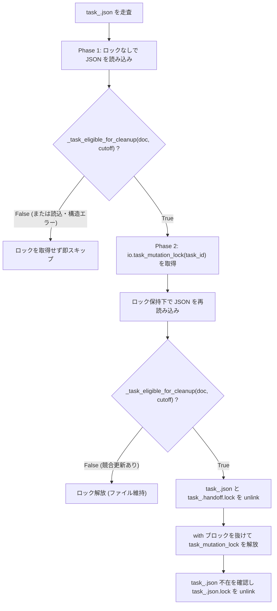

# Herdr Orchestrator Task Registry クリーンアップ機構 設計書

- **対象 Issue**: [Issue #157](https://github.com/okinawa-systembit/herdr-orchestration/issues/157)
- **親 Issue**: [Issue #112](https://github.com/okinawa-systembit/herdr-orchestration/issues/112)（将来仕様（update コマンド等）およびロードマップ §23 検証項目のバックログ追跡）
- **ステータス**: 実装中
- **関連文書**:
  - [01-foundation.md](herdr-orchestrator/01-foundation.md#sec-2-4): 設計原則の Orchestrator 適用（§2.4〜§2.10）
  - [03-task-registry.md](herdr-orchestrator/03-task-registry.md#sec-6-8): Task Registry Retention / Cleanup（§6.8）および Locking（§6.5）
  - [06-results-and-workflows.md](herdr-orchestrator/06-results-and-workflows.md#sec-10): Result Contract・`result-submit`（§10）
  - [07-skill-and-implementation.md](herdr-orchestrator/07-skill-and-implementation.md#sec-14-2): 公開 CLI 境界（§14.2）およびエージェントのコマンド自動実行境界（§15.3）
  - [herdr-orchestrator-task-list.md](herdr-orchestrator-task-list.md#21-厳密な読み取り専用): `task-list` 読み取り専用契約（§2.1）
  - [Phase 2 設計書](reviews/REVIEW_SKILL_PHASE2_DESIGN.md#sec-6): リポジトリ内成果物（A 領域）の 30 日保護および削除ガードレール（Issue #97）

---

<a id="sec-1"></a>

## 1. 背景と目的

<a id="sec-1-1"></a>

### 1.1 背景と現状の課題

[03-task-registry.md §6.8 Retention / Cleanup](herdr-orchestrator/03-task-registry.md#sec-6-8) では、cron や systemd timer を要求せず lazy cleanup によって完了後 30 日以上経過した task を最大 1 日 1 回自動削除する仕様が定義されている。また、内部実装として `skills/herdr-orchestrator/scripts/orchestrator/registry/operations.py` に `cleanup_tasks()` および `_try_delete_task_if_eligible()` が実装され、低レベル内部 CLI（`task-registry.py cleanup`）および単体テスト（`tests/test_orchestrator_phase2_registry.py`）が存在する。

しかし、現行実装には以下の 4 つの課題が存在する。

1. **公開 CLI からの未接続（デッドコード化）**:
   公開 CLI（`herdr-orchestrator` の各サブコマンド）から `cleanup_tasks()` が一度も呼び出されておらず、通常のオーケストレーション運用では Task Registry（`${XDG_STATE_HOME:-~/.local/state}/herdr-orchestrator/tasks/`）内の古い task ファイルが自動削除されない。
2. **可観測性の欠如**:
   現在 Task Registry 内に何件の task が蓄積しており、そのうち何件が削除対象（30 日経過・terminal 状態）であるか、最終クリーンアップ実行時刻（`last_cleanup_at`）がいつであるかを人間やエージェントが診断する手段がない。
3. **手動管理インターフェースの不在**:
   公開 CLI `herdr-orchestrator` にクリーンアップを明示実行または事前確認（`--dry-run`）するサブコマンドが存在しない。
4. **ロック競合および `.json.lock` 残存の技術的課題**:
   現行の `_try_delete_task_if_eligible()` は、削除条件の判定前に全 `task_*.json` に対して排他ロック（`io.task_mutation_lock(task_id)`）をブロッキング取得するため、稼働中 task のミューテーションとロック競合を起こしうる。また、削除時に `<task_id>.json` と `<task_id>.handoff.lock` のみを unlink しており、`<task_id>.json.lock`（0 バイトのロックファイル）が永続的に残存する。

<a id="sec-1-2"></a>

### 1.2 目的

本設計書は、[基本方針正本](core-principles.md) の原則 1（KISS 原則）、原則 2（人間中心の可観測性）、原則 6（単一正本）、および指針 10（黙って失敗しない）に基づき、以下を達成することを目的とする。

1. `result-submit` 完了後の best-effort 処理として lazy cleanup を安全に接続し、日常運用における Task Registry の自動整理を有効化する。
2. `herdr-orchestrator doctor` に読み取り専用の `registry_cleanup` 診断情報を追加し、Task Registry の蓄積状況と最終掃除日時を可視化する。
3. 手動管理用の公開 CLI サブコマンド `herdr-orchestrator cleanup-registry [--dry-run] [--json]` を新設し、人間およびエージェントが安全に手動掃除・事前確認を行えるようにする。
4. ロックなし事前フィルタ（Phase 1）とロック取得後再検証（Phase 2）の **2 段階判定**、および `<task_id>.json.lock` の確実な削除により、稼働中タスクとのロック競合とロックファイル残存を解消する。
5. 30 日保持期間（`_RETENTION_DAYS = 30`）の絶対保護と、エージェントによる直接ファイル削除（`rm` 等）を禁止するセーフティガードレールを確立する。

---

<a id="sec-2"></a>

## 2. 基本設計方針（ハイブリッド構成と責務境界）

<a id="sec-2-1"></a>

### 2.1 ハイブリッド構成（Lazy Cleanup + Doctor 可視化 + 手動 CLI）

Task Registry のクリーンアップは、単一の仕組みに頼るのではなく、以下の 3 要素を組み合わせたハイブリッド構成とする。

```mermaid
flowchart TD
  subgraph Auto["1. 自動掃除 (Lazy Cleanup)"]
    RS["herdr-orchestrator result-submit"] -->|"結果確定 + completion 通知後"| LC["cleanup_tasks(nonblocking=True, ignore_rate_limit=False)"]
    LC -->|"1日1回レート制限 / 非ブロッキング"| DEL["30日経過 terminal task + lock 削除"]
  end

  subgraph Obs["2. 可観測性 (Doctor 可視化)"]
    DOC["herdr-orchestrator doctor"] -->|"完全 Read-Only 集計"| STAT["registry_cleanup 診断フィールド出力"]
  end

  subgraph Manual["3. 手動管理 CLI"]
    CLI["herdr-orchestrator cleanup-registry [--dry-run] [--json]"] -->|"HERDR_ENV=1 免除 / レート制限無視"| MC["cleanup_tasks(nonblocking=False, ignore_rate_limit=True, dry_run=...)"]
  end
```



| 構成要素          | トリガー / コマンド                                        | 主な役割と特徴                                                                                                                  |
| ----------------- | ---------------------------------------------------------- | ------------------------------------------------------------------------------------------------------------------------------- |
| **Lazy Cleanup**  | `herdr-orchestrator result-submit` 完了時                  | cron 不要の自動掃除。`last_cleanup_at` による最大 1 日 1 回のレート制限と非ブロッキングロックにより、通常処理の遅延・失敗を防ぐ |
| **Doctor 可視化** | `herdr-orchestrator doctor`                                | 完全読み取り専用で総タスク数、削除対象件数（リポジトリ別内訳含む）、孤立ロック数、`last_cleanup_at` を可視化する                |
| **手動管理 CLI**  | `herdr-orchestrator cleanup-registry [--dry-run] [--json]` | 人間またはエージェントによる明示実行・事前確認。`HERDR_ENV=1` 免除、1 日 1 回のレート制限をバイパスして即時実行する             |

<a id="sec-2-2"></a>

### 2.2 リポジトリ内成果物（A 領域）と中央 Task Registry（B 領域）の責務分離

本リポジトリおよびオーケストレーション基盤における保持期間管理は、対象領域に応じて明確に責務を分離する（原則 4・原則 6）。

| 区分       | 対象領域                                                                            | 管轄ツール / CLI                                             | スコープ                                 | 設計正本                                                                            |
| ---------- | ----------------------------------------------------------------------------------- | ------------------------------------------------------------ | ---------------------------------------- | ----------------------------------------------------------------------------------- |
| **A 領域** | リポジトリ内の作業ファイル・内部レビュー記録（`.input/`、`docs/reviews/internal/`） | `scripts/repo-review-helper cleanup-candidates`              | 当該 Git リポジトリ（worktree）ローカル  | [Phase 2 設計書](reviews/REVIEW_SKILL_PHASE2_DESIGN.md#sec-6)                       |
| **B 領域** | 中央 Task Registry（`${XDG_STATE_HOME:-~/.local/state}/herdr-orchestrator/tasks/`） | `herdr-orchestrator`（`result-submit` / `cleanup-registry`） | ホスト上の全リポジトリ・全 worktree 共通 | 本設計書（Issue #157）および [§6.8](herdr-orchestrator/03-task-registry.md#sec-6-8) |

> [!IMPORTANT]
> 中央 Task Registry（B 領域）は `${XDG_STATE_HOME:-~/.local/state}/herdr-orchestrator/tasks/` に配置されており、**同一ユーザーの全リポジトリ・全 worktree で共有**される。そのため、あるリポジトリでの `result-submit` や `cleanup-registry` の実行は、他リポジトリに属する完了後 30 日超の task も含めて横断的にクリーンアップする。この全リポジトリ共通の性質は、`doctor` および `cleanup-registry` の出力フィールド（`shared_across_repositories: true` およびリポジトリ別内訳）で明示する。

---

<a id="sec-3"></a>

## 3. Lazy Cleanup（自動掃除）の接続設計

<a id="sec-3-1"></a>

### 3.1 トリガーポイントの選定理由（`result-submit` のみ）と自動許可（allow）方針との整合

[§6.8](herdr-orchestrator/03-task-registry.md#sec-6-8) の lazy cleanup を接続する公開 CLI コマンドは、**`herdr-orchestrator result-submit` の 1 か所のみ**とする。選定理由、および配布テンプレートにおける自動許可（`allow`）方針との整合は以下のとおりである。

1. **読み取り専用コマンド（`doctor` / `task-status` / `task-result` / `task-list`）の無副作用契約の維持**:
   これらは状態を変更しない読み取り専用コマンドであり、[herdr-orchestrator-task-list.md §2.1](herdr-orchestrator-task-list.md#21-厳密な読み取り専用) でも「`task-list` 実行時に [§6.8](herdr-orchestrator/03-task-registry.md#sec-6-8) の lazy cleanup は起動しない」と明記されている。状態確認や診断のたびに裏で Registry が変化する副作用を持たせないため、読み取り系コマンドには接続しない。
2. **Handoff 配送クリティカルパスの保護**:
   `handoff` は live agent 解決・`handoff.lock` 取得・Herdr `agent prompt` 実行というタイミング制約の厳しいクリティカルパスを持つため、ディレクトリ走査を伴うクリーンアップを挟まない。
3. **タスクライフサイクル終端との一致**:
   `result-submit` はタスクが terminal 状態（`succeeded` / `failed`）へ遷移し、completion 通知まで完了した直後のライフサイクル終端であり、そもそも Registry への書き込み権限を持つミューテーションコマンドである。ここで 1 日 1 回の lazy cleanup を起動するのが最も自然である。
4. **[§15.2](herdr-orchestrator/07-skill-and-implementation.md#sec-15-2)「destructive operation は自動許可対象へ含めない」および配布テンプレート（`allow`）との整合**:
   `result-submit` は Worker の自動完了報告に不可欠であるため、配布テンプレート（[install/README.md §2.1](../skills/herdr-orchestrator/install/README.md#21-コマンド分類と許可方針)、`codex-execpolicy-snippet.rules`、[public-cli.md §6.1](../skills/herdr-orchestrator/references/public-cli.md#61-実行承認設定-codex-execpolicy)）において自動許可（`allow`）に設定されている。
   ここで、[§6.8](herdr-orchestrator/03-task-registry.md#sec-6-8) の保持期間満了（作成から 30 日以上経過かつ `task.status` / `completion.status` がともに terminal）に基づく自動削除および孤立ロックの回収は、**Orchestrator が自己管理する内部メタデータの規定されたライフサイクル管理（ガベージコレクション）であり、[§15.2](herdr-orchestrator/07-skill-and-implementation.md#sec-15-2) および [§15.4](herdr-orchestrator/07-skill-and-implementation.md#sec-15-4) が禁じる destructive operation（利用者データ・リポジトリ内成果物・稼働中状態の破壊や任意パス削除）には該当しない**と定義する。したがって、`result-submit` に lazy cleanup を接続しても `result-submit` を `allow` とする安全性根拠は維持される（実装 PR では [install/README.md §2.1](../skills/herdr-orchestrator/install/README.md#21-コマンド分類と許可方針) の `result-submit` 備考欄にも「完了後に 1 日 1 回の lazy cleanup（§6.8）を実行する」旨を明記する）。

<a id="sec-3-2"></a>

### 3.2 `result-submit` における実行フローとエラー隔離（指針 10）

`skills/herdr-orchestrator/scripts/orchestrator/result_commands.py` の `result_submit()` において、以下の順序と条件で `cleanup_tasks()` を呼び出す。

1. **実行タイミング**:
   - `registry.update_result(...)` が成功し、かつ `not replay` の場合に `best_effort_completion_after_result(task_id)` を実行した**後**、戻り値を返却する直前に実行する。
   - `replay == True`（同一内容の冪等再送）の場合は、副作用を最小化するため lazy cleanup を起動しない。
2. **非ブロッキング実行とレート制限**:
   - `registry.cleanup_tasks(nonblocking=True, ignore_rate_limit=False)` として呼び出す。
   - 他のプロセスがすでに `cleanup.run.lock` を保持している場合は、待機せず即座にスキップする（`skipped_lock: True`）。
   - `last_cleanup_at` スタンプから 24 時間（`timedelta(days=1)`）未満の場合は、ディレクトリ走査を行わず即座にスキップする（`skipped_rate_limit: True`）。
3. **エラー隔離と警告出力（指針 10「黙って失敗しない」）**:
   - Lazy cleanup 呼び出し全体を `try ... except Exception as exc:` で囲む。
   - 万が一クリーンアップ中に予期しない例外が発生した場合でも、**`result-submit` 自体の成功ステータス・終了コード（`0`）・標準出力の JSON ペイロードは一切変更しない**（主処理の保護）。
   - ただし、例外を無言で握り潰すことは禁止し、標準エラー（`sys.stderr`）に `[herdr-orchestrator] warning: lazy registry cleanup failed: <詳細>` を出力する（指針 10）。

```python
# result_commands.py における接続イメージ
if not replay:
    best_effort_completion_after_result(task_id)
    try:
        registry.cleanup_tasks(nonblocking=True, ignore_rate_limit=False)
    except Exception as exc:
        print(
            f"[herdr-orchestrator] warning: lazy registry cleanup failed: {exc}",
            file=sys.stderr,
        )
```

---

<a id="sec-4"></a>

## 4. 可観測性（`doctor` 可視化）の設計

<a id="sec-4-1"></a>

### 4.1 設計要件（完全 Read-Only・終了コード非影響）

`herdr-orchestrator doctor`（`skills/herdr-orchestrator/scripts/orchestrator/dispatch_commands.py` の `run_doctor()`）の返却 JSON ペイロードに、Task Registry の蓄積・クリーンアップ状況を示すトップレベルキー `"registry_cleanup"` を追加する。

- **完全 Read-Only**:
  `doctor` 実行時は、`tasks/` ディレクトリの作成、ロックファイルの作成・取得（`flock`）、スタンプファイルの更新、task ファイルの削除を**一切行わない**。
- **ディレクトリ未作成時の安全なフォールバック**:
  `${XDG_STATE_HOME:-~/.local/state}/herdr-orchestrator/tasks` が存在しない場合もディレクトリを作成せず、`total_tasks: 0`、`eligible_count: 0`、`eligible_by_repository: {}`、`orphan_lock_files_count: 0`、`last_cleanup_at: None` を返す。
- **終了コードへの非影響**:
  `doctor` の終了コード（`HERDR_ENV=1` かつ live list 成功時は `0`、それ以外は `1`）は従来どおりとし、削除対象タスクの有無や件数によって終了コードを変化させない。

<a id="sec-4-2"></a>

### 4.2 `registry_cleanup` 出力スキーマ

`herdr-orchestrator doctor` の出力 JSON に含める `"registry_cleanup"` オブジェクトのスキーマを以下に示す。

```json
{
  "herdr_env": true,
  "ok": true,
  "registry_cleanup": {
    "registry_path": "/home/user/.local/state/herdr-orchestrator/tasks",
    "shared_across_repositories": true,
    "retention_days": 30,
    "total_tasks": 42,
    "eligible_count": 5,
    "eligible_by_repository": {
      "a1b2c3d4-e5f6-4a7b-8c9d-0e1f2a3b4c5d": 3,
      "f0e1d2c3-b4a5-4987-8654-3210fedcba98": 2
    },
    "orphan_lock_files_count": 1,
    "last_cleanup_at": "2026-11-10T08:30:00Z"
  }
}
```

| フィールド名                 | 型                     | 説明                                                                                                                                          |
| ---------------------------- | ---------------------- | --------------------------------------------------------------------------------------------------------------------------------------------- |
| `registry_path`              | `string`               | Task Registry ディレクトリの絶対パス（`str(tasks_dir())`）                                                                                    |
| `shared_across_repositories` | `boolean`              | 常に `true`。当該 Registry がホスト上の全リポジトリ・全 worktree で共有されていることを明示する                                               |
| `retention_days`             | `integer`              | 保持期間の日数（常に `30`）                                                                                                                   |
| `total_tasks`                | `integer`              | `tasks/` 配下に存在する `task_*.json` ファイルの総数                                                                                          |
| `eligible_count`             | `integer`              | 現在時刻基準で [§6.8](herdr-orchestrator/03-task-registry.md#sec-6-8) の削除条件を満たす `task_*.json` の件数                                 |
| `eligible_by_repository`     | `object`               | 削除対象 task の `context.repository.identity` ごとの件数マップ（`dict[str, int]`）。`identity` が取得不能な場合は `"unknown"` キーに集計する |
| `orphan_lock_files_count`    | `integer`              | 対応する `task_<id>.json` が存在しない孤立ロックファイル（`task_*.json.lock` および `task_*.handoff.lock`）の総数                             |
| `last_cleanup_at`            | `string` または `null` | `last_cleanup_at` スタンプファイルの文字列値（未実行またはファイル不在時は `null`）                                                           |

---

<a id="sec-5"></a>

## 5. 手動管理インターフェース（`cleanup-registry` CLI）の設計

<a id="sec-5-1"></a>

### 5.1 コマンド構文とオプション

公開 CLI `herdr-orchestrator` にサブコマンド `cleanup-registry` を追加する。

```text
herdr-orchestrator cleanup-registry [--dry-run] [--json]
```

| オプション  | 必須 | デフォルト                    | 説明                                                                                                                                 |
| ----------- | ---- | ----------------------------- | ------------------------------------------------------------------------------------------------------------------------------------ |
| `--dry-run` | 任意 | `False`                       | ファイルの削除および `last_cleanup_at` の更新を行わず、削除対象となる task ID 一覧・件数・孤立ロック数を集計して返却する             |
| `--json`    | 任意 | `True`（標準出力は常に JSON） | 他の `herdr-orchestrator` サブコマンドとの一貫性および Issue #157 要件（`--dry-run` / `--json`）を満たすため明示フラグとして受理する |

> [!NOTE]
> `herdr-orchestrator` の全公開サブコマンドは標準出力に JSON を出力する設計（`emit_json`）であるため、`--json` 指定の有無にかかわらず標準出力は同一の JSON 形式とする（`--json` フラグを指定してもエラーにならず正常受理される）。

<a id="sec-5-2"></a>

### 5.2 実行環境要件（`HERDR_ENV=1` 免除とレート制限バイパス）

1. **`HERDR_ENV=1` 免除**:
   `cleanup-registry` は Herdr の live pane やエージェント通信（`herdr` CLI）を一切使用せず、ローカルファイルシステム上の Task Registry のみを操作する。したがって `identity` / `role` / `project` サブコマンドと同様に **`require_herdr_env()` を呼び出さず、`HERDR_ENV=1` がない通常の人間用ターミナルからも直接実行可能**とする。
2. **1 日 1 回レート制限のバイパス**:
   手動で `cleanup-registry` を実行した場合は、ユーザーが明示的に即時クリーンアップを要求しているため、`last_cleanup_at` による 1 日 1 回のレート制限をバイパスする（`ignore_rate_limit=True`）。
3. **排他制御と `last_cleanup_at` 更新**:
   - `--dry-run` が `False`（実削除モード）の場合は、`cleanup_run_lock(nonblocking=False)`（ロックファイル `cleanup.run.lock`）を取得して他のクリーンアップと直列化し、削除完了後に `last_cleanup_at` を現在時刻（UTC ISO 8601）で更新する。
   - `--dry-run` が `True` の場合は、完全読み取り専用で動作し、`cleanup.run.lock` の取得や `last_cleanup_at` の更新は行わない。

<a id="sec-5-3"></a>

### 5.3 出力 JSON スキーマと全リポジトリ共通スコープの明示

`herdr-orchestrator cleanup-registry` の出力 JSON スキーマを以下に示す。どのディレクトリから実行しても全リポジトリ共通の Task Registry が対象となることを、出力 JSON の `scope: "global"`、`shared_across_repositories: true`、および `deleted_by_repository` で明示する。

```json
{
  "command": "cleanup-registry",
  "scope": "global",
  "shared_across_repositories": true,
  "registry_path": "/home/user/.local/state/herdr-orchestrator/tasks",
  "retention_days": 30,
  "dry_run": false,
  "deleted": [
    "task_11111111-2222-4333-8444-555555555555",
    "task_66666666-7777-4888-9999-000000000000"
  ],
  "deleted_count": 2,
  "deleted_by_repository": {
    "a1b2c3d4-e5f6-4a7b-8c9d-0e1f2a3b4c5d": 2
  },
  "orphan_locks_deleted": 1,
  "last_cleanup_at": "2026-11-10T16:45:00Z"
}
```

| フィールド名                 | 型                     | 説明                                                                                                                                              |
| ---------------------------- | ---------------------- | ------------------------------------------------------------------------------------------------------------------------------------------------- |
| `command`                    | `string`               | 常に `"cleanup-registry"`                                                                                                                         |
| `scope`                      | `string`               | 常に `"global"`（カレントディレクトリに依存せず全リポジトリ共通の Registry を対象とすることを示す）                                               |
| `shared_across_repositories` | `boolean`              | 常に `true`                                                                                                                                       |
| `registry_path`              | `string`               | Task Registry ディレクトリの絶対パス                                                                                                              |
| `retention_days`             | `integer`              | 保持期間の日数（常に `30`）                                                                                                                       |
| `dry_run`                    | `boolean`              | `--dry-run` 指定時は `true`、実削除時は `false`                                                                                                   |
| `deleted`                    | `array of string`      | 削除された（`dry_run: true` の場合は削除対象と判定された）`task.id` の昇順リスト                                                                  |
| `deleted_count`              | `integer`              | `deleted` の要素数                                                                                                                                |
| `deleted_by_repository`      | `object`               | 削除（または削除対象）task の `context.repository.identity` ごとの件数マップ（`dict[str, int]`）                                                  |
| `orphan_locks_deleted`       | `integer`              | 削除された（`dry_run: true` の場合は検出された）孤立ロックファイル（対応する `task_<id>.json` が存在しない `.json.lock` / `.handoff.lock`）の件数 |
| `last_cleanup_at`            | `string` または `null` | 実削除後は更新後の UTC タイムスタンプ、`dry_run: true` 時は既存の `last_cleanup_at` 値（未実行なら `null`）                                       |

---

<a id="sec-6"></a>

## 6. 技術的課題の対処設計（2段階判定とロックファイル残存解消）

<a id="sec-6-1"></a>

### 6.1 2段階判定（Phase 1: ロックなし事前フィルタ → Phase 2: ロック取得後再検証・削除）

現行の `_try_delete_task_if_eligible(task_id, cutoff)` は、対象が作成直後の稼働中 task であっても無条件に `with io.task_mutation_lock(task_id):` をブロッキング取得してから JSON を読み込むため、稼働中 task の状態更新（`mutate_task`）とロック競合・待ち合わせを起こす（また、`create` 直後で一度も `mutate_task` されていない task に対しても不要な `.json.lock` を新規作成してしまう）。

これを解消するため、`_try_delete_task_if_eligible()` を以下の **2 段階判定**に改修する。



1. **Phase 1（ロックなし事前フィルタ）**:
   - `io.task_mutation_lock(task_id)` を**取得せずに** `task_<id>.json` を読み込み、`_task_eligible_for_cleanup(doc, cutoff)` を評価する。ファイル読み込みや JSON パースの失敗（`OSError` / `JSONDecodeError`）だけでなく、必須キー欠落や型不正等の構造破損（`KeyError` / `TypeError` / `ValueError`、またはトップレベルが `dict` でない場合）が発生した場合も、削除対象外（`False`）としてロックファイルに一切触れずに即スキップする。
   - これにより、稼働中 task や 30 日未満の task、および破損 JSON に対してロック競合や不要なロック取得が一切発生しなくなる。
2. **Phase 2（ロック取得後の再検証と削除）**:
   - Phase 1 を通過した task（30 日以上経過かつ terminal 状態）に対してのみ、`with io.task_mutation_lock(task_id):` で排他ロックを取得する。
   - ロック保持下で再度 `task_<id>.json` を読み込み、`_task_eligible_for_cleanup(doc, cutoff)` を再検証する（Phase 1 と Phase 2 の間に `reset-completion` 等で状態が変化していた場合は削除を中止する）。
   - 再検証でも eligible であれば、`<task_id>.json` および `<task_id>.handoff.lock` を `unlink(missing_ok=True)` で削除する。

<a id="sec-6-2"></a>

### 6.2 `<task_id>.json.lock` 残存問題の解消と孤立ロックスイープ

現行実装で `<task_id>.json.lock` が削除されていなかった問題に対し、以下の 2 段構えで完全解消する。

1. **タスク削除直後の `<task_id>.json.lock` 削除**:
   - Phase 2 で `<task_id>.json` と `<task_id>.handoff.lock` を削除し、`with io.task_mutation_lock(task_id):` ブロックを抜けて `flock(LOCK_UN)` およびファイルディスクリプタ `close()` が完了した**直後**に、`not path.exists()`（`<task_id>.json` が存在しないこと）を確認した上で `io.registry_lock_path(task_id).unlink(missing_ok=True)` を実行する。
   - `task_id` は UUIDv4 であり、一度削除された `task_id` が新規タスクで再利用されることはない。また、万が一別プロセスが同時にその `task_id` を参照しようとしても `<task_id>.json` がすでに存在しないため `task_not_found` となるだけであり、ロック解放直後の `.json.lock` unlink は競合安全である。
2. **既存の孤立ロックファイル（Orphan Lock Files）のスイープと安全性不変条件**:
   - 過去のバージョンで削除された task の残骸や、異常終了等で残った `task_<id>.json.lock` / `task_<id>.handoff.lock`（対応する `task_<id>.json` が存在しないもの）を回収するため、`cleanup_tasks()` 実行時に `tasks/` ディレクトリ内の `task_*.json.lock` および `task_*.handoff.lock` を走査する。
   - 対応する `task_<id>.json` が存在しないロックファイルについて、非ブロッキング `flock(LOCK_EX | LOCK_NB)` が取得できること（どのプロセスも保持していないこと）を確認した上で `unlink(missing_ok=True)` する。
   - **競合安全性の根拠（Registry 操作の不変条件）**:
     一般に `flock(LOCK_NB)` 後の `unlink` 単体では「別プロセスが open 済みの古い inode を後から lock する」競合を防げないが、Task Registry には以下の**不変条件**が存在するため安全である：
     1. `create_task_document`（`io.py`）はロックを取得せずに `task_<id>.json` を先に原子的に作成する。
     2. `mutate_task`（`io.py`）は `task_<id>.json` の存在（`path.exists()`）を確認してから `task_mutation_lock`（`<task_id>.json.lock`）を open / lock する。
     3. `handoff` の `<task_id>.handoff.lock` は `create` 完了後にのみ取得される。
     4. `task_id`（UUIDv4）は再利用されない。
        したがって、`task_<id>.json` が存在しないロックファイルは「これから新規作成される task」のものではあり得ず、仮に別プロセスが同時にそのロックを開こうとしても対象 task はすでに削除済み（`task_not_found`）であるため、アクティブな task のロック実体が失われることはない（※ 将来にわたり「JSON 作成が先、ロック取得が後」の順序不変条件を維持すること）。

<a id="sec-6-3"></a>

### 6.3 `io.cleanup_run_lock` と `operations.cleanup_tasks` のインターフェース拡張

1. **`io.cleanup_run_lock(*, nonblocking: bool = False)`**:
   既存の `skills/herdr-orchestrator/scripts/orchestrator/registry/io.py` の `cleanup_run_lock` はすでに `nonblocking: bool = False` 引数をサポートしている。`result-submit` からの lazy cleanup では `nonblocking=True`、手動 `cleanup-registry` では `nonblocking=False` を渡す。
2. **`operations.cleanup_tasks(*, now: datetime | None = None, nonblocking: bool = False, ignore_rate_limit: bool = False, dry_run: bool = False) -> dict[str, Any]`**:
   - `dry_run=True` の場合（または新しい読み取り専用集計関数 `inspect_cleanup_status(*, now: datetime | None = None)`）は、ロック取得・ファイル削除・スタンプ更新を一切行わず、Phase 1 相当の読み取りのみで集計結果を返す。
   - 返却辞書には、従来の互換キー（`"deleted": list[str]`、`"skipped_lock"` / `"skipped_rate_limit"`）に加え、`"deleted_count"`、`"deleted_by_repository"`、`"orphan_locks_deleted"`、`"last_cleanup_at"` を含める。

---

<a id="sec-7"></a>

## 7. セーフティガードレール（30日保護とエージェント行動規範）

<a id="sec-7-1"></a>

### 7.1 30 日保持期間（`_RETENTION_DAYS = 30`）の絶対保護

[§6.8](herdr-orchestrator/03-task-registry.md#sec-6-8) で定められた「作成（`timestamps.created_at`）から 30 日以上経過」かつ「`task.status` および `completion.status` が terminal」という削除条件は、監査証跡・トラブルシューティング・結果参照（`task-result` / `task-status`）の安全性を担保する不変の契約である。

- **保持期間短縮オプションの禁止**:
  `herdr-orchestrator cleanup-registry`（および内部 `task-registry.py cleanup`）には、保持期間を 30 日未満に短縮する `--days` オプションや、30 日未満・非 terminal の task を強制削除する `--force` / `--all` オプションを**設けない**（原則 1・指針 8）。
- **`timestamps.created_at` パース失敗時の安全側倒し**:
  `timestamps.created_at` が欠落または不正なフォーマットである場合、`_task_eligible_for_cleanup()` は常に `False` を返し、自動削除しない（破損レコードの勝手な消去を防ぐ）。

<a id="sec-7-2"></a>

### 7.2 エージェント行動規範（直接 `rm` 禁止・人間への委任・秘密情報例外）

リポジトリ内の作業領域（A 領域: [Phase 2 設計書 §6](reviews/REVIEW_SKILL_PHASE2_DESIGN.md#sec-6)）と中央 Task Registry（B 領域: 本設計書）の双方において、エージェントは以下の行動規範を厳守する。

1. **直接のファイル削除コマンド（`rm` 等）による Registry 操作の完全禁止**:
   エージェントは `${XDG_STATE_HOME:-~/.local/state}/herdr-orchestrator/` 配下の JSON ファイル・ロックファイル・スタンプファイルに対して、`rm`、`unlink`、Python スクリプト等による直接削除や直接書き換えを行ってはならない。Task Registry の整理は必ず `herdr-orchestrator cleanup-registry` を通じて行う。
2. **30 日以内のデータ削除要求に対する人間への委任**:
   万が一、ユーザー（人間）から「直近のタスク履歴を消したい」「30 日以内の Registry ファイルを削除してほしい」と指示された場合でも、エージェントは自ら削除コマンドを実行してはならない。エージェントは以下の影響を説明し、**人間自身のターミナル操作に委ねる**：
   - 稼働中（`created` / `in_progress` / `unknown`）または completion 未完了（`pending` / `processing`）の task を削除すると、Worker からの `result-submit` や Requester への通知が `task_not_found` で破綻すること。
   - 30 日以内の履歴を削除すると、直近のタスク結果参照（`task-result`）や監査証跡が失われること。
3. **秘密情報（トークン・鍵等）混入時の即時削除例外（原則 5）**:
   唯一の例外として、`instruction` や `result.summary` 等を通じて Task Registry ファイル内に認証トークン・秘密鍵・クレデンシャル等の秘密情報が誤って記録されたことが判明した場合は、[基本方針正本 原則 5](core-principles.md)（秘密の保護）を最優先し、30 日経過を待たずに該当ファイルの即時個別削除を許可する（ワイルドカード削除は禁止）。

---

<a id="sec-8"></a>

## 8. 実装・検証計画（テスト計画 RC-01〜）

<a id="sec-8-1"></a>

### 8.1 変更対象ファイル一覧

実装フェーズ（Issue #157 実装 PR）で変更対象となるファイルは以下のとおりである。

| 対象ファイル                                                             | 変更内容                                                                                                                                                                                          |
| ------------------------------------------------------------------------ | ------------------------------------------------------------------------------------------------------------------------------------------------------------------------------------------------- |
| `skills/herdr-orchestrator/scripts/orchestrator/registry/operations.py`  | `_try_delete_task_if_eligible` の 2 段階判定化・`.json.lock` 削除、孤立ロックスイープ、`cleanup_tasks` の引数拡張（`nonblocking`, `ignore_rate_limit`, `dry_run`）、`inspect_cleanup_status` 追加 |
| `skills/herdr-orchestrator/scripts/orchestrator/result_commands.py`      | `result_submit` における `not replay` 時の best-effort `cleanup_tasks(nonblocking=True, ignore_rate_limit=False)` 呼び出しと `stderr` 警告出力                                                    |
| `skills/herdr-orchestrator/scripts/orchestrator/dispatch_commands.py`    | `run_doctor` の返却辞書への `"registry_cleanup"`（Read-Only 診断情報）追加                                                                                                                        |
| `skills/herdr-orchestrator/scripts/orchestrator/public_cli.py`           | `PUBLIC_COMMANDS` / `_COMMAND_HELP` / `argparse` への `cleanup-registry [--dry-run] [--json]` 追加と `_cmd_cleanup_registry` 実装                                                                 |
| `skills/herdr-orchestrator/scripts/task-registry.py`                     | 内部 CLI `cleanup` サブコマンドの出力互換維持と拡張フィールド対応                                                                                                                                 |
| `skills/herdr-orchestrator/SKILL.md`                                     | 公開 CLI 一覧への `cleanup-registry` 追記および `doctor` 診断項目の説明更新                                                                                                                       |
| `skills/herdr-orchestrator/references/public-cli.md`                     | コマンド一覧および `cleanup-registry` / `doctor` / `result-submit`（§6.1 含む）の説明更新（D-2 波及対応）                                                                                         |
| `skills/herdr-orchestrator/install/README.md`                            | §2.1 コマンド分類表の `result-submit` 備考欄への「完了後に 1 日 1 回の lazy cleanup（§6.8）を実行する」旨の追記および `cleanup-registry` の追加（D-2 波及対応）                                   |
| `docs/herdr-orchestrator/07-skill-and-implementation.md`                 | §15.2 の「destructive operation は自動許可対象へ含めない」に、§6.8 の保持期間による自動整理は除く旨と本設計書 §3.1 への参照リンクを追記                                                           |
| `tests/test_orchestrator_phase2_registry.py`（または専用テストファイル） | 下記 §8.2 のテストケース（RC-01〜RC-10）の追加                                                                                                                                                    |

<a id="sec-8-2"></a>

### 8.2 テスト計画（RC-01〜RC-10）

指針 10（「テストは引数変換だけでなく実際の結果を検証する」）に基づき、実装時に以下の自動テストを追加・検証する。

| テスト ID | 検証カテゴリ                 | テスト内容と期待される結果                                                                                                                                                                                                                                                                                     |
| --------- | ---------------------------- | -------------------------------------------------------------------------------------------------------------------------------------------------------------------------------------------------------------------------------------------------------------------------------------------------------------- |
| **RC-01** | 2 段階判定・非対象・破損保護 | 30 日未満の task、30 日経過していても `task.status` が非 terminal（`created`, `in_progress`, `unknown`）や `completion.status` が `pending` / `processing` の task、および構文破損・必須キー欠落（`KeyError` / `TypeError` 等）の破損 JSON が Phase 1 で例外なくスキップされ、ロック取得や削除が行われないこと |
| **RC-02** | `.json.lock` 残存解消        | 30 日超かつ terminal の削除対象 task が削除された際、`<task_id>.json`、`<task_id>.handoff.lock` に加えて `<task_id>.json.lock` も完全に unlink され残存しないこと                                                                                                                                              |
| **RC-03** | 孤立ロックファイル回収       | 対応する `task_<id>.json` が存在しない孤立した `task_<id>.json.lock` / `task_<id>.handoff.lock` が存在する場合、`cleanup_tasks` 実行時に安全に削除され `orphan_locks_deleted` に計上されること（ただし他プロセスが flock 保持中のロックは削除しないこと）                                                      |
| **RC-04** | `result-submit` Lazy Cleanup | `result-submit`（初回確定、`not replay`）実行時に `cleanup_tasks` が自動実行され、30 日超の古い terminal task が削除されて `last_cleanup_at` が更新されること                                                                                                                                                  |
| **RC-05** | レート制限と Replay スキップ | `last_cleanup_at` が 24 時間以内の場合、および `result-submit` が `replay: true` の場合は、古い task が存在しても lazy cleanup がスキップされること                                                                                                                                                            |
| **RC-06** | `result-submit` エラー隔離   | `cleanup_tasks` が例外を送出するようモンキーパッチした状態で `result-submit` を実行しても、`result-submit` は終了コード `0` で正常完了し、`sys.stderr` に `warning: lazy registry cleanup failed:` が出力されること（指針 10）                                                                                 |
| **RC-07** | `doctor` Read-Only 可視化    | `herdr-orchestrator doctor` の JSON 出力に `registry_cleanup`（`total_tasks`, `eligible_count`, `eligible_by_repository`, `orphan_lock_files_count`, `last_cleanup_at` 等）が含まれ、実行前後でファイル・ロック・スタンプが一切変化しないこと（`tasks/` 未作成時もディレクトリを作らないこと）                 |
| **RC-08** | `cleanup-registry --dry-run` | `herdr-orchestrator cleanup-registry --dry-run`（`HERDR_ENV` 未設定環境を含む）が削除対象リストと件数を JSON で返し、実ファイルおよび `last_cleanup_at` を変更しないこと                                                                                                                                       |
| **RC-09** | `cleanup-registry` 実削除    | `herdr-orchestrator cleanup-registry` が `last_cleanup_at` の 24 時間レート制限を無視して即時実行され、対象 task とロックファイルを削除し、`last_cleanup_at` を更新すること                                                                                                                                    |
| **RC-10** | 非ブロッキング競合回避       | 別プロセスが `cleanup.run.lock` を保持中に `result-submit`（または `cleanup_tasks(nonblocking=True)`）が呼ばれた場合、ブロックせず即座に `skipped_lock: True` で返ること                                                                                                                                       |
