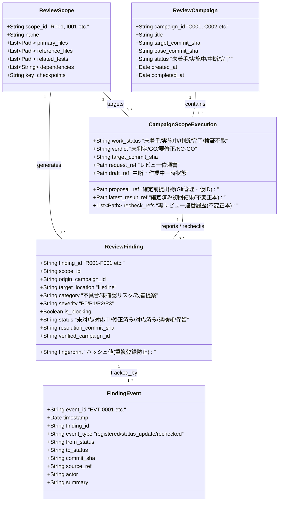
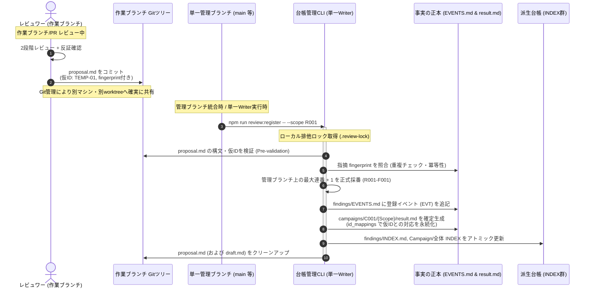
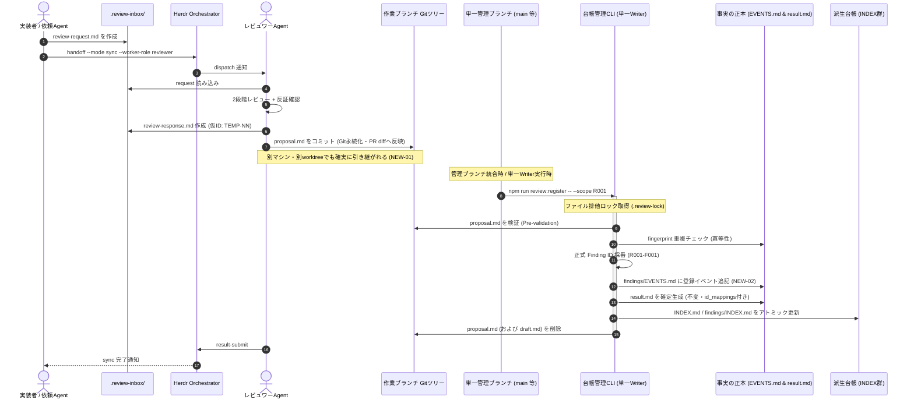
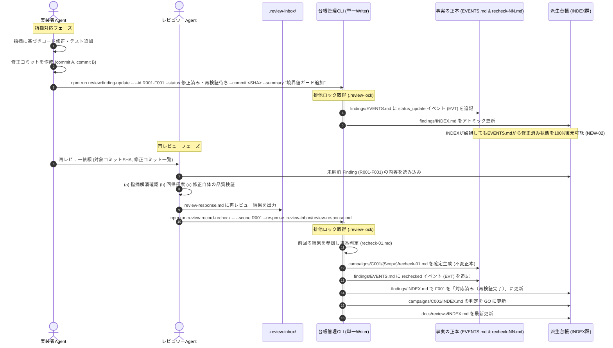
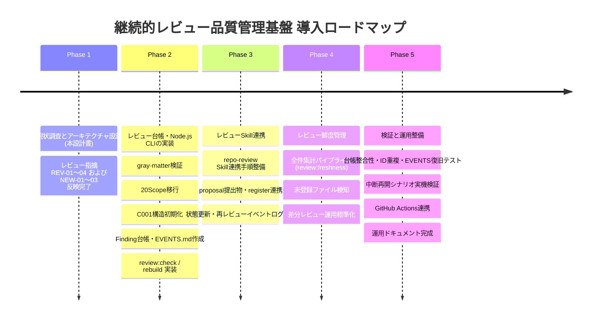

# herdr-orchestration 継続的レビュー品質管理基盤 設計書 (Continuous Review Design)

本書は、`herdr-orchestration` リポジトリにおける継続的なコードレビューと品質管理を実現するための基盤設計書である。
既存の分割レビュー計画（20タスク）、レビュー台帳、`repo-review` Skill を最大限に再利用し、単発の全体レビューにとどまらず、将来の変更・リリース・再レビューにおいても持続可能な品質管理アーキテクチャを定義する。

---

## 目次

1. [現状分析 (Current State Analysis)](#sec-1)
2. [既存資産の再利用方針と開発環境・技術選定 (Asset Reuse & Technology Strategy)](#sec-2)
3. [推奨アーキテクチャと責務境界 (Architecture & Responsibilities)](#sec-3)
4. [ディレクトリ構成 (Directory Structure)](#sec-4)
5. [データモデル仕様 (Data Models)](#sec-5)
6. [Finding ID 採番規則と確定前受け渡し（単一管理ブランチ・単一 Writer 方式）(Finding ID, Proposals & Collision Prevention)](#sec-6)
7. [レビュー状態管理と履歴の不変性 (State Lifecycle & Immutability)](#sec-7)
8. [レビュー実行・中断・再開フロー (Execution, Pause & Resume Flow)](#sec-8)
9. [再レビュー実行フローと複数ファイル更新の整合性・障害復旧 (Re-review Flow, Consistency & Recovery)](#sec-9)
10. [レビュー鮮度管理と変更影響判定パイプライン (Freshness & Impact Analysis Pipeline)](#sec-10)
11. [既存ブランチからの移行計画 (Migration Plan)](#sec-11)
12. [台帳管理 CLI 設計と Phase 2〜5 実装タスク (CLI Design & Roadmap)](#sec-12)
13. [リスク・未確定事項・トレードオフ (Risks & Trade-offs)](#sec-13)
14. [結論と次のステップ (Conclusion)](#sec-14)

---

<a id="sec-1"></a>

## 1. 現状分析 (Current State Analysis)

### 1.1 既存資産の現状 (`docs/split-code-review-plan`)

現在、`docs/split-code-review-plan` ブランチには以下のファイル群が整備されている。

1. **`docs/reviews/PLAN.md` (695行)**:
   - 個別レビュー（R001〜R014、R006A/Bを含む15タスク）および結合レビュー（I001〜I005、5タスク）の全20タスクが精緻に定義されている。
   - リポジトリ内の全実装コード（Python）、CLIスクリプト（Shell）、Skill定義（Markdown）、CI/CD（GitHub Actions）の完全カバレッジ対応表が存在する。
   - Claude 3.7 Sonnet 等の AI モデルにおける 5 時間枠・週間枠の消費特性（1セッションあたり主対象コード150〜350行）を踏まえた負荷制御設計がなされている。
2. **`docs/reviews/INDEX.md` (92行)**:
   - 全20タスクの進捗、判定、担当者、コミットSHAを一覧管理する台帳の初期案。
3. **`docs/reviews/{TaskID}/request.md` (全20ファイル)**:
   - 各タスクの主対象ファイル、参照ファイル、参照設計書、関連テスト、重点確認事項を定義したレビュー依頼書。
4. **`.agents/skills/repo-review/SKILL.md` および `references.md`**:
   - 2段階レビュー（第1段階: 仕様整合性、第2段階: 批判的不具合探索）、反証確認（8つの問い）、重大度（P0〜P3）とBlocking判定の分離管理、P1過大評価禁止ルール、P2例外的Blocking基準、既存保証の維持確認など、業界標準を大きく超える厳格なレビュー規律が定義されている。
5. **`.review-inbox/`**:
   - Orchestrator 経由のレビュー受け渡し用の一時バッファ（Git管理外）。

### 1.2 現行設計の課題と外部レビュー検出事項

Phase 1 設計書の外部レビュー（第2回および第3回）において、継続的品質管理基盤としての堅牢性を確保するために以下の課題が特定された。

| 課題領域                 | レビュー検出事項                                           |        重大度         | 継続運用におけるリスクと影響                                                                                                                     |
| :----------------------- | :--------------------------------------------------------- | :-------------------: | :----------------------------------------------------------------------------------------------------------------------------------------------- |
| **Finding ID 採番競合**  | REV-01：Gitブランチ間の衝突解決と履歴不変性の矛盾          |   **P1 / Blocking**   | ブランチ間衝突時に確定済み結果ファイルの参照を書き換える方式は不変性原則と矛盾する。ローカルファイルロックでは異なるブランチ間の競合を防げない。 |
| **単一Writerの形骸化**   | REV-02：再レビュー時に単一Writerを経由しない更新経路       |   **P2 / Blocking**   | 再レビュー時に Implementer が台帳を直接更新し、Reviewer が確定結果ファイルを直接作成する設計になっており、排他制御と整合しない。                 |
| **鮮度判定の見落とし**   | REV-03：未分類ファイル検出による既知Scope評価の中断        |   **P2 / Blocking**   | 未分類ファイル検出時に早期終了するフローチャートになっており、同一コミットに含まれる既知Scopeの変更評価（stale判定）が見落とされる。             |
| **依存導入の記述齟齬**   | REV-04：依存ライブラリ導入時期の記述不一致                 | **P2 / Non-blocking** | `@11ty/gray-matter` は Phase 1 で既に追加済み（package.json/lockfile更新済み）であるにもかかわらず、設計書内でPhase 2作業と記述されていた。      |
| **確定前結果の受け渡し** | NEW-01：確定前レビュー結果の永続化・受け渡し経路が不明確   |   **P2 / Blocking**   | Git管理外の `.review-inbox/` だけでは別作業ツリー・別マシン・別エージェントで管理ブランチ実行時に成果物が引き継がれず喪失・未登録となる。        |
| **状態変更履歴の復旧**   | NEW-02：INDEX再生成だけではFindingの状態変更履歴を復旧不能 |   **P2 / Blocking**   | 初回確定結果のみでは Implementer の修正完了等の動的状態変更が失われ、INDEX破損時に最新状態を 100% 決定論的に復元できない。                       |
| **複数ファイル更新**     | NEW-03：複数ファイルの原子的更新に関する説明が不正確       | **P2 / Non-blocking** | `fs.renameSync` はファイル単位の原子的操作であり複数ファイル間トランザクションではないため、クラッシュ時の部分不整合と復旧手順の明記が必要。     |

---

<a id="sec-2"></a>

## 2. 既存資産の再利用方針と開発環境・技術選定 (Asset Reuse & Technology Strategy)

### 2.1 継承・維持する要素（完全維持）

本基盤の導入にあたり、既存のレビュー設計・品質基準・タスク定義を原則として 100% 継承する。不要な再設計やレビュー基準の緩和は一切行わない。

1. **全20レビュータスクの論理定義**:
   - 個別レビュー（R001〜R014、計15タスク）および結合レビュー（I001〜I005、計5タスク）。
   - 各タスクの責務、主対象ファイル、参照ファイル、関連テスト、重点確認事項。
2. **`repo-review` Skill の品質基準・規律**:
   - 2段階レビュー（第1段階：設計整合性、第2段階：批判的不具合探索）。
   - 指摘の3分類（確認済み不具合、未確認リスク、改善提案）。
   - 重大度（P0〜P3）と Blocking 判定の厳格な分離。
   - P1 過大評価禁止ルール（4要素必須）および P2 例外的 Blocking 基準。
   - 指摘候補に対する反証確認（8つの反証問い）および既存保証の維持確認。
3. **判定基準**:
   - `GO`: 未解消の確認済み Blocking 指摘が 0 件、必須観点確認済み、未実施検証明示。
   - `要修正`: Blocking 指摘が 1 件以上存在、または重要な修正が必要。
   - `NO-GO`: 設計破綻、基盤機能の停止など致命的障害。

### 2.2 開発環境・技術選定の確定方針

既存の「Python標準ライブラリのみ使用」という制約は、Herdr Orchestrator本体および配布物（`skills/herdr-orchestrator/`, `install.sh`）に関する制約である。
**開発用ツールやリポジトリ内のレビュー品質管理ツールに対する制約ではない。**

本リポジトリの開発・CI環境との統一、および Markdown エコシステムとの親和性を考慮し、レビュー品質管理基盤には **Node.js** を採用する。

| 項目                   | 採用方針           | 技術・ツール                             | 選定理由・制約                                                                   |
| :--------------------- | :----------------- | :--------------------------------------- | :------------------------------------------------------------------------------- |
| **レビュー成果物**     | Markdown (`.md`)   | GitHub Flavored Markdown                 | 人間およびLLMが Git 上で直接差分を閲覧・PRレビュー可能。                         |
| **管理メタデータ**     | YAML Frontmatter   | Markdown 先頭ブロック                    | Markdown ファイル内部に不可分に保持し、成果物とメタデータの分離を防ぐ。          |
| **Frontmatter解析**    | Node.js ライブラリ | `@11ty/gray-matter`                      | 高速・軽量で広く使われており、安全に YAML をパース・シリアライズ可能。           |
| **台帳管理スクリプト** | Node.js CLI        | `node:fs`, `node:path`, `node:crypto` 等 | ID採番、重複検出、ファイル操作は Node.js 標準機能で実装。追加依存を排除。        |
| **Markdown整形・lint** | 既存環境を再利用   | `prettier`, `markdownlint-cli2`          | リポジトリ既存の `package.json` scripts を再利用し、重複実装を禁止。             |
| **履歴・差分管理**     | バージョン管理     | Git (HEAD, diff, commit SHA)             | コミットSHAをアンカーとして一意性と追跡性を保証。                                |
| **Orchestrator配布物** | 依存の完全分離     | Python 3 標準ライブラリのみ              | 本ツールの npm 依存（`@11ty/gray-matter`）は Orchestrator 配布物に一切含めない。 |

### 2.3 実装上の制約事項

1. **成果物形式**: レビュー成果物を独立した JSON や YAML ファイルに変更しない。Markdown 正本を維持する。
2. **依存管理（REV-04反映）**: 追加ライブラリは原則として `@11ty/gray-matter`（`devDependencies`）のみとする。本ライブラリは Phase 1 において既に `package.json` および `package-lock.json` へ追加・固定されており、Phase 2 ではこれを用いた動作検証および CLI 実装を行う。
3. **動的取得の禁止**: エージェント実行時に毎回 `npx` 等で動的ダウンロードを行う設計を禁止する。初期セットアップ時に `npm install` を完了させる。
4. **配布物混入の防止**: 台帳管理コードや npm 設定が、`install.sh` やリリース配布アーカイブ（`.tar.gz`）に混入しない構成を徹底する。

---

<a id="sec-3"></a>

## 3. 推奨アーキテクチャと責務境界 (Architecture & Responsibilities)

### 3.1 3層分離データモデルの全体像

継続的品質管理を実現するため、レビューの関心事を以下の 3 つの直交する層に分離する。さらに、NEW-01 および NEW-02 への対応として、確定前提出物（`proposal.md`）と永続的な状態変更イベントログ（`findings/EVENTS.md`）を明確に位置付ける。



- **Review Scope (論理責務・不変)**: モジュールの論理的な責務や境界を表す静的資産（`scopes/` 配下）。
- **Review Campaign (実施回・不変ログ)**: 特定のコミット群を対象としたレビュープロジェクト（`campaigns/` 配下）。確定結果は上書き不可。
- **Review Finding (指摘事項・動的ライフサイクル)**: 発見された課題のエンティティ。
  - **事実の正本 (Single Source of Truth)**: 確定レビュー結果（`result.md`, `recheck-NN.md`）および状態変更イベントログ（`findings/EVENTS.md`）。追記のみ可能で改変不可。
  - **派生台帳 (Derived Views / Cache)**: 全体 INDEX、Campaign INDEX、および `findings/INDEX.md`。正本からいつでも 100% 決定論的に再生成可能。

### 3.2 責務境界（Herdr Orchestrator との分離）

中央 Orchestrator の中核機能（配送・Registry）にリポジトリ固有のレビュー管理ロジックを一切混入させず、明確な境界を維持する。

| コンポーネント            | 実行環境 / 配置場所                                                    | 主な責務                                                                                             | 扱うデータ                                                 |
| :------------------------ | :--------------------------------------------------------------------- | :--------------------------------------------------------------------------------------------------- | :--------------------------------------------------------- |
| **Herdr Orchestrator**    | `skills/herdr-orchestrator/` / `~/.agents/skills/herdr-orchestration/` | Agent間配送、タスク状態遷移（`dispatch`, `result`, `completion`）、排他制御                          | Task Registry（`task.json`）                               |
| **repo-review Skill**     | `.agents/skills/repo-review/`                                          | レビュー作業の実行、批判的不具合探索、反証確認、重大度判定、仮指摘の起草、`proposal.md` の作成       | `.review-inbox/`（一時バッファ）、`proposal.md`（Git管理） |
| **Review Management CLI** | `scripts/reviews/` (Node.js)                                           | 正式 Finding ID 採番、EVENTS記録、台帳更新（単一Writer）、確定ファイル生成、鮮度判定、台帳整合性復旧 | `docs/reviews/` 配下の Markdown 群                         |
| **Git**                   | リポジトリルート                                                       | コミットSHAによるレビュー対象の同一性保証、作業ブランチ間のレビュー提出物の確実な受け渡し            | Git HEAD, Tree, Commit 履歴                                |
| **GitHub Actions**        | `.github/workflows/`                                                   | PR 時の台帳整合性自動チェック（ID重複・参照切れ・INDEX整合性の検証）                                 | CI 実行ログ・検証ステータス                                |

---

<a id="sec-4"></a>

## 4. ディレクトリ構成 (Directory Structure)

可読性、保守性、Git 管理の容易さを最優先し、以下のディレクトリ構成を採用する。確定結果、提出物、中断状態、およびイベントログを明確に分離する。

```text
docs/reviews/
├── README.md                           # 継続的レビュー品質管理基盤の運用ガイド
├── CONTINUOUS_REVIEW_DESIGN.md         # 本設計書（アーキテクチャ・データモデル・鮮度管理）
├── INDEX.md                            # リポジトリ全体の最新品質ダッシュボード（派生キャッシュ・再生成可能）
├── PLAN.md                             # 20タスクの全体分割計画・負荷制御方針（正本）
│
├── scopes/                             # 【Scope層】論理レビュー対象の静的定義（原則不変）
│   ├── R001-primitives.md
│   ├── R002-identity-cli.md
│   ├── ...
│   ├── R014-cicd.md
│   ├── I001-registry-handoff.md
│   └── ... (全20 Scope)
│
├── campaigns/                          # 【Campaign層】レビュー実施回の履歴ログ（不変保存）
│   ├── C001-initial-full-review/
│   │   ├── INDEX.md                    # C001 の全Scope進捗・判定一覧（派生キャッシュ・再生成可能）
│   │   ├── R001-primitives/
│   │   │   ├── request.md              # レビュー依頼書（不変）
│   │   │   ├── draft.md                # 【中断・作業中一時状態】（作業中のみ存在・完了時削除）
│   │   │   ├── proposal.md             # 【確定前レビュー提出物】（作業ブランチでGit管理・正式登録後削除）
│   │   │   ├── result.md               # 【確定済み初回レビュー結果】（事実の正本・原則不変・確定後編集禁止）
│   │   │   ├── recheck-01.md           # 【再レビュー結果 1回目】（事実の正本・連番追加）
│   │   │   └── recheck-02.md           # 【再レビュー結果 2回目】（事実の正本・連番追加）
│   │   └── ... (全20タスク)
│   │
│   └── C002-followup-review/           # 将来の差分レビュー実施回
│       ├── INDEX.md
│       └── ...
│
└── findings/                           # 【Finding層】指摘事項の永続ライフサイクル管理
    ├── EVENTS.md                       # 【状態変更イベントログ】（事実の正本・追記型永続履歴）
    └── INDEX.md                        # 全Findingの最新状態集約台帳（派生キャッシュ・再生成可能）
```

---

<a id="sec-5"></a>

## 5. データモデル仕様 (Data Models)

各ファイルは、GitHub Flavored Markdown の先頭に標準的な YAML Frontmatter を保持する。Frontmatter の解析・直列化には `@11ty/gray-matter` を使用する。

### 5.1 Review Scope モデル (`scopes/{ScopeID}.md`)

```markdown
---
scope_id: R001
name: primitives
title: "基盤・パス・環境・エラー・命名規則"
estimated_load: small
dependencies: []
primary_files:
  - skills/herdr-orchestrator/scripts/orchestrator/paths.py
  - skills/herdr-orchestrator/scripts/orchestrator/env.py
  - skills/herdr-orchestrator/scripts/orchestrator/errors.py
  - skills/herdr-orchestrator/scripts/orchestrator/worktree.py
  - skills/herdr-orchestrator/scripts/orchestrator/naming.py
reference_files: []
related_tests:
  - tests/test_orchestrator_phase0.py
  - tests/test_orchestrator_phase1_naming.py
  - tests/test_orchestrator_phase1_worktree.py
related_docs:
  - docs/herdr-orchestrator/01-foundation.md#sec-1
  - docs/herdr-orchestrator/02-roles-and-task-contract.md#sec-4
---

# Scope: R001 基盤・パス・環境・エラー・命名規則

...
```

### 5.2 中断・作業中一時状態モデル (`campaigns/{CID}/{ScopeID}/draft.md`)

```markdown
---
campaign_id: C001
scope_id: R001
target_commit: e527edc67866ffee5d7ec1527e1274b4ab395a9d
work_status: paused # in_progress | paused
verified_files:
  - skills/herdr-orchestrator/scripts/orchestrator/paths.py
  - skills/herdr-orchestrator/scripts/orchestrator/env.py
pending_files:
  - skills/herdr-orchestrator/scripts/orchestrator/errors.py
  - skills/herdr-orchestrator/scripts/orchestrator/worktree.py
  - skills/herdr-orchestrator/scripts/orchestrator/naming.py
paused_reason: "Claude 3.7 Sonnet 5時間利用枠上限到達のため退避"
updated_at: 2026-10-14T11:45:00+09:00
---

# 作業中ドラフト: C001 / R001

...
```

### 5.3 確定前レビュー提出物モデル (`campaigns/{CID}/{ScopeID}/proposal.md`)

指摘 NEW-01 への対応として、作業ブランチ上で作成され、Git 管理によって確実に管理ブランチへ引き継がれるレビュー提出物（Review Proposal）のスキーマを定義する。

```markdown
---
campaign_id: C001
scope_id: R001
review_type: proposal
target_commit: e527edc67866ffee5d7ec1527e1274b4ab395a9d
work_status: proposed
verdict: changes_requested # GO | changes_requested | NO-GO
blocking_findings_count: 1
non_blocking_findings_count: 1
provisional_findings:
  - temp_id: TEMP-01
    title: "ベースディレクトリ解決時の境界値ガード不足"
    target_location: "skills/herdr-orchestrator/scripts/orchestrator/paths.py:45-52"
    category: 不具合 # 不具合 | 未確認リスク | 改善提案
    severity: P1 # P0 | P1 | P2 | P3
    is_blocking: true
    fingerprint: 8f4e2a3c9b1d5e7f0a2c4e6a8b0d2f4e6a8b0d2f4e6a8b0d2f4e6a8b0d2f4e6a
  - temp_id: TEMP-02
    title: "エラー型名の命名規則の統一"
    target_location: "skills/herdr-orchestrator/scripts/orchestrator/errors.py:12-15"
    category: 改善提案
    severity: P3
    is_blocking: false
    fingerprint: 1a2b3c4d5e6f7a8b9c0d1e2f3a4b5c6d7e8f9a0b1c2d3e4f5a6b7c8d9e0f1a2b
reviewed_by: Claude 3.7 Sonnet
proposed_at: 2026-10-14T12:00:00+09:00
---

# レビュー提出物 (Proposal): C001 / R001

（作業ブランチで Git コミットされ、管理ブランチでの正式登録 CLI 実行時に `result.md` へ昇格し削除される）
...
```

### 5.4 確定済み初回レビュー結果モデル (`campaigns/{CID}/{ScopeID}/result.md`)

```markdown
---
campaign_id: C001
scope_id: R001
review_type: initial
target_commit: e527edc67866ffee5d7ec1527e1274b4ab395a9d
work_status: completed
verdict: changes_requested # GO | changes_requested | NO-GO
blocking_findings_count: 1
non_blocking_findings_count: 1
reported_findings:
  - finding_id: R001-F001
    severity: P1
    is_blocking: true
  - finding_id: R001-F002
    severity: P3
    is_blocking: false
id_mappings: # 仮IDと正式IDの追跡対応マップ (NEW-01対応)
  - temp_id: TEMP-01
    finding_id: R001-F001
    fingerprint: 8f4e2a3c9b1d5e7f0a2c4e6a8b0d2f4e6a8b0d2f4e6a8b0d2f4e6a8b0d2f4e6a
  - temp_id: TEMP-02
    finding_id: R001-F002
    fingerprint: 1a2b3c4d5e6f7a8b9c0d1e2f3a4b5c6d7e8f9a0b1c2d3e4f5a6b7c8d9e0f1a2b
reviewed_by: Claude 3.7 Sonnet
completed_at: 2026-10-14T12:30:00+09:00
---

# レビュー結果報告: C001 / R001: 基盤・パス・環境・エラー・命名規則

（確定後は原則不変。一切の上書き編集を禁止）
...
```

### 5.5 再レビュー結果モデル (`campaigns/{CID}/{ScopeID}/recheck-NN.md`)

```markdown
---
campaign_id: C001
scope_id: R001
review_type: re-review
recheck_round: 1
target_commit: a1b2c3d4e5f60718293a4b5c6d7e8f9012345678 # 修正後の検証対象コミット
base_commit: e527edc67866ffee5d7ec1527e1274b4ab395a9d # 前回のレビュー対象コミット
previous_result_ref: result.md # 前回結果への相対参照
resolution_commits: # 修正コミット群（複数存在する場合に対応）
  - commit: f1e2d3c4b5a6
    summary: "R001-F001 の境界値ガード追加"
  - commit: a1b2c3d4e5f6
    summary: "テストケース追加と型修正"
rechecked_findings:
  - finding_id: R001-F001
    previous_status: 未対応
    new_status: 対応済み（再検証完了）
    resolution_verdict: resolved # resolved | partially_resolved | unresolved
work_status: completed
verdict: GO # 全Blocking解消により GO
reviewed_by: Claude 3.7 Sonnet
completed_at: 2026-10-14T14:15:00+09:00
---

# 再レビュー結果報告 (Round 1): C001 / R001

...
```

### 5.6 Finding 状態変更イベントログモデル (`docs/reviews/findings/EVENTS.md`)

指摘 NEW-02 への対応として、すべての Finding のライフサイクル状態変更を不可逆に記録する追記型（Append-only）イベントログの仕様を定義する。確定済み成果物および本イベントログが「動かすことのできない事実の正本（Single Source of Truth）」となる。

```markdown
---
format_version: 1.0.0
total_events: 3
last_event_id: EVT-0003
updated_at: 2026-10-14T14:15:00+09:00
---

# Finding 状態変更イベントログ (Finding Lifecycle Events)

本書は、全 Finding の状態変更（登録、修正報告、再検証完了、保留等）の不可逆な履歴台帳である。
各イベントは追記（Append-only）され、`review:rebuild-index` は本書と確定成果物から最新台帳を 100% 決定論的に復元する。

| イベントID | 発生日時                  | 対象Finding | イベント種別    | 変更前状態             | 変更後状態               | 関連コミットSHA | 根拠成果物 / 参照                   | 実行者        | 変更理由・要約                  |
| :--------- | :------------------------ | :---------- | :-------------- | :--------------------- | :----------------------- | :-------------- | :---------------------------------- | :------------ | :------------------------------ |
| `EVT-0001` | 2026-10-14T12:30:00+09:00 | `R001-F001` | `registered`    | `null`                 | `未対応`                 | `e527edc6...`   | `campaigns/C001/R001/result.md`     | `Reviewer`    | 初回レビュー確定による新規登録  |
| `EVT-0002` | 2026-10-14T13:45:00+09:00 | `R001-F001` | `status_update` | `未対応`               | `修正済み・再検証待ち`   | `a1b2c3d4...`   | `commit:a1b2c3d4`                   | `Implementer` | 境界値ガードの追加修正を完了    |
| `EVT-0003` | 2026-10-14T14:15:00+09:00 | `R001-F001` | `rechecked`     | `修正済み・再検証待ち` | `対応済み（再検証完了）` | `a1b2c3d4...`   | `campaigns/C001/R001/recheck-01.md` | `Reviewer`    | 再レビュー Round 1 で解消を確認 |
```

### 5.7 差分レビュー結果モデル (`campaigns/{CID}/{ScopeID}/delta-NN.md`)

```markdown
---
campaign_id: C002
scope_id: R001
review_type: delta
delta_round: 1
target_commit: 99887766554433221100aabbccddeeff00112233
base_commit: a1b2c3d4e5f60718293a4b5c6d7e8f9012345678
diff_files:
  - skills/herdr-orchestrator/scripts/orchestrator/env.py
impact_checkpoints:
  direct_impact: passed
  side_effects: passed
  regression_tests: passed
  guarantees_preserved: passed
work_status: completed
verdict: GO
reviewed_by: Claude 3.7 Sonnet
completed_at: 2026-10-15T10:00:00+09:00
---

# 差分レビュー結果報告: C002 / R001

...
```

### 5.8 各レビュー種別の Frontmatter 項目対応表

| 項目                           |  提出物 (`proposal.md`)  |    初回 (`result.md`)     | 再レビュー (`recheck-NN.md`) |   差分 (`delta-NN.md`)    | 用途                            |
| :----------------------------- | :----------------------: | :-----------------------: | :--------------------------: | :-----------------------: | :------------------------------ |
| `campaign_id`                  |         **必須**         |         **必須**          |           **必須**           |         **必須**          | 所属する実施回                  |
| `scope_id`                     |         **必須**         |         **必須**          |           **必須**           |         **必須**          | 対象論理 Scope                  |
| `review_type`                  |        `proposal`        |         `initial`         |         `re-review`          |          `delta`          | レビュー種別の識別              |
| `target_commit`                |         **必須**         |         **必須**          |           **必須**           |         **必須**          | 検証対象コミットSHA             |
| `base_commit`                  |           任意           |       任意 (null可)       |           **必須**           |         **必須**          | 比較元コミットSHA               |
| `previous_result_ref`          |           なし           |           なし            |           **必須**           |           任意            | 前回の結果ファイル参照          |
| `recheck_round`                |           なし           |           なし            |           **必須**           |           なし            | 再レビュー連番                  |
| `provisional_findings`         |         **必須**         |           なし            |             なし             |           なし            | 仮ID・fingerprint付き指摘リスト |
| `reported_findings`            |           なし           |         **必須**          |             なし             |           なし            | 正式ID付き確定指摘リスト        |
| `id_mappings`                  |           なし           |         **必須**          |             なし             |           なし            | 仮IDと正式IDの対応表            |
| `resolution_commits`           |           なし           |           なし            |           **必須**           |           なし            | 修正コミットのリスト            |
| `rechecked_findings`           |           なし           |           なし            |           **必須**           |           なし            | 再検証対象 Finding と合否       |
| `diff_files`                   |           なし           |           なし            |             なし             |         **必須**          | 検証した差分ファイル一覧        |
| `work_status`                  |         **必須**         |         **必須**          |           **必須**           |         **必須**          | 作業状態                        |
| `verdict`                      |         **必須**         |         **必須**          |           **必須**           |         **必須**          | 品質判定                        |
| `reviewed_by`                  |         **必須**         |         **必須**          |           **必須**           |         **必須**          | 実施エージェント/モデル         |
| `proposed_at` / `completed_at` | **必須** (`proposed_at`) | **必須** (`completed_at`) |  **必須** (`completed_at`)   | **必須** (`completed_at`) | タイムスタンプ                  |

---

<a id="sec-6"></a>

## 6. Finding ID 採番規則と確定前受け渡し（単一管理ブランチ・単一 Writer 方式）(Finding ID, Proposals & Collision Prevention)

指摘 REV-01（P1 / Blocking）および NEW-01（P2 / Blocking）への対応として、確定済み結果の履歴不変性を最優先とし、**作業ブランチから管理ブランチへの確実な受け渡しパイプライン**と、**正式 Finding ID の発行権限を「単一管理ブランチ」に集約するアーキテクチャ**を確立する。

### 6.1 ローカルファイルロックの適用限界の明示

ローカルファイルロック（`docs/reviews/.review-lock`）は、**同一マシン・同一作業ツリー内で並行動作するプロセス間の排他制御**にのみ有効である。
異なる Git ブランチ間、フォークリポジトリ間、または別マシンの作業環境間における同時採番の競合を防ぐことはできない。
ブランチ間・環境間の一意性は、**Git のコミット履歴管理および単一管理ブランチ集約方式**によって保証する。

### 6.2 単一管理ブランチ集約方式と確定前受け渡しパイプライン (NEW-01対応)

指摘 NEW-01 で検出された通り、Git 管理外の `.review-inbox/` のみを受け渡し手段とすると、作業ツリー（git worktree）の切り替え、別マシンでの作業、あるいは別エージェントによる管理ブランチ操作時にレビュー結果が引き継がれず喪失する。
これに対処するため、**Git 管理されたレビュー提出物（`proposal.md`）を用いた2層パイプライン**を導入する。



#### 確実な受け渡しと重複登録防止の要件定義

1. **作業ブランチにおける仮 ID 運用と Git 永続化**:
   - 作業ブランチ（feature ブランチや PR ブランチ）でのレビュー実施中は、正式 Finding ID を発行せず、仮 ID（`TEMP-01`, `TEMP-02` 等）のみを使用する。
   - レビュー完了時、レビュワーは `campaigns/{CID}/{ScopeID}/proposal.md` を作成し、Git コミットする。これにより成果物はコミットオブジェクトとして永続化され、PR の diff に含まれ、別マシン・別 worktree・別エージェント環境へ確実に引き継がれる。
   - `.review-inbox/` は同一マシン内での一時バッファ・通知用として維持されるが、成果物の受け渡し正本は `proposal.md` とする。
2. **正式 ID 発行権限の単一管理ブランチ集約**:
   - 正式 Finding ID（`{ScopeID}-F{3桁}`）の採番および台帳登録は、**単一の管理対象ブランチ（`main` またはレビュー管理ブランチ）上の CLI（`review:register`）でのみ実行**される。
3. **仮 ID と正式 ID の対応関係の保持**:
   - 確定生成される `result.md` の Frontmatter に `id_mappings`（`temp_id`、`finding_id`、`fingerprint`）を記録し、作業ブランチ時の仮 ID と正式 ID の追跡性を永続保証する。
4. **指摘ハッシュ (fingerprint) による重複登録防止と冪等性**:
   - 各指摘の内容（Scope、対象ファイル、行範囲、カテゴリ、抜粋）から SHA-256 ハッシュ（fingerprint）を算出する。
   - 仮に同じ `proposal.md` に対して登録コマンドが多重実行されても、既存の fingerprint と照合して二重採番を防止し、既存の正式 ID を再利用する（冪等性の確保）。
5. **失敗時の再実行性と成果物の保護**:
   - 正式登録処理（`review:register`）が異常終了した場合、`proposal.md` は削除されずにそのまま残るため、原因解決後に同一コマンドを再実行して安全に復旧できる。
   - 正式登録の全ステップ（正本永続化と台帳更新）が成功するまで、元のレビュー提出物が失われることはない。
6. **Orchestrator 本体の無変更**:
   - 本受け渡しメカニズムは、Git の標準機能とリポジトリ側 Node.js CLI のみで実現され、Orchestrator 本体の配送ロジックや Task Registry には一切変更を加えない。

### 6.3 確定済みレビュー結果の不変性最優先とフェイルセーフ解決規則

1. **確定済み成果物の ID 変更禁止（原則不変）**:
   - 一度確定生成された `result.md`、`recheck-NN.md`、`delta-NN.md` 内に記録された Finding ID は、後から変更することを**厳格に禁止**する。過去の結果ファイルを一括置換するようなリナンバリング運用は行わない。
2. **万一の衝突検出時の解決規則（フェイルセーフ）**:
   - 管理ブランチ外で誤って正式 ID が発行されたり、予期せぬマージによって ID 重複が発生した場合、CI および `npm run review:check` がこれを即座に検知し、マージをブロック（exit code 1）する。
   - **解決手順**:
     - 確定済み成果物を手動改変するのではなく、衝突を引き起こした側の未マージブランチにおいて確定結果を破棄し、ドラフト状態（仮 ID）に戻す。
     - 管理ブランチの最新 HEAD を取り込み、最新の空き番号から改めて正式 ID を再発行して確定結果を再生成する。

### 6.4 再レビュー時の ID 継続利用

同一指摘の再レビューでは、必ず初回に発行された正式 Finding ID（例: `R001-F001`）を引き継ぎ、新しい Finding ID を絶対に発行しない。

---

<a id="sec-7"></a>

## 7. レビュー状態管理と履歴の不変性 (State Lifecycle & Immutability)

### 7.1 ファイル種別ごとの更新・不変性マトリクス

NEW-01、NEW-02、および NEW-03 への対応として、ファイル種別を「**事実の正本（SSoT）**」「**確定前提出物・作業状態**」「**派生台帳（ビュー/キャッシュ）**」に明確に分類し、不変性ルールを定義する。

| ファイル種別         | パス・配置場所                            | 分類                  | 更新方針                      | ライフサイクルとルール                                                                    |
| :------------------- | :---------------------------------------- | :-------------------- | :---------------------------- | :---------------------------------------------------------------------------------------- |
| **確定前提出物**     | `campaigns/{CID}/{ScopeID}/proposal.md`   | 確定前提出物          | **作業ブランチでGitコミット** | レビュワーが作業ブランチで作成。Git経由で管理ブランチへ受け渡され、正式登録完了時に削除。 |
| **作業中一時状態**   | `campaigns/{CID}/{ScopeID}/draft.md`      | 作業状態              | **更新可能（作業中のみ）**    | 中断時の進捗退避先。再開時に読み込まれ、提出または完了時に削除される。                    |
| **確定済み初回結果** | `campaigns/{CID}/{ScopeID}/result.md`     | **事実の正本 (SSoT)** | **原則不変（上書き禁止）**    | 管理ブランチ上で確定出力。仮IDとの対応表を保持。確定後は一切の改変を禁止。                |
| **再レビュー結果**   | `campaigns/{CID}/{ScopeID}/recheck-NN.md` | **事実の正本 (SSoT)** | **新規追加（連番ログ）**      | 過去の成果物を上書きせず、連番で新規ファイル追加。確定後は改変禁止。                      |
| **差分レビュー結果** | `campaigns/{CID}/{ScopeID}/delta-NN.md`   | **事実の正本 (SSoT)** | **新規追加（連番ログ）**      | コード変更後の差分追従結果を連番で新規ファイル追加。確定後は改変禁止。                    |
| **状態変更ログ**     | `docs/reviews/findings/EVENTS.md`         | **事実の正本 (SSoT)** | **追記のみ (Append-only)**    | Findingの全ライフサイクル遷移（登録・修正・再検証）を不可逆に追記。改変・削除禁止。       |
| **Finding 台帳**     | `docs/reviews/findings/INDEX.md`          | **派生台帳 (ビュー)** | **更新可能（再生成可能）**    | 全Findingの最新状態集約。確定成果物とEVENTS.mdから100%決定論的に再生成可能。              |
| **Campaign 台帳**    | `campaigns/{CID}/INDEX.md`                | **派生台帳 (ビュー)** | **更新可能（再生成可能）**    | 当該Campaign内の全Scope最新進捗。確定成果物から100%決定論的に再生成可能。                 |
| **全体統合台帳**     | `docs/reviews/INDEX.md`                   | **派生台帳 (ビュー)** | **更新可能（再生成可能）**    | リポジトリ全体の最新品質ダッシュボード。全正本から100%決定論的に再生成可能。              |

### 7.2 直交する 3 つの状態軸

1. **レビュー作業状態 (Work Status)**: `未着手 (not_started)` / `実施中 (in_progress)` / `中断 (paused)` / `完了 (completed)` / `検証不能 (unverifiable)`
2. **レビュー品質判定 (Verdict)**: `未判定 (unassessed)` / `GO` / `要修正 (changes_requested)` / `NO-GO`
3. **指摘状態 (Finding Status)**: `未対応` / `対応中` / `修正済み・再検証待ち` / `対応済み（再検証完了）` / `部分対応` / `誤検知・不採用` / `保留 (Non-blockingのみ)`

### 7.3 監査追跡性（Audit Trail）の保証

過去の `result.md`（要修正）を残したまま、修正コミット後に `recheck-01.md`（GO）が追加されるため、Git 履歴を遡らなくても成果物ディレクトリを閲覧するだけで、修正・解消の全経緯が 100% 透過的に追跡可能である。

---

<a id="sec-8"></a>

## 8. レビュー実行・中断・再開フロー (Execution, Pause & Resume Flow)

### 8.1 新規レビュー実行と確定フロー



### 8.2 中断（Pause）手順

AI モデルの 5 時間枠・週間枠やコンテキスト上限に近づいた場合、以下の手順で作業を安全に退避する。

1. レビュワーは検証が完了したファイルと未検証のファイルを明確にリストアップする。
2. `campaigns/{CID}/{ScopeID}/draft.md` を作成（または更新）し、Frontmatter に `work_status: paused`、検証済みファイル一覧、残存ファイル一覧、中断理由、対象コミットSHAを記録する。
3. `campaigns/{CID}/INDEX.md` および `docs/reviews/INDEX.md` の当該 Scope 作業状態を `中断` に更新する。
4. 人間チャットへ「中断時点の進捗」「退避完了」を報告して処理を停止する。

### 8.3 再開（Resume）手順とコード変更時の安全措置

1. **対象コミット同一性の検証**:
   - 再開時、レビュワーは現在の作業ブランチ HEAD のコミットSHAを取得し、`draft.md` 内の `target_commit` と比較する。
2. **コミットが同一の場合（正常再開）**:
   - `draft.md` の `verified_files` の再検証をスキップし、`pending_files` の検証から直ちに再開する（重複トークン消費の抑制）。
3. **中断中に対象コードが変更されていた場合の扱い（安全措置）**:
   - `draft.md` の `target_commit` と現在の HEAD が不一致の場合、**過去の部分検証結果は無効（stale）** とみなす。
   - レビュワーは `draft.md` を破棄し、新しい HEAD コミットに対して最初から検証をやり直す（推測による部分引き継ぎを禁止）。

---

<a id="sec-9"></a>

## 9. 再レビュー実行フローと複数ファイル更新の整合性・障害復旧 (Re-review Flow, Consistency & Recovery)

指摘 REV-02（P2 / Blocking）への対応として、Implementer および Reviewer による台帳・成果物ファイルの直接編集を禁止し、**すべての書き込みを台帳管理 CLI（単一 Writer）へ一元化**する。
さらに、指摘 NEW-02（P2 / Blocking）および NEW-03（P2 / Non-blocking）への対応として、**イベントログによる状態変更履歴の完全復元性**と、**正本ファースト（Write SSoT First）による複数ファイル整合性・障害復旧設計**を確立する。

### 9.1 再レビュー実行フロー



### 9.2 複数 Markdown ファイル更新の整合性と障害復旧 (NEW-02, NEW-03 対応)

#### 1. 単一ファイル原子的置換と複数ファイル間トランザクションの区別 (NEW-03)

- **単一ファイルの原子性**:
  Node.js / POSIX の `fs.renameSync` は、同一ファイルシステム内において**単一ファイル単位でのみ原子的（Atomic）**である。更新対象ファイルを一時ファイル（`.tmp`）として全内容をフラッシュ書き出しした上でリネーム置換することにより、ファイル途中での破損や中途半端な読み取りを完全に防止する。
- **複数ファイル間の非トランザクション性**:
  OS レベルでは複数ファイルを跨いだ単一トランザクション（All-or-Nothing）は提供されない。したがって、複数ファイルをシーケンシャルにリネーム置換する過程で異常終了（電源断、SIGKILL、プロセスクラッシュ）が発生した場合、「ファイル A は置換済みだがファイル B は未置換」という**部分更新状態（Partial Update）**が原理的に発生し得る。

#### 2. 正本ファースト（Write SSoT First）原則と明確な更新順序

部分更新による台帳破損を恒久的に防ぐため、台帳管理 CLI は以下の**厳格な 4 段階の更新パイプライン**に従って書き込みを行う。

| 順序  | ステップ                                  | 対象                                                             | 操作内容                                                                    | 障害時の影響と安全性                                                            |
| :---: | :---------------------------------------- | :--------------------------------------------------------------- | :-------------------------------------------------------------------------- | :------------------------------------------------------------------------------ |
| **1** | **Pre-validation** (更新前検証)           | メモリ上                                                         | 全変更対象ファイルの構文、ID整合性、Frontmatter スキーマを検証。            | 1 件でもエラーがあればディスクへの書き込みを行わず即座に中断。安全。            |
| **2** | **SSoT Persistence** (事実の正本の永続化) | 確定成果物 (`result.md` / `recheck-NN.md`)、`findings/EVENTS.md` | 一時ファイル書き出し後、各正本ファイルを `fs.renameSync` で不可逆に永続化。 | **ビジネスロジック上の「事実」が記録完了。** ここで落ちても事実は失われない。   |
| **3** | **View Synchronization** (派生台帳の同期) | `findings/INDEX.md`、Campaign `INDEX.md`、全体 `INDEX.md`        | 正本から生成した最新ビューを一時ファイル経由で順次 `fs.renameSync`。        | 途中で落ちた場合、INDEX と正本にズレが生じるが、ステップ 2 の正本から復元可能。 |
| **4** | **Cleanup** (一時作業ファイルの削除)      | `proposal.md`、`draft.md`                                        | 正本・台帳の全更新完了を確認後、作業ファイルを削除。                        | 完了確認前に削除されることはない。                                              |

#### 3. クラッシュ検出と決定論的復旧メカニズム (`review:rebuild-index`) (NEW-02, NEW-03)

万が一ステップ 3（派生台帳の同期）の途中でプロセスがクラッシュした場合の検出と復旧は、以下の手順で保証される。

1. **クラッシュ検出**:
   - `npm run review:check` および全台帳 CLI の起動時に、正本（確定成果物および `findings/EVENTS.md` の最新イベント）と各 INDEX 内のステータス・件数を自動照合する。
   - 不整合（INDEX が古い、または未更新）が検知された場合、エラーを報告し、修復を促す。
2. **決定論的完全復旧 (NEW-02完全解消)**:
   - CLI コマンド `npm run review:rebuild-index` を実行する。
   - 本コマンドは、確定成果物群（`result.md`、`recheck-NN.md`、`delta-NN.md`）と状態変更イベントログ（`findings/EVENTS.md`）の全イベントを時系列にリプレイ（再生）し、各 Finding の最新ステータス（未対応、修正済み・再検証待ち、対応済み等）および修正コミット SHA をメモリ上で完全に再現した上で、すべての INDEX ファイル（`findings/INDEX.md`、`campaigns/{CID}/INDEX.md`、`docs/reviews/INDEX.md`）を**100% 決定論的に再生成・整合復旧**する。
   - これにより、確定成果物単独では復元できなかった動的な状態遷移（Implementer による修正完了報告など）も含め、台帳破損から完全に回復できる。
3. **更新再実行の冪等性 (Idempotency)**:
   - `review:register`、`review:finding-update`、`review:record-recheck` は、同一の引数や同一の指摘内容（fingerprint 照合）が再投入された場合、既存のイベントログと照合し、既に適用済みであれば多重書き込みを行わずに正常終了する。

---

<a id="sec-10"></a>

## 10. レビュー鮮度管理と変更影響判定パイプライン (Freshness & Impact Analysis Pipeline)

指摘 REV-03（P2 / Blocking）への対応として、未登録ファイルが存在しても既知 Scope の変更評価（`stale` 判定）を中断せず、**全変更ファイルを漏れなく走査・集計してから最終判定するパイプライン**を確立する。

### 10.1 レビュー鮮度ステータス (Freshness Status)

| 鮮度ステータス                    | 定義                                                     | 判定条件                                                                                    |
| :-------------------------------- | :------------------------------------------------------- | :------------------------------------------------------------------------------------------ |
| **最新 (fresh)**                  | レビュー判定が現在のコードに対して完全に有効             | レビュー時コミット以降、対象 Scope の主対象・参照・依存 Scope、および未分類の変更が一切ない |
| **要再検証 (stale)**              | コード変更により過去の判定が無効化された状態             | 対象 Scope の構成ファイル、または直接・推移的依存関係に変更が存在する                       |
| **差分追従済み (delta_verified)** | 変更後に差分レビューが実施され GO が確認された状態       | 差分レビュー（`delta-NN.md`）が実施され、回帰や保証喪失がないことが確認されている           |
| **未確認 (unverified)**           | 当該コードに対するレビューが一度も実施されていない       | レビュー結果ファイルが存在しない                                                            |
| **要確認 (review_needed)**        | 未分類のファイル変更等が存在し、安全側に倒して確認が必要 | Scope 未登録の新規・修正ファイルが検出された場合（リポジトリ全体警告）                      |
| **対象外 (out_of_scope)**         | 品質管理対象外の独立ファイル                             | ドキュメントの誤字修正など、事前に合意された対象外変更                                      |

### 10.2 変更影響判定アルゴリズム（全件走査・集計パイプライン）

```mermaid
flowchart TD
    Start[Git 差分の取得<br>git diff -M --name-status base..head] --> Init[集計バッファの初期化<br>direct = {}, transitive = {}, global = {}, unclassified = []]
    Init --> ScanLoop[全変更ファイルの網羅走査]

    subgraph FileScanPipeline["ファイル走査パイプライン（全件評価）"]
        ScanLoop --> CheckDirect{primary_files に含まれる？}
        CheckDirect -- Yes --> MarkDirect[該当 Scope を direct リストへ記録]
        CheckDirect -- No --> CheckTrans{reference_files / 依存Scope？}
        CheckTrans -- Yes --> MarkTrans[該当 Scope を transitive リストへ記録]
        CheckTrans -- No --> CheckGlobal{基盤・共通設定・CI？}
        CheckGlobal -- Yes --> MarkGlobal[波及する全 Scope を global リストへ記録]
        CheckGlobal -- No --> CheckKnown{合意済みの対象外ファイル？}
        CheckKnown -- Yes --> MarkIgnored[対象外リストへ記録]
        CheckKnown -- No --> MarkUnscoped[未分類変更リストへ記録]
    end

    MarkDirect --> CheckMore{全変更ファイルを走査完了？}
    MarkTrans --> CheckMore
    CheckMore -- No --> ScanLoop
    MarkGlobal --> CheckMore
    MarkIgnored --> CheckMore
    MarkUnscoped --> CheckMore

    CheckMore -- Yes --> FinalAggregation[全件集計後の最終判定ステップ]

    subgraph FinalDecision["最終判定・レポート出力"]
        FinalAggregation --> EvaluateScopes[各 Scope の鮮度確定<br>優先度: stale > delta_verified > fresh > unverified]
        FinalAggregation --> EvaluateUnscoped{未分類変更リストが<br>1件以上存在するか？}
        EvaluateUnscoped -- Yes --> RaiseWarning[未分類変更警告を発行<br>ダッシュボード全体状態を「要確認」に指定]
        EvaluateUnscoped -- No --> NoWarning[警告なし]
        EvaluateScopes --> CombineReport[統合鮮度レポートの出力]
        RaiseWarning --> CombineReport
        NoWarning --> CombineReport
    end
```

### 10.3 集計パイプラインの詳細ステップ

1. **ステップ 1: 変更ファイル一覧の取得**:
   - `git diff -M --name-status base..head` を実行し、リネーム・追加・削除・修正を含む全変更ファイルを取得する。
2. **ステップ 2: 全変更ファイルの網羅的分類（評価を中断しない）**:
   - 未分類ファイルが見つかった場合でも処理を中断せず、すべての変更ファイルを走査する。
   - 変更ファイルごとに該当する影響カテゴリ（直接、間接、基盤、未分類）をバッファに蓄積する。
3. **ステップ 3: Scope 別鮮度の確定（優先順位の適用）**:
   - 同一 Scope に対して複数の判定要素が存在する場合、以下の優先順位に従って最終ステータスを決定する：
     **`要再検証 (stale)` ＞ `差分追従済み (delta_verified)` ＞ `最新 (fresh)` ＞ `未確認 (unverified)`**
   - （`direct`、`transitive`、`global` のいずれかに該当する Scope は、無条件で `stale` となる）。
4. **ステップ 4: 未分類変更警告の独立発行**:
   - 未分類変更（unclassified）が 1 件でも存在する場合、各 Scope の鮮度判定結果（例: `R001` が `stale` であること）はそのまま維持した上で、**リポジトリ全体に対して「未分類ファイル変更警告」を発行し、全体サマリを `要確認 (review_needed)`** とする。
   - これにより、既知 Scope の変更見落としと、新規ファイルの未分類見落としの双方を完全に防止する。

### 10.4 差分レビュー (Delta Review) の 6 大必須観点

差分レビュー（`delta-NN.md`）を実施する際は、以下の 6 項目を漏れなく検証しなければならない。

1. **変更差分そのものの問題**: 追加・修正行自体の論理、境界値、型エラー。
2. **既存処理への影響**: 呼び出し元・先における事前・事後条件の破壊。
3. **前回指摘の修正状況**: 指摘内容が正しく解決されているか。
4. **新たな回帰不具合**: 既存機能・既存テストへの波及。
5. **既存保証の維持確認**: エラー回避や最適化のために品質ゲートが弱められていないか。
6. **結合部分への波及**: 結合レビュー対象（I001〜I005）への影響。

---

<a id="sec-11"></a>

## 11. 既存ブランチからの移行計画 (Migration Plan)

### 11.1 移行マッピング表

| 現行ファイル (`docs/reviews/`)                       | 移行先パス                                                                    | 移行方針                                                                                                       |
| :--------------------------------------------------- | :---------------------------------------------------------------------------- | :------------------------------------------------------------------------------------------------------------- |
| `PLAN.md`                                            | `docs/reviews/PLAN.md`                                                        | 全体計画・分割原則の正本として維持。Scope 定義へのリンクを追加。                                               |
| `INDEX.md`                                           | `docs/reviews/INDEX.md` / `campaigns/C001-.../INDEX.md`                       | 現行の全体進捗台帳を C001 の台帳として再配置し、ルート `INDEX.md` はリポジトリ全体の統合ダッシュボードへ刷新。 |
| `R001-primitives/request.md`                         | `scopes/R001-primitives.md` / `campaigns/C001-.../R001-primitives/request.md` | 責務・ファイル定義を Scope 定義として切り出し、実施回固有情報（対象SHA等）を C001 依頼書として配置。           |
| `R002` 〜 `R014`, `I001` 〜 `I005` (各 `request.md`) | 同上 (全20タスク)                                                             | 同上。各タスクの主対象ファイル・テスト・確認事項を 100% 保持。                                                 |
| （新規作成）                                         | `findings/INDEX.md`                                                           | 空の Finding 台帳テンプレートを作成。                                                                          |
| （新規作成）                                         | `README.md`                                                                   | 本基盤の全体概要およびエージェント向け運用手順書を作成。                                                       |

### 11.2 移行時の完全性保証

- **情報欠落ゼロの機械的検証**: 現行の `PLAN.md` および各 `request.md` に記載されているファイル名、行数、依存関係、テストケース名、確認事項が完全に `scopes/*.md` に移行されたことを、移行スクリプト実行後に自動検証する。
- **Git 履歴の保全**: 移行作業中の Git コミット・プッシュは、利用者の明示的な指示があるまで絶対に実行しない。

---

<a id="sec-12"></a>

## 12. 台帳管理 CLI 設計と Phase 2〜5 実装タスク (CLI Design & Roadmap)

### 12.1 台帳管理 CLI アーキテクチャ (Node.js)

1. **言語・ライブラリ**:
   - ランタイム: **Node.js** (v20以上)
   - 依存ライブラリ: **`@11ty/gray-matter`**（Frontmatter パース・シリアライズ用、`devDependencies` に追加済み）
   - 標準モジュール: `node:fs`, `node:path`, `node:crypto`, `node:child_process`（Git コマンド呼び出し用）
2. **Orchestrator 配布物との分離**:
   - `scripts/reviews/` 配下のスクリプトおよび `@11ty/gray-matter` はリポジトリの開発・管理環境でのみ使用する。
   - `install.sh` や Orchestrator 配布アーカイブ（`.tar.gz`）にはこれらを一切含めない。

### 12.2 コマンドの固定化と承認抑制設計

エージェント実行時の任意シェル承認ポップアップを抑制するため、`package.json` の scripts に固定エントリーポイントを用意する。

```json
{
  "scripts": {
    "review:check": "node scripts/reviews/check.js",
    "review:status": "node scripts/reviews/status.js",
    "review:freshness": "node scripts/reviews/freshness.js",
    "review:submit-proposal": "node scripts/reviews/submit-proposal.js",
    "review:register": "node scripts/reviews/register.js",
    "review:finding-update": "node scripts/reviews/update-finding.js",
    "review:sync-inbox": "node scripts/reviews/sync-inbox.js",
    "review:record-recheck": "node scripts/reviews/record-recheck.js",
    "review:rebuild-index": "node scripts/reviews/rebuild-index.js"
  }
}
```

1. **読み取り専用コマンド（承認リスク低）**:
   - `review:check`: 台帳の整合性、ID重複、参照切れ、EVENTS.md と INDEX の同期状態、Frontmatter スキーマを検証。
   - `review:status`: リポジトリ全体の最新品質状態、Campaign 進捗、未解消 Finding を表示。
   - `review:freshness`: 全変更ファイル走査パイプラインに基づき、各 Scope の鮮度および未分類警告を出力。
2. **作業ブランチ用コマンド（提出物作成）**:
   - `review:submit-proposal`: レビュワーが作成した仮指摘を検証し、Git コミット対象の `campaigns/{CID}/{ScopeID}/proposal.md` を生成（NEW-01対応）。
3. **書き込み専用コマンド（単一 Writer 集約・管理ブランチ実行・排他ロック制御）**:
   - `review:register`: `proposal.md` を取り込み、正式 Finding ID を採番し、`findings/EVENTS.md` に追記の上、確定成果物（`result.md`）と INDEX 群を生成・更新（NEW-01, NEW-02対応）。
   - `review:finding-update`: Implementer による Finding ステータス更新（修正済み・再検証待ち）。`findings/EVENTS.md` にイベントを追記し、台帳同期（NEW-02対応）。
   - `review:record-recheck`: 再レビュー結果から連番 `recheck-NN.md` を確定生成し、`findings/EVENTS.md` に追記の上、台帳同期（NEW-02対応）。
   - `review:sync-inbox`: 同一マシン環境におけるローカル一時バッファ（`.review-inbox`）からの直接同期（手動・補助用）。
   - `review:rebuild-index`: 確定済み成果物（`result.md`, `recheck-NN.md`, `delta-NN.md`）および状態変更イベントログ（`findings/EVENTS.md`）を正本として全 INDEX 群を 100% 決定論的に再生成・復旧（NEW-02, NEW-03対応）。

### 12.3 Phase 2〜5 の具体的ロードマップ



#### Phase 2: レビュー台帳・Node.js CLIの実装

- **Task 2.1 (REV-04反映)**: Phase 1 で追加済みの `@11ty/gray-matter` の読み込み・Frontmatter パース動作検証およびパーサーユーティリティの実装。
- **Task 2.2**: `docs/reviews/scopes/` 配下に 20 タスクの Scope 定義ファイルを生成（情報欠落ゼロ検証）。
- **Task 2.3**: `docs/reviews/campaigns/C001-initial-full-review/` を初期化し、現行 20 タスクの `request.md` を再配置。
- **Task 2.4 (NEW-02反映)**: `docs/reviews/findings/INDEX.md`、`docs/reviews/findings/EVENTS.md`（初期空テンプレート）、および統合 `docs/reviews/INDEX.md` を作成。
- **Task 2.5 (REV-02, NEW-02, NEW-03反映)**: `scripts/reviews/check.js`（`review:check`）および `scripts/reviews/rebuild-index.js`（`review:rebuild-index`: 確定成果物群 + `EVENTS.md` から全 INDEX を 100% 決定論的再生成）を実装。

#### Phase 3: レビューSkill連携

- **Task 3.1 (REV-01, NEW-01反映)**: `.agents/skills/repo-review/SKILL.md` および `references.md` に、作業ブランチでの仮 ID 起草ルール、`proposal.md` 作成・コミット手順、および台帳 CLI 連携手順を追記。
- **Task 3.2 (NEW-01, NEW-02反映)**: `scripts/reviews/submit-proposal.js`（`review:submit-proposal`）および `scripts/reviews/register.js`（`review:register`: 単一Writer・排他ロック・指紋照合・`EVENTS.md` 追記・確定生成）の実装。
- **Task 3.3 (REV-02, NEW-02反映)**: `scripts/reviews/update-finding.js`（`review:finding-update`: `EVENTS.md` 追記・修正ステータス更新）および `scripts/reviews/record-recheck.js`（`review:record-recheck`: `EVENTS.md` 追記・連番再レビュー確定生成）の実装。
- **Task 3.4**: 中断時（5時間枠到達）における `draft.md` 退避および再開手順のガイド作成。

#### Phase 4: レビュー鮮度管理

- **Task 4.1 (REV-03反映)**: `scripts/reviews/freshness.js`（全件集計パイプライン、Scope 優先順位、未登録ファイル変更検知、削除・リネーム追跡）の実装。
- **Task 4.2**: コード変更時に `docs/reviews/INDEX.md` の鮮度ステータスを自動更新する手順の確立。
- **Task 4.3**: 差分レビュー（`delta-NN.md`）の記録テンプレートおよび 6 大観点チェックリストの作成。

#### Phase 5: 検証と運用整備

- **Task 5.1 (NEW-02, NEW-03反映)**: 台帳整合性テスト、ID重複防止テスト、INDEX再生成復旧テスト（`EVENTS.md` リプレイによる完全復旧検証）の自動化。
- **Task 5.2 (NEW-01反映)**: 作業ブランチでの proposal 作成 → 管理ブランチでの register 確定 → 中断・再開・再レビューの一連の実機モックシナリオ検証。
- **Task 5.3**: `docs/reviews/README.md` の運用マニュアル整備。
- **Task 5.4**: PR 時に `npm run review:check` を実行する GitHub Actions ワークフローの追加。

---

<a id="sec-13"></a>

## 13. リスク・未確定事項・トレードオフ (Risks & Trade-offs)

### 13.1 正式 ID 採番: 単一管理ブランチ集約 vs ブランチ間リナンバリング (REV-01)

- **採用**: **正式 ID 発行権限を「単一管理ブランチ」に集約し、作業ブランチでは仮 ID のみ使用する**。
- **採用理由**:
  - 確定済み成果物（`result.md`）に正式 ID を刻んだ後で ID を書き換える矛盾を完全に排除できる。
  - Git マージ時に正式 ID の競合が原理的に発生しない。
- **トレードオフ**:
  - 作業ブランチ（PR レビュー中）の時点では仮 ID（`TEMP-01` 等）で対話する必要があるが、確定成果物の不変性と監査性の維持において圧倒的に優れる。

### 13.2 確定前結果の受け渡し: Git管理 proposal.md vs 一時バッファ .review-inbox 単独 (NEW-01)

- **採用**: **作業ブランチで `proposal.md` を Git コミットし、管理ブランチで正式登録後に削除する2層パイプライン**。
- **採用理由**:
  - Git 管理外の一時バッファに依存せず、別 worktree・別マシン・別エージェントでも確実にレビュー成果物が共有される。
  - 指摘ハッシュ（fingerprint）照合により、重複登録を防止し冪等性を確保できる。
- **トレードオフ**:
  - 一時的に `proposal.md` が Git 履歴に現れるが、PR diff 上でレビュー指摘を直接確認できるメリットがあり、正式登録完了時に安全にクリーンアップされる。

### 13.3 状態変更履歴の復元性: 追記型イベントログ (EVENTS.md) vs INDEX単独更新 (NEW-02)

- **採用**: **すべての Finding 状態変更を `findings/EVENTS.md` に追記型で不可逆記録し、INDEX を再生成可能な派生ビューとする**。
- **採用理由**:
  - 初回確定結果（`result.md`）に記録されない動的状態変更（Implementer の修正報告など）も含め、INDEX 破損時に 100% 決定論的復旧が可能となる。
  - 確定成果物の不変性を完全に保ちながら、完全な監査ログ（Audit Trail）を維持できる。
- **トレードオフ**:
  - イベント追記処理が加わるが、単一の Markdown 表またはブロックへの追記であり、オーバーヘッドは無視できるほど小さい。

### 13.4 複数ファイル更新: 正本ファースト (Write SSoT First) vs 複雑なトランザクション機構 (NEW-03)

- **採用**: **厳格な書き込み順序（Pre-validation → 正本永続化 → 派生台帳更新）と `review:rebuild-index` による修復**。
- **採用理由**:
  - POSIX / Node.js に存在しない複数ファイル間トランザクションを無理にエミュレートせず、事実の正本（SSoT）を先に確定させてビューを再生成可能とすることで、最も軽量かつ確実に整合性を維持できる。
- **トレードオフ**:
  - 更新途中で異常終了した場合に `rebuild-index` コマンドの実行が必要となるが、`review:check` による自動検知と決定論的復元が担保されているため運用リスクは極めて低い。

### 13.5 鮮度判定: 全件網羅集計パイプライン vs 早期終了判定 (REV-03)

- **採用**: **全変更ファイルを網羅走査・集計してから Scope 判定と未分類警告を独立して下すパイプライン**。
- **採用理由**:
  - 未登録ファイルが含まれていても、同一コミット内の既知 Scope（例: R001）の変更評価（stale 判定）が見落とされるリスクを完全に排除できる。
- **トレードオフ**:
  - 差分走査のステップが全件走査となるが、Git diff のファイル走査はミリ秒単位で完了するためパフォーマンス影響は皆無であり、安全性が最大化される。

---

<a id="sec-14"></a>

## 14. 結論と次のステップ (Conclusion)

本改訂設計により、外部レビュー指摘（REV-01〜REV-04 および NEW-01〜NEW-03）がすべて完全に解消され、履歴の不変性、単一 Writer 方式、Git 経由の確実な受け渡し、状態変更イベントログによる完全復元性、正本ファーストの障害復旧、鮮度判定の完全性、および実装ロードマップの整合性が確定した。

**本報告完了の時点で作業を停止し、利用者の確認と承認を待つ。承認を得るまで Phase 2 以降の実装、Git コミット、Git プッシュは実行しない。**
