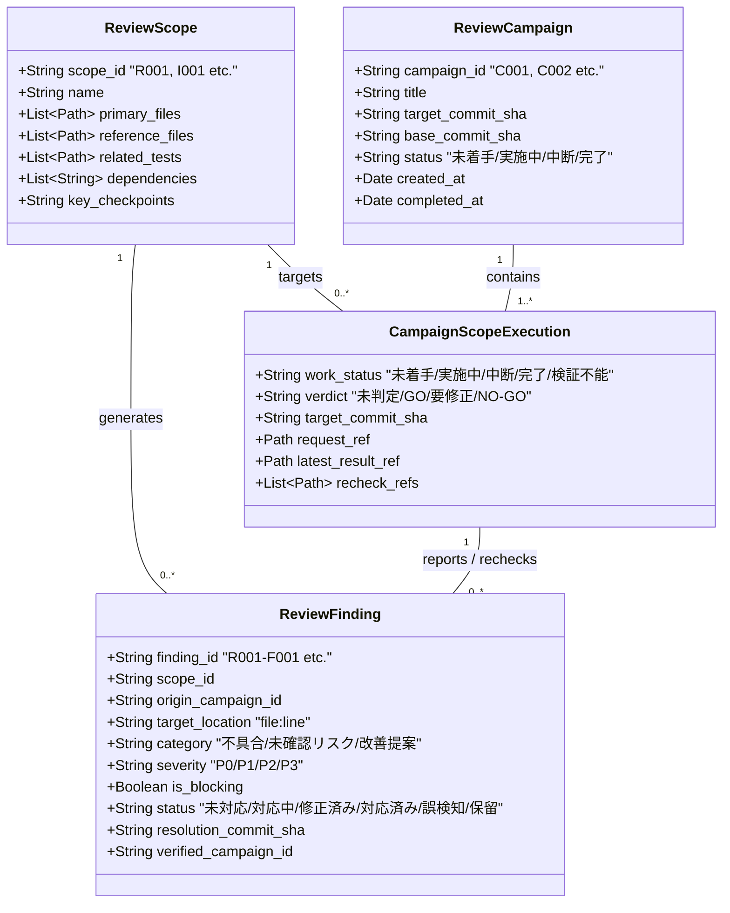
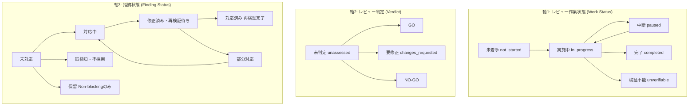
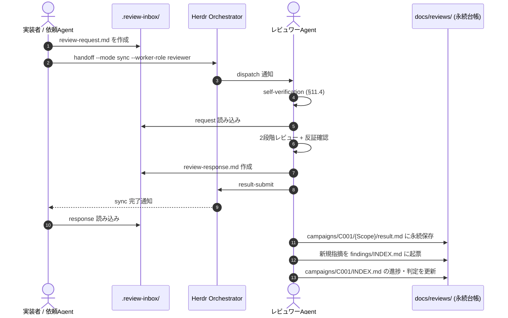
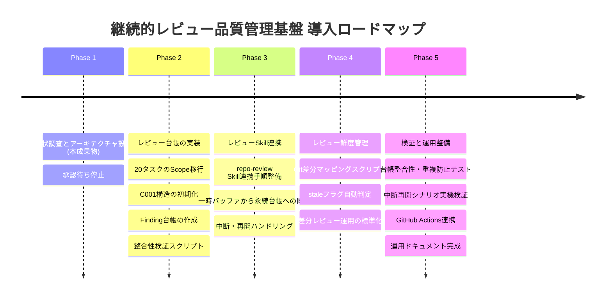

# herdr-orchestration 継続的レビュー品質管理基盤 設計書 (Continuous Review Design)

本書は、`herdr-orchestration` リポジトリにおける継続的なコードレビューと品質管理を実現するための基盤設計書である。
既存の分割レビュー計画（20タスク）、レビュー台帳、`repo-review` Skill を最大限に再利用し、単発の全体レビューにとどまらず、将来の変更・リリース・再レビューにおいても持続可能な品質管理アーキテクチャを定義する。

---

## 目次

1. [現状分析 (Current State Analysis)](#sec-1)
2. [既存資産の再利用方針 (Asset Reuse Strategy)](#sec-2)
3. [推奨アーキテクチャ (Architecture Overview)](#sec-3)
4. [ディレクトリ構成 (Directory Structure)](#sec-4)
5. [データモデル仕様 (Data Models)](#sec-5)
6. [ID採番規則と衝突防止 (ID Numbering & Collision Prevention)](#sec-6)
7. [レビュー状態管理と状態遷移 (State Lifecycle Management)](#sec-7)
8. [レビュー実行フロー (Review Execution Flow)](#sec-8)
9. [再レビュー実行フローと指摘追跡 (Re-review & Finding Tracking)](#sec-9)
10. [レビュー鮮度管理と変更影響判定 (Freshness & Impact Analysis)](#sec-10)
11. [既存ブランチからの移行計画 (Migration Plan)](#sec-11)
12. [Phase 2〜5 の具体的実装タスク (Implementation Roadmap)](#sec-12)
13. [リスク・未確定事項・トレードオフ (Risks & Trade-offs)](#sec-13)

---

<a id="sec-1"></a>

## 1. 現状分析 (Current State Analysis)

### 1.1 既存資産の現状 (`docs/split-code-review-plan`)

現在、`docs/split-code-review-plan` ブランチには以下のファイル群が整備されている。

1. **`docs/reviews/PLAN.md` (695行)**:
   - 個別レビュー（R001〜R014、R006A/Bを含む15タスク）および結合レビュー（I001〜I005、5タスク）の全20タスクが精緻に定義されている。
   - リポジトリ内の全実装コード（Python）、CLIスクリプト（Shell）、Skill定義（Markdown）、CI/CD（GitHub Actions）の完全カバレッジ対応表が存在する。
   - Claude 3.7 Sonnet 等の AI モデルにおける 5 時間枠・週間枠の消費特性（1セッションあたり主対象コード150〜350行）を踏まえた負荷制御設計がなされている。
2. **`docs/reviews/INDEX.md` (92行)**:
   - 全20タスクの進捗、判定、担当者、コミットSHAを一覧管理する台帳の初期案。
3. **`docs/reviews/{TaskID}/request.md` (全20ファイル)**:
   - 各タスクの主対象ファイル、参照ファイル、参照設計書、関連テスト、重点確認事項を定義したレビュー依頼書。
4. **`.agents/skills/repo-review/SKILL.md` および `references.md`**:
   - 2段階レビュー（第1段階: 仕様整合性、第2段階: 批判的不具合探索）、反証確認（8つの問い）、重大度（P0〜P3）とBlocking判定の分離管理、P1過大評価禁止ルール、P2例外的Blocking基準、既存保証の維持確認など、業界標準を大きく超える厳格なレビュー規律が定義されている。
5. **`.review-inbox/`**:
   - Orchestrator 経由のレビュー受け渡し用の一時バッファ（Git管理外）。

### 1.2 現行設計の課題と限界

現行の分割レビュー計画は「初回の全体レビュー（baseline: `e527edc`）を 1 回実施する」という前提で最適化されており、今後の継続的運用において以下の構造的課題を抱えている。

| 課題領域                     | 現行の仕様・実態                                                          | 継続運用における問題点                                                                                               |
| :--------------------------- | :------------------------------------------------------------------------ | :------------------------------------------------------------------------------------------------------------------- |
| **対象と実施回の結合**       | `docs/reviews/R001-primitives/` 直下に `request.md` と `result.md` を配置 | 次回リリースや差分修正時に再レビューを行うと過去の `result.md` が上書き消失するか、非構造的な命名乱立を招く。        |
| **指摘事項の追跡性**         | 指摘ID（`R001-F001` 等）の体系はあるが、指摘単体の状態遷移台帳がない      | 指摘が「未対応」「対応中」「修正済み」「再検証完了（解消）」のどの段階にあるか、修正コミットはどれかが追跡できない。 |
| **レビュー鮮度の未管理**     | レビュー判定に対象コミットSHAは記録されるが、コード変更との照合機構がない | ファイル変更後も過去の GO 判定が有効に見えてしまい、古い GO を誤って最新コードの品質保証と見誤るリスクがある。       |
| **中断・再開の形式化不足**   | 中断手順はあるが、部分的に検証された状態や再開時のチェックリストが未分離  | AIモデルの利用枠上限（5時間枠・トークン制限）による強制中断時に、どこまで検証済みで何が未検証かが失われやすい。      |
| **台帳と一時バッファの混同** | `.review-inbox/` と `docs/reviews/` の永続化連携手順が未定義              | Orchestrator 経由で受け渡されたレビュー結果をどのように永続台帳へ同期するかがエージェントごとにブレる。              |

---

<a id="sec-2"></a>

## 2. 既存資産の再利用方針 (Asset Reuse Strategy)

本基盤の導入にあたり、既存のレビュー設計・品質基準・タスク定義を原則として 100% 継承する。不要な再設計やレビュー基準の緩和は一切行わない。

### 2.1 継承・維持する要素

1. **全20レビュータスクの論理定義（完全継承）**:
   - 個別レビュー（R001〜R014、計15タスク）
   - 結合レビュー（I001〜I005、計5タスク）
   - 各タスクの責務、主対象ファイル、参照ファイル、関連テスト、重点確認事項。
2. **`repo-review` Skill の品質基準・レビュー規律（完全維持）**:
   - 2段階レビュー（第1段階：設計整合性、第2段階：批判的不具合探索）
   - 指摘の3分類（確認済み不具合、未確認リスク、改善提案）
   - 重大度（P0〜P3）と Blocking 判定の厳格な分離
   - P1 過大評価禁止ルール（4要素必須）
   - P2 の例外的 Blocking 基準
   - 指摘候補に対する反証確認（8つの反証問い）
   - 既存保証の維持確認（保証喪失・意図せぬ差分の検証）
   - 事実と推論・未実行テストの明確な区別
3. **判定基準**:
   - `GO`: 未解消の確認済み Blocking 指摘が 0 件、必須観点確認済み、未実施検証明示。
   - `要修正`: Blocking 指摘が 1 件以上存在、または重要な修正が必要。
   - `NO-GO`: 設計破綻、基盤機能の停止など致命的障害。

### 2.2 拡張・新設する要素

1. **管理概念の 3 層分離**: Scope（論理対象）、Campaign（実施回）、Finding（指摘事項）の独立管理。
2. **履歴の不変ログ化**: 過去のレビュー結果・再レビュー結果を連番ファイル（`result.md`, `recheck-01.md` 等）として永続保存。
3. **レビュー鮮度管理（Freshness Management）**: Git 差分に基づくレビュー判定の有効性検証と変更影響判定。
4. **Finding ライフサイクル台帳**: 指摘の発行から解消確認（クローズ）までの追跡台帳。
5. **機械的整合性検証スクリプト**: 重複ID、参照切れ、パス存在を自動検証する軽量チェッカー（Python標準ライブラリのみ使用）。

---

<a id="sec-3"></a>

## 3. 推奨アーキテクチャ (Architecture Overview)

### 3.1 3層分離データモデルの全体像

継続的品質管理を実現するため、レビューの関心事を以下の 3 つの直交する層に分離する。



- **Review Scope (論理責務・不変)**:
  コードベースが進化しても、モジュールの論理的な責務や境界は原則として変化しない。Scope 定義は静的資産として `scopes/` 配下に定義される。
- **Review Campaign (実施回・不変ログ)**:
  「初回全体レビュー」「v0.1.2リリース前レビュー」「差分追従レビュー」など、特定のコミット群を対象として実施されるレビュープロジェクト。過去の Campaign の実行結果は不変（Immutable）であり、上書きされない。
- **Review Finding (指摘事項・動的ライフサイクル)**:
  レビューによって発見された課題。Scope を親として採番され、Campaign をまたいで修正と再検証が行われる。同一の問題に対して新しい ID は発行せず、既存 ID のステータスを遷移させる。

### 3.2 責務境界（Herdr Orchestrator との分離）

中央 Orchestrator の中核機能（配送・Registry）にリポジトリ固有のレビュー管理ロジックを一切混入させず、明確な境界を維持する。

| コンポーネント                 | 実行環境 / 配置場所                                                    | 主な責務                                                                     | 扱うデータ                         |
| :----------------------------- | :--------------------------------------------------------------------- | :--------------------------------------------------------------------------- | :--------------------------------- |
| **Herdr Orchestrator**         | `skills/herdr-orchestrator/` / `~/.agents/skills/herdr-orchestration/` | Agent間配送、タスク状態遷移（`dispatch`, `result`, `completion`）、排他制御  | Task Registry（`task.json`）       |
| **repo-review Skill**          | `.agents/skills/repo-review/`                                          | レビュー作業の実行、批判的不具合探索、反証確認、重大度判定、判定書の作成     | `.review-inbox/`（一時バッファ）   |
| **Review Management (本基盤)** | `docs/reviews/`                                                        | Scope定義、Campaign履歴の永続保存、Finding追跡台帳、鮮度判定、台帳整合性検証 | `docs/reviews/` 配下の Markdown 群 |
| **Git**                        | リポジトリルート                                                       | コミットSHAによるレビュー対象の同一性保証、ファイル変更差分の提供            | Git HEAD, Tree, Commit 履歴        |
| **GitHub Actions**             | `.github/workflows/`                                                   | 将来的な PR 時の台帳整合性自動チェック（ID重複・参照切れの防止）             | CI 実行ログ・検証ステータス        |

---

<a id="sec-4"></a>

## 4. ディレクトリ構成 (Directory Structure)

可読性、保守性、Git 管理の容易さを最優先し、以下のディレクトリ構成を採用する。追加の外部ライブラリを必要とせず、プレーンな Markdown と YAML Frontmatter で構成する。

```text
docs/reviews/
├── README.md                           # 継続的レビュー品質管理基盤の運用ガイド
├── CONTINUOUS_REVIEW_DESIGN.md         # 本設計書（アーキテクチャ・データモデル・鮮度管理）
├── INDEX.md                            # リポジトリ全体の最新品質ダッシュボード
├── PLAN.md                             # 20タスクの全体分割計画・負荷制御方針（正本）
│
├── scopes/                             # 【Scope層】論理レビュー対象の静的定義（原則不変）
│   ├── R001-primitives.md
│   ├── R002-identity-cli.md
│   ├── R003-live-agent.md
│   ├── R004-registry-schema.md
│   ├── R005-registry-io.md
│   ├── R006A-registry-lifecycle.md
│   ├── R006B-registry-ops.md
│   ├── R007-dispatch.md
│   ├── R008-handoff.md
│   ├── R009-result.md
│   ├── R010-completion.md
│   ├── R011-public-cli.md
│   ├── R012-installer.md
│   ├── R013-skills.md
│   ├── R014-cicd.md
│   ├── I001-registry-handoff.md
│   ├── I002-handoff-result.md
│   ├── I003-result-completion.md
│   ├── I004-cli-contract.md
│   └── I005-ecosystem.md
│
├── campaigns/                          # 【Campaign層】レビュー実施回の履歴ログ（不変保存）
│   ├── C001-initial-full-review/
│   │   ├── INDEX.md                    # C001 の全Scope進捗・判定一覧
│   │   ├── R001-primitives/
│   │   │   ├── request.md              # レビュー依頼書（対象SHA・重点事項）
│   │   │   ├── result.md               # 初回レビュー結果報告書
│   │   │   └── recheck-01.md           # （再レビュー実施時）再検証結果報告書
│   │   ├── R002-identity-cli/
│   │   │   ├── request.md
│   │   │   └── result.md
│   │   └── ... (全20タスク)
│   │
│   └── C002-followup-review/           # 将来の差分レビュー実施回
│       ├── INDEX.md
│       └── ...
│
└── findings/                           # 【Finding層】指摘事項の永続ライフサイクル管理
    └── INDEX.md                        # 全Findingの最新状態・履歴・修正追跡台帳
```

---

<a id="sec-5"></a>

## 5. データモデル仕様 (Data Models)

各 Markdown ファイルは、人間が読みやすい GitHub Markdown 形式を維持しつつ、機械的な整合性検証や差分検出が容易になるよう、ファイルの先頭に標準的な YAML Frontmatter を保持する。

### 5.1 Review Scope モデル (`scopes/{ScopeID}.md`)

```markdown
---
scope_id: R001
name: primitives
title: "基盤・パス・環境・エラー・命名規則"
estimated_load: small
dependencies: []
primary_files:
  - skills/herdr-orchestrator/scripts/orchestrator/paths.py
  - skills/herdr-orchestrator/scripts/orchestrator/env.py
  - skills/herdr-orchestrator/scripts/orchestrator/errors.py
  - skills/herdr-orchestrator/scripts/orchestrator/worktree.py
  - skills/herdr-orchestrator/scripts/orchestrator/naming.py
reference_files: []
related_tests:
  - tests/test_orchestrator_phase0.py
  - tests/test_orchestrator_phase1_naming.py
  - tests/test_orchestrator_phase1_worktree.py
related_docs:
  - docs/herdr-orchestrator/01-foundation.md#sec-1
  - docs/herdr-orchestrator/02-roles-and-task-contract.md#sec-4
---

# Scope: R001 基盤・パス・環境・エラー・命名規則

## 1. 責務と範囲

...

## 2. 重点確認事項

...
```

### 5.2 Campaign Scope 依頼モデル (`campaigns/{CID}/{ScopeID}/request.md`)

```markdown
---
campaign_id: C001
scope_id: R001
target_commit: e527edc67866ffee5d7ec1527e1274b4ab395a9d
base_commit: null
review_type: initial # initial | re-review | delta
status: in_progress # not_started | in_progress | paused | completed | unverifiable
assigned_reviewer: Claude 3.7 Sonnet
created_at: 2026-10-14T11:00:00+09:00
---

# レビュー依頼: C001 / R001: 基盤・パス・環境・エラー・命名規則

## 1. レビュー概要

- **対象コミット**: `e527edc67866ffee5d7ec1527e1274b4ab395a9d`
- **Scope定義**: [../../scopes/R001-primitives.md](../../scopes/R001-primitives.md)
  ...
```

### 5.3 Campaign Scope 結果モデル (`campaigns/{CID}/{ScopeID}/result.md`)

```markdown
---
campaign_id: C001
scope_id: R001
target_commit: e527edc67866ffee5d7ec1527e1274b4ab395a9d
work_status: completed # completed | paused | unverifiable
verdict: GO # GO | changes_requested | NO-GO
blocking_findings_count: 0
non_blocking_findings_count: 2
reviewed_by: Claude 3.7 Sonnet
completed_at: 2026-10-14T12:30:00+09:00
---

# レビュー結果報告: C001 / R001: 基盤・パス・環境・エラー・命名規則

## 1. 総合評価

- **判定**: **GO**
- **作業状態**: 完了
- **対象コミット**: `e527edc67866ffee5d7ec1527e1274b4ab395a9d`

## 2. 検出指摘サマリ

- Blocking 指摘: 0 件
- Non-blocking 指摘: 2 件（R001-F001, R001-F002）

## 3. 指摘事項詳細

...
```

### 5.4 Review Finding 台帳モデル (`findings/INDEX.md`)

```markdown
# Review Findings 台帳 (指摘事項永続追跡)

| Finding ID    | Scope | 初出 | 対象コミット | 重大度 | Block |  分類  | 状態     | 修正コミット | 解消確認            | 概要                         |
| :------------ | :---- | :--- | :----------- | :----: | :---: | :----: | :------- | :----------- | :------------------ | :--------------------------- |
| **R001-F001** | R001  | C001 | `e527edc`    |   P3   |  No   |  改善  | 対応済み | `a1b2c3d`    | C001 / `recheck-01` | `paths.py` 内の型ヒント補正  |
| **R008-F001** | R008  | C001 | `e527edc`    |   P1   |  Yes  | 不具合 | 修正済み | `f4e5d6c`    | 未検証              | handoff タイムアウト時の競合 |
```

---

<a id="sec-6"></a>

## 6. ID採番規則と衝突防止 (ID Numbering & Collision Prevention)

複数エージェントによる並行作業や、将来の継続レビューにおいて ID 衝突を起こさないため、決定論的かつ不変な採番ルールを定める。

### 6.1 Review Scope ID

- **フォーマット**: `{プレフィックス}{番号}`
  - 個別レビュー: `R001` 〜 `R014`（`R006A`, `R006B` を含む15タスク）
  - 結合レビュー: `I001` 〜 `I005`（5タスク）
- **不変性**: 原則として固定。新機能や新モジュールが恒常的に追加された場合のみ、末尾に新規採番（例: `R015`）を行う。

### 6.2 Review Campaign ID

- **フォーマット**: `C{3桁連番}`（例: `C001`, `C002`, `C003`）
- **ディレクトリ名**: `C{3桁連番}-{概要スラッグ}`（例: `C001-initial-full-review`）
- **採番ルール**: 新たな全体レビューまたは差分レビューラウンドを開始する際に、`campaigns/` 配下の最大番号に `+1` して発行する。

### 6.3 Review Finding ID

- **フォーマット**: `{ScopeID}-F{3桁連番}`（例: `R001-F001`, `R008-F002`, `I003-F001`）
- **スコープ内一意性**: Finding ID は Scope ごとに独立して連番を付与する。
- **衝突防止設計**:
  - 各エージェントは自分が担当する Scope のプレフィックス（`R008-F...` 等）のみを採番する。
  - 異なる Scope を並行レビューしているエージェント同士は、プレフィックスが異なるため絶対に ID 衝突を起こさない。
  - 同一 Scope 内の既存 Finding は `findings/INDEX.md` を参照し、当該 Scope の最大連番に `+1` する。
- **ID の永続性（不変性の徹底）**:
  - 再レビューで同一の指摘を再検証する際、**絶対に新しい Finding ID を発行してはならない**。
  - 修正が不十分な場合（部分対応）や再検証に合格した場合（対応済み）は、既存の Finding ID のステータスと履歴を更新する。

---

<a id="sec-7"></a>

## 7. レビュー状態管理と状態遷移 (State Lifecycle Management)

本基盤では、「作業の進捗」「品質の合否」「個別指摘の対応状況」を明確に直交する 3 つの軸として分離管理する。

### 7.1 直交する 3 つの管理軸



- **「作業完了」と「GO判定」を同一視しない**:
  レビュー作業が完了しても、Blocking 指摘が存在すれば判定は `要修正` または `NO-GO` である。
- **「修正コードの存在」と「指摘対応済み」を同一視しない**:
  実装者がコードを修正した時点では `修正済み・再検証待ち` であり、レビュワーが再検証を行って初めて `対応済み（再検証完了）` となる。

### 7.2 指摘状態の遷移規則

| 状態名                                           | 定義                                                                           | 遷移可能な次状態                               |
| :----------------------------------------------- | :----------------------------------------------------------------------------- | :--------------------------------------------- |
| **未対応 (open)**                                | 指摘が起票され、実装者が未着手の状態                                           | `対応中`, `誤検知・不採用`, `保留`             |
| **対応中 (in_progress)**                         | 実装者が修正コードの作成・テストを行っている状態                               | `修正済み・再検証待ち`, `未対応`（差し戻し）   |
| **修正済み・再検証待ち (fixed_pending_recheck)** | 実装者が修正とコミットを完了し、レビュワーの再検証を待つ状態                   | `対応済み（再検証完了）`, `部分対応`, `未対応` |
| **対応済み（再検証完了） (resolved)**            | レビュワーが再レビューを行い、問題の解消を確認した状態（**終態**）             | なし                                           |
| **部分対応 (partially_resolved)**                | 修正は行われたが、エッジケースや二次的な不具合が残存している状態               | `対応中`                                       |
| **誤検知・不採用 (dismissed)**                   | 反証や仕様協議の結果、不具合ではないと合意された状態（**終態**）               | なし                                           |
| **保留 (deferred)**                              | 現行リリースでは対応を見送る合意がなされた状態（**Non-blocking指摘のみ許容**） | `未対応`（次期Campaignで再開時）               |

---

<a id="sec-8"></a>

## 8. レビュー実行フロー (Review Execution Flow)

### 8.1 新規レビュー実行フロー



### 8.2 中断と再開フロー (AI モデルの利用枠対策)

Claude 3.7 Sonnet などの 5 時間枠・週間枠に到達した場合、以下の手順で安全に状態を退避し、後続セッションで確実に再開する。

1. **中断処理 (Pause)**:
   - レビュワーは、検証が完了したファイルと未完了のファイルを特定する。
   - `campaigns/{CID}/{ScopeID}/result.md` に暫定結果を記録し、Frontmatter に `work_status: paused`、`verdict: unassessed` を明記する。
   - `docs/reviews/INDEX.md` および Campaign INDEX の作業状態を `中断` に更新する。
   - 人間チャットへ「中断時点の検証済み項目」「残存検証項目」を報告して停止する。
2. **再開処理 (Resume)**:
   - 新規セッション開始時、`docs/reviews/INDEX.md` から `中断` 状態の Scope を取得。
   - `campaigns/{CID}/{ScopeID}/result.md` の中断ログを読み込み、未検証の項目からレビューを再開する。
   - 重複した検証をスキップし、トークン消費を最小限に抑える。

---

<a id="sec-9"></a>

## 9. 再レビュー実行フローと指摘追跡 (Re-review & Finding Tracking)

### 9.1 再レビューの厳格な追跡手順

実装者が指摘を修正した後に行う再レビューでは、以下の規律を遵守する。

1. **前回指摘の引き継ぎ**:
   - レビュワーは `findings/INDEX.md` から当該 Scope の未解消指摘（`未対応`, `修正済み・再検証待ち`, `部分対応`）の一覧を読み込む。
   - 前回の結果ファイル（`result.md` または前回の `recheck-NN.md`）を参照し、指摘の背景・発生条件を再確認する。
2. **結果ファイルの不変保存**:
   - 初回の `result.md` を**絶対に上書きしない**。
   - 再レビュー結果は `campaigns/{CID}/{ScopeID}/recheck-01.md`（2回目以降は連番 `recheck-02.md`）として新規作成する。
3. **再検証の観点**:
   - **(a) 指摘事項の解消確認**: 修正コードが問題を確実に解決しているか。
   - **(b) 回帰不具合の探索**: 修正によって既存の動作や契約が破壊されていないか。
   - **(c) 新規変更箇所の品質**: 修正コード自体に新たな不具合（境界値ミス、型エラー等）が含まれていないか。
4. **Finding 台帳の更新**:
   - 解消が確認された指摘は `findings/INDEX.md` で `対応済み（再検証完了）` に更新し、修正コミットSHAと再検証記録（例: `C001 / recheck-01`）を記録する。
   - 未解消または新たな問題がある場合は `部分対応` とし、理由を記録する。
5. **判定の更新**:
   - 全ての Blocking 指摘が `対応済み（再検証完了）` となり、回帰がなければ判定を `GO` へ更新する。

---

<a id="sec-10"></a>

## 10. レビュー鮮度管理と変更影響判定 (Freshness & Impact Analysis)

継続的品質管理における最重要機能として、コミットの進行に伴うレビュー結果の「鮮度」を管理する。

### 10.1 レビュー鮮度ステータス (Freshness Status)

各 Scope に対し、現在の作業ブランチ（HEAD）に対する鮮度状態を以下のように分類する。

| 鮮度ステータス                    | 定義                                                                 | 判定ルール                                                 |
| :-------------------------------- | :------------------------------------------------------------------- | :--------------------------------------------------------- |
| **最新 (fresh)**                  | レビュー完了時と同一コミット、または関連ファイルに変更がない         | 対象 Scope の主対象・参照・依存先ファイルの差分が 0 件     |
| **要再検証 (stale)**              | レビュー完了後に、対象 Scope のコードまたは依存関係が変更された      | 対象 Scope のファイルまたは依存 Scope に変更コミットが存在 |
| **差分追従済み (delta_verified)** | 変更発生後に差分レビューが実施され、影響・回帰がないことが確認された | 差分レビュー（Delta Review）が実施され GO 判定されている   |
| **未確認 (unverified)**           | 一度もレビューが実施されていない                                     | レビュー結果ファイルが存在しない                           |
| **対象外 (out_of_scope)**         | 品質管理対象外のファイル群                                           | Scope 定義に含まれない独立ファイル                         |

### 10.2 変更影響判定アルゴリズム (Impact Analysis)

コード変更が発生した際、Git 差分から影響を受ける Scope を以下のように機械的かつ安全側に判定する。

```mermaid
flowchart TD
    Start[Git 変更コミットの発生] --> GetDiff[git diff --name-only base..head]
    GetDiff --> CheckDirect{変更ファイルが<br>primary_files に含まれるか？}
    CheckDirect -- Yes --> MarkDirect[当該 Scope を「要再検証 (stale)」に指定]
    CheckDirect -- No --> CheckTransitive{変更ファイルが<br>reference_files または<br>依存 Scope に含まれるか？}
    CheckTransitive -- Yes --> MarkTransitive[依存 Scope を「要再検証 (stale)」候補に指定]
    CheckTransitive -- No --> CheckGlobal{変更ファイルが基盤<br>R001/R004/CI設定か？}
    CheckGlobal -- Yes --> MarkAll[波及する全 Scope を「要再検証」候補に指定]
    CheckGlobal -- No --> NoImpact[影響なし（fresh維持）]
    MarkDirect --> Output[要再レビュー対象リストを出力]
    MarkTransitive --> Output
    MarkAll --> Output
```

- **安全側の原則**:
  「影響がないと論理的に証明できない変更は、すべて要再検証とする」。エージェントの推測によって勝手にレビュー済み（fresh）として扱ってはならない。

### 10.3 差分レビュー (Delta Review) の実施要件

全体レビューを毎回ゼロからやり直すのではなく、過去のレビュー結果を活用した効率的な「差分レビュー」を許可する。ただし、以下の 6 つの観点を漏れなく確認することを必須とする。

1. **変更差分そのものの問題**: 新規追加・修正された行自体のロジック、境界値、型安全性。
2. **関連する既存処理への影響**: 変更箇所の呼び出し元・呼び出し先における事前条件・事後条件の維持。
3. **前回指摘の修正状況**: 指摘された内容が正しく直されているか。
4. **新たな回帰不具合**: 修正によって既存のテストが壊れていないか、未テストの分岐が生まれていないか。
5. **既存保証の喪失**: エラー回避や最適化のために、本来の安全性や品質ゲートが弱められていないか。
6. **結合部分への波及**: インターフェースやデータ構造の変更が、結合レビュー対象（I001〜I005）に波及していないか。

> [!WARNING]
> **品質緩和の絶対禁止**  
> トークン消費削減や作業効率化を口実にして、上記 6 項目の検証を省略したり、レビュー品質基準を緩和してはならない。

---

<a id="sec-11"></a>

## 11. 既存ブランチからの移行計画 (Migration Plan)

現在 `docs/split-code-review-plan` ブランチに存在する 22 ファイルから、本基盤への安全な移行手順を定義する。

### 11.1 移行マッピング表

| 現行ファイル (`docs/reviews/`)                       | 移行先パス                                                                    | 移行方法と方針                                                                                                 |
| :--------------------------------------------------- | :---------------------------------------------------------------------------- | :------------------------------------------------------------------------------------------------------------- |
| `PLAN.md`                                            | `docs/reviews/PLAN.md`                                                        | 全体計画・分割原則の正本として維持。Scope 定義へのリンクを追加。                                               |
| `INDEX.md`                                           | `docs/reviews/INDEX.md` / `campaigns/C001-.../INDEX.md`                       | 現行の全体進捗台帳を C001 の台帳として再配置し、ルート `INDEX.md` はリポジトリ全体の統合ダッシュボードへ刷新。 |
| `R001-primitives/request.md`                         | `scopes/R001-primitives.md` / `campaigns/C001-.../R001-primitives/request.md` | 責務・ファイル定義を Scope 定義として切り出し、実施回固有情報（対象SHA等）を C001 依頼書として配置。           |
| `R002` 〜 `R014`, `I001` 〜 `I005` (各 `request.md`) | 同上 (全20タスク)                                                             | 同上。各タスクの主対象ファイル・テスト・確認事項を完全に保持。                                                 |
| （新規）                                             | `findings/INDEX.md`                                                           | 空の Finding 台帳テンプレートを作成。                                                                          |
| （新規）                                             | `README.md`                                                                   | 本基盤の全体概要およびエージェント向け運用手順書を作成。                                                       |

### 11.2 移行時の完全性保証

1. **情報欠落ゼロ**: 現行の `PLAN.md` および各 `request.md` に記載されているファイル名、行数、依存関係、テストケース名、重点確認事項が 1 文字も欠落することなく `scopes/*.md` に移行されること。
2. **Git 履歴の保全**: 移行作業は Git の履歴追跡が効く形で行い、コミット・プッシュは利用者の明示的な指示があるまで絶対に実行しない。

---

<a id="sec-12"></a>

## 12. Phase 2〜5 の具体的実装タスク (Implementation Roadmap)

本計画は 5 つの段階に分けて計画的に導入する。今回は Phase 1 の設計であり、利用者の承認を得た後に Phase 2 へ着手する。



### Phase 2: レビュー台帳の実装

- **Task 2.1**: `docs/reviews/scopes/` ディレクトリ作成および 20 タスクの Scope 定義ファイル生成（`R001`〜`R014`, `I001`〜`I005`）。
- **Task 2.2**: `docs/reviews/campaigns/C001-initial-full-review/` ディレクトリ作成および現行 20 タスク `request.md` の再配置。
- **Task 2.3**: `docs/reviews/findings/INDEX.md` のテンプレート作成。
- **Task 2.4**: ルート `docs/reviews/INDEX.md`（統合ダッシュボード）の作成。
- **Task 2.5**: 軽量な台帳整合性チェッカースクリプト（`scripts/verify-review-ledger.py` 等、Python標準ライブラリのみ使用）の実装。

### Phase 3: レビューSkill連携

- **Task 3.1**: `.agents/skills/repo-review/SKILL.md` および `references.md` に、本基盤（Scope / Campaign / Finding）との連携手順を追記。
- **Task 3.2**: レビュー完了時に `.review-inbox/review-response.md` を `campaigns/{CID}/{ScopeID}/result.md` へ永続化する手順の形式化。
- **Task 3.3**: 指摘検出時の `findings/INDEX.md` への起票および再レビュー時のステータス更新手順の確立。
- **Task 3.4**: 中断時（5時間枠到達）における作業状態退避と再開手順のガイド作成。

### Phase 4: レビュー鮮度管理

- **Task 4.1**: `git diff` を解析し、変更ファイルから影響を受ける Scope を抽出するスクリプト（`scripts/check-review-freshness.py` 等）の実装。
- **Task 4.2**: コード更新時に `docs/reviews/INDEX.md` の鮮度ステータスを `要再検証 (stale)` に更新するワークフローの確立。
- **Task 4.3**: 差分レビュー（Delta Review）の記録テンプレート（`delta-01.md` 等）の作成。

### Phase 5: 検証と運用整備

- **Task 5.1**: 台帳整合性テストの実行（ID重複チェック、参照切れチェック、パス存在チェック）。
- **Task 5.2**: 中断・再開・再レビューの一連のモックシナリオ検証。
- **Task 5.3**: `docs/reviews/README.md` の運用マニュアル整備。
- **Task 5.4**: （必要に応じ）PR 時に台帳整合性を検証する GitHub Actions ワークフローの追加。

---

<a id="sec-13"></a>

## 13. リスク・未確定事項・トレードオフ (Risks & Trade-offs)

各設計判断における採用理由、代替案、トレードオフを以下に明示する。

### 13.1 Markdown正本 vs 構造化データ (JSON/YAML) 正本

- **採用**: **Markdown (YAML Frontmatter付き) を正本とする**。
- **採用理由**:
  - 人間および LLM エージェントが Git 上で直接差分を閲覧・編集・PR レビューするのに最も適している。
  - 特別なビルドツールや外部ライブラリを導入することなく、Git 単体で永続化と可視化が成立する。
- **代替案**: SQLite や単一の大きな JSON/YAML ファイルを正本とし、Markdown を自動生成する。
- **トレードオフ**:
  - 代替案は機械処理が厳密になる反面、Git 上でのコンフリクト解決が極めて困難になり、レビュー履歴の追跡性が下がる。
  - Markdown 正本はパースの厳密性で劣るが、YAML Frontmatter と Python 標準ライブラリによる軽量チェッカーを組み合わせることで、堅牢性と運用性の最良のバランスを確保できる。

### 13.2 Finding ID 採番における並行作業の競合リスク

- **採用**: **Scope 単位のプレフィックス採番 (`{ScopeID}-F{3桁}`)**。
- **採用理由**:
  - 複数エージェントが異なる Scope を並行してレビューする場合、プレフィックスが異なるため ID の競合が原理的に発生しない。
- **代替案**: リポジトリ全体でグローバルな連番（`F0001`, `F0002`...）を発行する。
- **トレードオフ**:
  - グローバル連番は台帳が一元化されるが、並行レビュー時に同一 ID を奪い合う競合が発生しやすい。Scope 単位採番は Scope をまたぐ指摘の集計に一手間かかるが、並行作業の安全性において圧倒的に優れる。

### 13.3 レビュー鮮度管理の自動化レベル

- **採用**: **CLI スクリプトによる判定支援 ＋ レビュワー/実装者による合意更新**。
- **採用理由**:
  - Git hook 等で完全自動更新すると、コミットのたびに台帳ファイルが自動書き換えされ、開発作業のノイズや意図せぬ差分競合を生みやすい。
- **代替案**: Git commit hook や push hook で完全に自動同期する。
- **トレードオフ**:
  - 完全自動化は手動更新の手間を省けるが、エージェント環境やCI環境でのトラブル原因になりやすい。CLI スクリプトによる明示的実行＋CIでの整合性検証とすることで、安全性と透過性を両立する。

### 13.4 AI モデルの 5 時間枠・週間枠への対応

- **採用**: **Scope 単位の粒度管理（主対象150〜350行）＋ 中断（paused）状態の明示**。
- **採用理由**:
  - 過去の実測値に基づき、1つの Scope が 1 セッション（5時間枠以内）で確実に完了するよう分割されている。
  - 万が一途中で制限に達しても、中間ログを残して `paused` にすることで、別モデルや枠回復後に安全に再開可能。
- **トレードオフ**:
  - タスク数が 20 個と多くなるため全体の進捗管理の手間は増えるが、枠超過による作業消失やコンテキスト飽和によるレビュー精度の劣化を確実に防止できる。

---

<a id="sec-14"></a>

## 14. 結論と次のステップ (Conclusion)

本設計により、既存の 20 タスクおよび `repo-review` Skill の高いレビュー品質を完全に維持したまま、将来にわたってレビュー履歴、指摘事項、レビュー鮮度を安全かつ確実に管理できる基盤が整う。

**本報告（Phase 1）完了の時点で作業を停止し、利用者の確認と承認を待つ。承認を得るまで Phase 2 以降の実装には進まない。**
