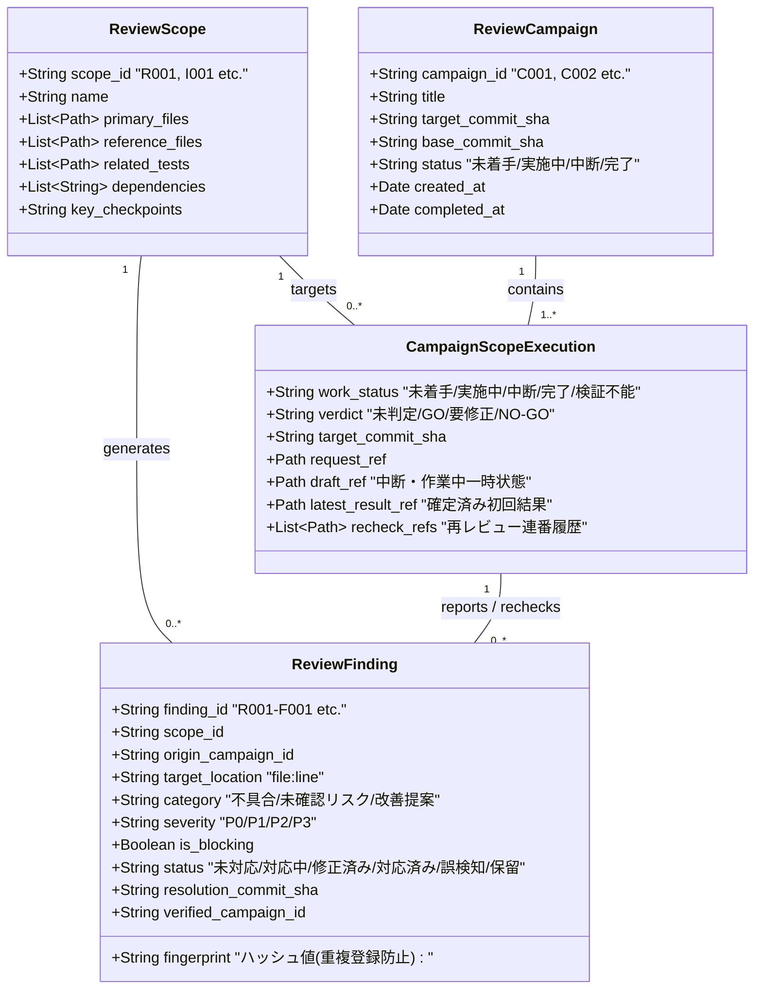
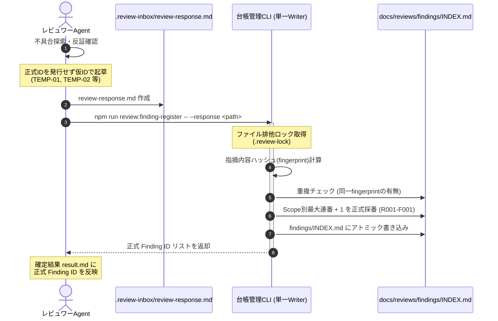
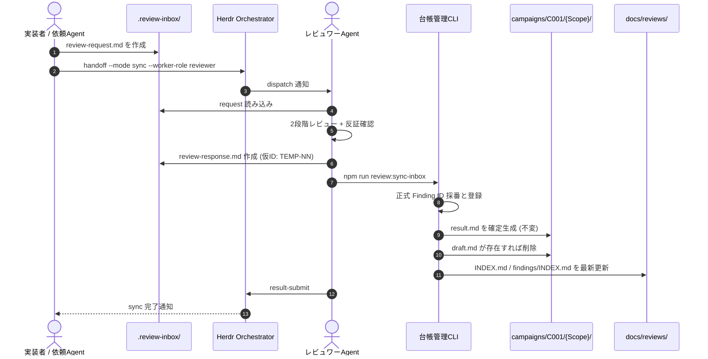
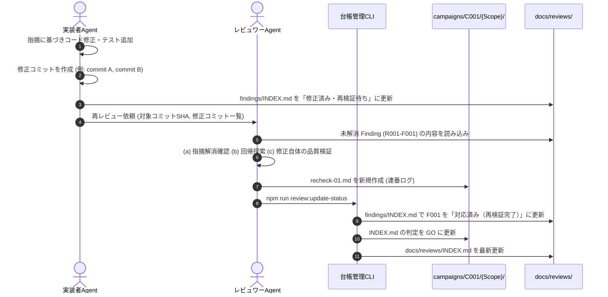
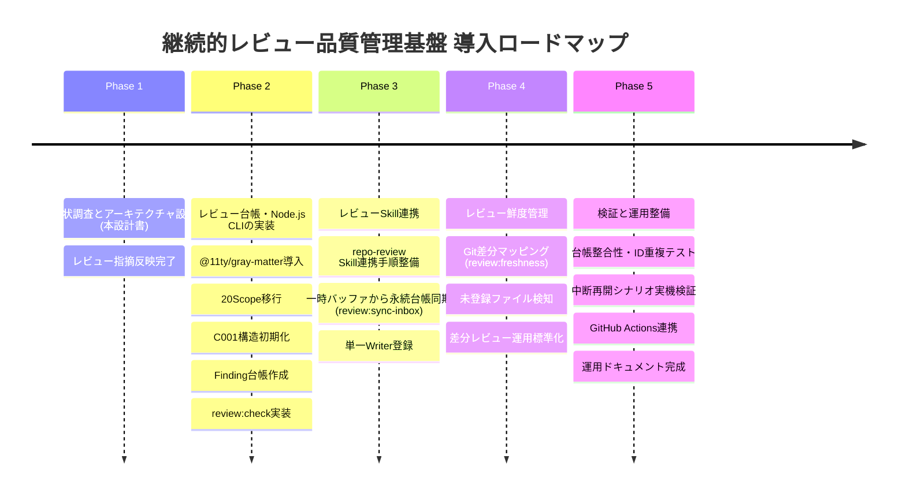

# herdr-orchestration 継続的レビュー品質管理基盤 設計書 (Continuous Review Design)

本書は、`herdr-orchestration` リポジトリにおける継続的なコードレビューと品質管理を実現するための基盤設計書である。
既存の分割レビュー計画（20タスク）、レビュー台帳、`repo-review` Skill を最大限に再利用し、単発の全体レビューにとどまらず、将来の変更・リリース・再レビューにおいても持続可能な品質管理アーキテクチャを定義する。

---

## 目次

1. [現状分析 (Current State Analysis)](#sec-1)
2. [既存資産の再利用方針と開発環境・技術選定 (Asset Reuse & Technology Strategy)](#sec-2)
3. [推奨アーキテクチャと責務境界 (Architecture & Responsibilities)](#sec-3)
4. [ディレクトリ構成 (Directory Structure)](#sec-4)
5. [データモデル仕様 (Data Models)](#sec-5)
6. [Finding ID 採番規則と競合防止（単一 Writer 方式）(Finding ID & Collision Prevention)](#sec-6)
7. [レビュー状態管理と履歴の不変性 (State Lifecycle & Immutability)](#sec-7)
8. [レビュー実行・中断・再開フロー (Execution, Pause & Resume Flow)](#sec-8)
9. [再レビュー実行フローと指摘追跡 (Re-review & Finding Tracking)](#sec-9)
10. [レビュー鮮度管理と変更影響判定 (Freshness & Impact Analysis)](#sec-10)
11. [既存ブランチからの移行計画 (Migration Plan)](#sec-11)
12. [台帳管理 CLI 設計と Phase 2〜5 実装タスク (CLI Design & Roadmap)](#sec-12)
13. [リスク・未確定事項・トレードオフ (Risks & Trade-offs)](#sec-13)
14. [結論と次のステップ (Conclusion)](#sec-14)

---

<a id="sec-1"></a>

## 1. 現状分析 (Current State Analysis)

### 1.1 既存資産の現状 (`docs/split-code-review-plan`)

現在、`docs/split-code-review-plan` ブランチには以下のファイル群が整備されている。

1. **`docs/reviews/PLAN.md` (695行)**:
   - 個別レビュー（R001〜R014、R006A/Bを含む15タスク）および結合レビュー（I001〜I005、5タスク）の全20タスクが精緻に定義されている。
   - リポジトリ内の全実装コード（Python）、CLIスクリプト（Shell）、Skill定義（Markdown）、CI/CD（GitHub Actions）の完全カバレッジ対応表が存在する。
   - Claude 3.7 Sonnet 等の AI モデルにおける 5 時間枠・週間枠の消費特性（1セッションあたり主対象コード150〜350行）を踏まえた負荷制御設計がなされている。
2. **`docs/reviews/INDEX.md` (92行)**:
   - 全20タスクの進捗、判定、担当者、コミットSHAを一覧管理する台帳の初期案。
3. **`docs/reviews/{TaskID}/request.md` (全20ファイル)**:
   - 各タスクの主対象ファイル、参照ファイル、参照設計書、関連テスト、重点確認事項を定義したレビュー依頼書。
4. **`.agents/skills/repo-review/SKILL.md` および `references.md`**:
   - 2段階レビュー（第1段階: 仕様整合性、第2段階: 批判的不具合探索）、反証確認（8つの問い）、重大度（P0〜P3）とBlocking判定の分離管理、P1過大評価禁止ルール、P2例外的Blocking基準、既存保証の維持確認など、業界標準を大きく超える厳格なレビュー規律が定義されている。
5. **`.review-inbox/`**:
   - Orchestrator 経由のレビュー受け渡し用の一時バッファ（Git管理外）。

### 1.2 現行設計の課題とレビュー検出事項

現行の分割レビュー計画および初期設計案には、継続的運用において以下の構造的課題およびレビュー指摘事項が存在する。

| 課題領域                 | レビュー指摘事項       | 継続運用におけるリスクと影響                                                                                                                                                            |
| :----------------------- | :--------------------- | :-------------------------------------------------------------------------------------------------------------------------------------------------------------------------------------- |
| **Finding ID 採番競合**  | 指摘1（P1 / Blocking） | 各エージェントが既存の最大連番+1を自律採番する方式では、同一Scopeの並列レビューや複数Scopeの同時登録時にIDが重複する。またGitブランチ間で独立採番された場合の衝突解決策が欠如している。 |
| **レビュー履歴の不変性** | 指摘2（P1 / Blocking） | 確定結果を不変ログとする方針と、中断・再開時に結果ファイルを直接更新する運用との間に矛盾がある。確定結果と暫定状態の分離、および中断中にコードが変更された場合の扱いが未定義である。    |
| **再レビュー追跡性**     | 指摘3（P2 / Blocking） | 再レビュー結果のメタデータが不足しており、修正コミットが複数積まれた際に対象コードと判定の対応関係が機械的に追跡できない。                                                              |
| **鮮度判定の安全性**     | 指摘4（P2 / Blocking） | Scope定義に未登録のファイル変更（新規追加、ルート直下、未分類ファイル）を見落とし、コード変更後も誤って過去のGO判定を有効（fresh）と判定してしまう重大な穴が存在する。                  |
| **技術選定の混同**       | 設計レビュー確認事項   | Orchestrator配布パッケージの「Python標準ライブラリ制約」を開発用レビューツールに誤適用していた。既存のリポジトリ開発環境（Node.js）との整合が必要。                                     |

---

<a id="sec-2"></a>

## 2. 既存資産の再利用方針と開発環境・技術選定 (Asset Reuse & Technology Strategy)

### 2.1 継承・維持する要素（完全維持）

本基盤の導入にあたり、既存のレビュー設計・品質基準・タスク定義を原則として 100% 継承する。不要な再設計やレビュー基準の緩和は一切行わない。

1. **全20レビュータスクの論理定義**:
   - 個別レビュー（R001〜R014、計15タスク）および結合レビュー（I001〜I005、計5タスク）。
   - 各タスクの責務、主対象ファイル、参照ファイル、関連テスト、重点確認事項。
2. **`repo-review` Skill の品質基準・規律**:
   - 2段階レビュー（第1段階：設計整合性、第2段階：批判的不具合探索）。
   - 指摘の3分類（確認済み不具合、未確認リスク、改善提案）。
   - 重大度（P0〜P3）と Blocking 判定の厳格な分離。
   - P1 過大評価禁止ルール（4要素必須）および P2 例外的 Blocking 基準。
   - 指摘候補に対する反証確認（8つの反証問い）および既存保証の維持確認。
3. **判定基準**:
   - `GO`: 未解消の確認済み Blocking 指摘が 0 件、必須観点確認済み、未実施検証明示。
   - `要修正`: Blocking 指摘が 1 件以上存在、または重要な修正が必要。
   - `NO-GO`: 設計破綻、基盤機能の停止など致命的障害。

### 2.2 開発環境・技術選定の確定方針

既存の「Python標準ライブラリのみ使用」という制約は、Herdr Orchestrator本体および配布物（`skills/herdr-orchestrator/`, `install.sh`）に関する制約である。
**開発用ツールやリポジトリ内のレビュー品質管理ツールに対する制約ではない。**

本リポジトリの開発・CI環境との統一、および Markdown エコシステムとの親和性を考慮し、レビュー品質管理基盤には **Node.js** を採用する。

| 項目                   | 採用方針           | 技術・ツール                             | 選定理由・制約                                                                   |
| :--------------------- | :----------------- | :--------------------------------------- | :------------------------------------------------------------------------------- |
| **レビュー成果物**     | Markdown (`.md`)   | GitHub Flavored Markdown                 | 人間およびLLMが Git 上で直接差分を閲覧・PRレビュー可能。                         |
| **管理メタデータ**     | YAML Frontmatter   | Markdown 先頭ブロック                    | Markdown ファイル内部に不可分に保持し、成果物とメタデータの分離を防ぐ。          |
| **Frontmatter解析**    | Node.js ライブラリ | `@11ty/gray-matter`                      | 高速・軽量で広く使われており、安全に YAML をパース・シリアライズ可能。           |
| **台帳管理スクリプト** | Node.js CLI        | `node:fs`, `node:path`, `node:crypto` 等 | ID採番、重複検出、ファイル操作は Node.js 標準機能で実装。追加依存を排除。        |
| **Markdown整形・lint** | 既存環境を再利用   | `prettier`, `markdownlint-cli2`          | リポジトリ既存の `package.json` scripts を再利用し、重複実装を禁止。             |
| **履歴・差分管理**     | バージョン管理     | Git (HEAD, diff, commit SHA)             | コミットSHAをアンカーとして一意性と追跡性を保証。                                |
| **Orchestrator配布物** | 依存の完全分離     | Python 3 標準ライブラリのみ              | 本ツールの npm 依存（`@11ty/gray-matter`）は Orchestrator 配布物に一切含めない。 |

### 2.3 実装上の制約事項

1. **成果物形式**: レビュー成果物を独立した JSON や YAML ファイルに変更しない。Markdown 正本を維持する。
2. **依存管理**: 追加ライブラリは原則として `@11ty/gray-matter`（`devDependencies`）のみとする。バージョンは `package-lock.json` で厳密に固定する。
3. **動的取得の禁止**: エージェント実行時に毎回 `npx` 等で動的ダウンロードを行う設計を禁止する。初期セットアップ時に `npm install` を完了させる。
4. **配布物混入の防止**: 台帳管理コードや npm 設定が、`install.sh` やリリース配布アーカイブ（`.tar.gz`）に混入しない構成を徹底する。

---

<a id="sec-3"></a>

## 3. 推奨アーキテクチャと責務境界 (Architecture & Responsibilities)

### 3.1 3層分離データモデルの全体像

継続的品質管理を実現するため、レビューの関心事を以下の 3 つの直交する層に分離する。



- **Review Scope (論理責務・不変)**: モジュールの論理的な責務や境界を表す静的資産（`scopes/` 配下）。
- **Review Campaign (実施回・不変ログ)**: 特定のコミット群を対象としたレビュープロジェクト（`campaigns/` 配下）。確定結果は上書き不可。
- **Review Finding (指摘事項・動的ライフサイクル)**: 発見された課題の永続エンティティ（`findings/INDEX.md`）。同一課題には永続的に同一 ID を維持。

### 3.2 責務境界（Herdr Orchestrator との分離）

中央 Orchestrator の中核機能（配送・Registry）にリポジトリ固有のレビュー管理ロジックを一切混入させず、明確な境界を維持する。

| コンポーネント            | 実行環境 / 配置場所                                                    | 主な責務                                                                    | 扱うデータ                         |
| :------------------------ | :--------------------------------------------------------------------- | :-------------------------------------------------------------------------- | :--------------------------------- |
| **Herdr Orchestrator**    | `skills/herdr-orchestrator/` / `~/.agents/skills/herdr-orchestration/` | Agent間配送、タスク状態遷移（`dispatch`, `result`, `completion`）、排他制御 | Task Registry（`task.json`）       |
| **repo-review Skill**     | `.agents/skills/repo-review/`                                          | レビュー作業の実行、批判的不具合探索、反証確認、重大度判定、仮指摘の起草    | `.review-inbox/`（一時バッファ）   |
| **Review Management CLI** | `scripts/reviews/` (Node.js)                                           | 正式 Finding ID 採番、台帳更新（単一Writer）、鮮度判定、台帳整合性検証      | `docs/reviews/` 配下の Markdown 群 |
| **Git**                   | リポジトリルート                                                       | コミットSHAによるレビュー対象の同一性保証、ファイル変更差分の提供           | Git HEAD, Tree, Commit 履歴        |
| **GitHub Actions**        | `.github/workflows/`                                                   | PR 時の台帳整合性自動チェック（ID重複・参照切れの防止）                     | CI 実行ログ・検証ステータス        |

---

<a id="sec-4"></a>

## 4. ディレクトリ構成 (Directory Structure)

可読性、保守性、Git 管理の容易さを最優先し、以下のディレクトリ構成を採用する。確定結果と中断状態をディレクトリ内で明確に分離する。

```text
docs/reviews/
├── README.md                           # 継続的レビュー品質管理基盤の運用ガイド
├── CONTINUOUS_REVIEW_DESIGN.md         # 本設計書（アーキテクチャ・データモデル・鮮度管理）
├── INDEX.md                            # リポジトリ全体の最新品質ダッシュボード（更新可能）
├── PLAN.md                             # 20タスクの全体分割計画・負荷制御方針（正本）
│
├── scopes/                             # 【Scope層】論理レビュー対象の静的定義（原則不変）
│   ├── R001-primitives.md
│   ├── R002-identity-cli.md
│   ├── ...
│   ├── R014-cicd.md
│   ├── I001-registry-handoff.md
│   └── ... (全20 Scope)
│
├── campaigns/                          # 【Campaign層】レビュー実施回の履歴ログ（不変保存）
│   ├── C001-initial-full-review/
│   │   ├── INDEX.md                    # C001 の全Scope進捗・判定一覧（更新可能）
│   │   ├── R001-primitives/
│   │   │   ├── request.md              # レビュー依頼書（不変）
│   │   │   ├── draft.md                # 【中断・作業中一時状態】（作業中のみ存在・完了時削除）
│   │   │   ├── result.md               # 【確定済み初回レビュー結果】（原則不変・確定後編集禁止）
│   │   │   ├── recheck-01.md           # 【再レビュー結果 1回目】（不変・新規追加）
│   │   │   └── recheck-02.md           # 【再レビュー結果 2回目】（不変・連番追加）
│   │   └── ... (全20タスク)
│   │
│   └── C002-followup-review/           # 将来の差分レビュー実施回
│       ├── INDEX.md
│       └── ...
│
└── findings/                           # 【Finding層】指摘事項の永続ライフサイクル管理
    └── INDEX.md                        # 全Findingの最新状態・履歴・修正追跡台帳（更新可能）
```

---

<a id="sec-5"></a>

## 5. データモデル仕様 (Data Models)

各ファイルは、GitHub Flavored Markdown の先頭に標準的な YAML Frontmatter を保持する。Frontmatter の解析・直列化には `@11ty/gray-matter` を使用する。

### 5.1 Review Scope モデル (`scopes/{ScopeID}.md`)

```markdown
---
scope_id: R001
name: primitives
title: "基盤・パス・環境・エラー・命名規則"
estimated_load: small
dependencies: []
primary_files:
  - skills/herdr-orchestrator/scripts/orchestrator/paths.py
  - skills/herdr-orchestrator/scripts/orchestrator/env.py
  - skills/herdr-orchestrator/scripts/orchestrator/errors.py
  - skills/herdr-orchestrator/scripts/orchestrator/worktree.py
  - skills/herdr-orchestrator/scripts/orchestrator/naming.py
reference_files: []
related_tests:
  - tests/test_orchestrator_phase0.py
  - tests/test_orchestrator_phase1_naming.py
  - tests/test_orchestrator_phase1_worktree.py
related_docs:
  - docs/herdr-orchestrator/01-foundation.md#sec-1
  - docs/herdr-orchestrator/02-roles-and-task-contract.md#sec-4
---

# Scope: R001 基盤・パス・環境・エラー・命名規則

...
```

### 5.2 中断・作業中一時状態モデル (`campaigns/{CID}/{ScopeID}/draft.md`)

```markdown
---
campaign_id: C001
scope_id: R001
target_commit: e527edc67866ffee5d7ec1527e1274b4ab395a9d
work_status: paused # in_progress | paused
verified_files:
  - skills/herdr-orchestrator/scripts/orchestrator/paths.py
  - skills/herdr-orchestrator/scripts/orchestrator/env.py
pending_files:
  - skills/herdr-orchestrator/scripts/orchestrator/errors.py
  - skills/herdr-orchestrator/scripts/orchestrator/worktree.py
  - skills/herdr-orchestrator/scripts/orchestrator/naming.py
paused_reason: "Claude 3.7 Sonnet 5時間利用枠上限到達のため退避"
updated_at: 2026-10-14T11:45:00+09:00
---

# 作業中ドラフト: C001 / R001

...
```

### 5.3 確定済み初回レビュー結果モデル (`campaigns/{CID}/{ScopeID}/result.md`)

```markdown
---
campaign_id: C001
scope_id: R001
review_type: initial
target_commit: e527edc67866ffee5d7ec1527e1274b4ab395a9d
work_status: completed
verdict: changes_requested # GO | changes_requested | NO-GO
blocking_findings_count: 1
non_blocking_findings_count: 1
reported_findings:
  - finding_id: R001-F001
    severity: P1
    is_blocking: true
  - finding_id: R001-F002
    severity: P3
    is_blocking: false
reviewed_by: Claude 3.7 Sonnet
completed_at: 2026-10-14T12:30:00+09:00
---

# レビュー結果報告: C001 / R001: 基盤・パス・環境・エラー・命名規則

（確定後は原則不変。一切の上書き編集を禁止）
...
```

### 5.4 再レビュー結果モデル (`campaigns/{CID}/{ScopeID}/recheck-NN.md`)

指摘3の修正要件に基づき、再レビュー結果には追跡に必要な全項目を必須化する。

```markdown
---
campaign_id: C001
scope_id: R001
review_type: re-review
recheck_round: 1
target_commit: a1b2c3d4e5f60718293a4b5c6d7e8f9012345678 # 修正後の検証対象コミット
base_commit: e527edc67866ffee5d7ec1527e1274b4ab395a9d # 前回のレビュー対象コミット
previous_result_ref: result.md # 前回結果への相対参照
resolution_commits: # 修正コミット群（複数存在する場合に対応）
  - commit: f1e2d3c4b5a6
    summary: "R001-F001 の境界値ガード追加"
  - commit: a1b2c3d4e5f6
    summary: "テストケース追加と型修正"
rechecked_findings:
  - finding_id: R001-F001
    previous_status: 未対応
    new_status: 対応済み（再検証完了）
    resolution_verdict: resolved # resolved | partially_resolved | unresolved
work_status: completed
verdict: GO # 全Blocking解消により GO
reviewed_by: Claude 3.7 Sonnet
completed_at: 2026-10-14T14:15:00+09:00
---

# 再レビュー結果報告 (Round 1): C001 / R001

...
```

### 5.5 差分レビュー結果モデル (`campaigns/{CID}/{ScopeID}/delta-NN.md`)

```markdown
---
campaign_id: C002
scope_id: R001
review_type: delta
delta_round: 1
target_commit: 99887766554433221100aabbccddeeff00112233
base_commit: a1b2c3d4e5f60718293a4b5c6d7e8f9012345678
diff_files:
  - skills/herdr-orchestrator/scripts/orchestrator/env.py
impact_checkpoints:
  direct_impact: passed
  side_effects: passed
  regression_tests: passed
  guarantees_preserved: passed
work_status: completed
verdict: GO
reviewed_by: Claude 3.7 Sonnet
completed_at: 2026-10-15T10:00:00+09:00
---

# 差分レビュー結果報告: C002 / R001

...
```

### 5.6 各レビュー種別の Frontmatter 項目対応表

| 項目                  | 初回 (`result.md`) | 再レビュー (`recheck-NN.md`) | 差分 (`delta-NN.md`) | 用途                      |
| :-------------------- | :----------------: | :--------------------------: | :------------------: | :------------------------ |
| `campaign_id`         |      **必須**      |           **必須**           |       **必須**       | 所属する実施回            |
| `scope_id`            |      **必須**      |           **必須**           |       **必須**       | 対象論理 Scope            |
| `review_type`         |     `initial`      |         `re-review`          |       `delta`        | レビュー種別の識別        |
| `target_commit`       |      **必須**      |           **必須**           |       **必須**       | 検証対象コミットSHA       |
| `base_commit`         |   任意 (null可)    |           **必須**           |       **必須**       | 比較元コミットSHA         |
| `previous_result_ref` |        なし        |           **必須**           |         任意         | 前回の結果ファイル参照    |
| `recheck_round`       |        なし        |           **必須**           |         なし         | 再レビュー連番            |
| `resolution_commits`  |        なし        |           **必須**           |         なし         | 修正コミットのリスト      |
| `rechecked_findings`  |        なし        |           **必須**           |         なし         | 再検証対象 Finding と合否 |
| `diff_files`          |        なし        |             なし             |       **必須**       | 検証した差分ファイル一覧  |
| `work_status`         |      **必須**      |           **必須**           |       **必須**       | 作業状態                  |
| `verdict`             |      **必須**      |           **必須**           |       **必須**       | 品質判定                  |
| `reviewed_by`         |      **必須**      |           **必須**           |       **必須**       | 実施エージェント/モデル   |
| `completed_at`        |      **必須**      |           **必須**           |       **必須**       | 完了タイムスタンプ        |

---

<a id="sec-6"></a>

## 6. Finding ID 採番規則と競合防止（単一 Writer 方式）(Finding ID & Collision Prevention)

指摘1（P1 / Blocking）への対応として、エージェントによる自律採番を廃止し、**Reviewer と台帳管理担当（Ledger Writer）の責務分離** および **単一 Writer 方式** を導入する。

### 6.1 責務の明確な分離



1. **Reviewer（検査担当）**:
   - 正式な Finding ID を自己採番しない。
   - `review-response.md` には仮ID（`TEMP-01`, `TEMP-02` 等）または指摘のローカル連番を記載して報告する。
2. **台帳管理CLI（単一 Writer / 登録担当）**:
   - 正式な Finding ID の発行および `findings/INDEX.md` への書き込みは、台帳管理CLI（`npm run review:finding-register`）が一元的に担う。

### 6.2 単一 Writer 方式と排他制御・リトライ

1. **ファイルロックによる排他制御**:
   - CLI 実行時、`docs/reviews/.review-lock` に対して Node.js の `node:fs`（`flag: 'wx'`）による原子的ファイル作成ロックを取得する。
   - 処理完了時、または例外終了時に必ずロックを解除する（`try...finally`）。
2. **同時書き込み時の再試行（Exponential Backoff）**:
   - ロック取得に失敗した場合は、ランダムなバックオフ（100ms〜500ms）を挟んで最大 10 回再試行する。
3. **重複登録防止（Fingerprint による同一性判定）**:
   - 指摘の「対象ファイル相対パス」「該当行」「問題の要約」から SHA-256 ハッシュ（fingerprint）を生成する。
   - `findings/INDEX.md` 内に同一 fingerprint の未解消指摘が既に存在する場合は、新規 ID を発行せず既存の Finding ID を返却する（冪等性の保証）。

### 6.3 Git ブランチ間での ID 衝突防止と解決方針

異なる Git ブランチで並行して同一 Scope に対する Finding が登録され、PR マージ時に ID 重複（コンフリクト）が発生した場合の解決ルールを定める。

1. **衝突の機械的検出**:
   - CI および `npm run review:check` は、リポジトリ内の全 Finding ID の重複を厳密に検査する。重複が存在する場合は exit code 1 でビルドを失敗させる。
2. **解決方針（マージ側ブランチのリナンバリング）**:
   - 後からマージするブランチ側の Finding ID を、現在のベースブランチ（`main`）の最新空き番号へリナンバリングする。
   - CLI コマンド `npm run review:finding-renumber -- --from R001-F003 --to R001-F005` を提供し、`findings/INDEX.md` および該当 Campaign 内の結果ファイルの参照を一括更新する。
3. **終態 Finding の不変保護**:
   - すでに `対応済み（再検証完了）` または `誤検知・不採用` でクローズされた過去の Finding ID の番号変更は一切禁止する。

### 6.4 再レビュー時の ID 継続利用

再レビューにおいて、過去に起票された指摘を再検証する際は、**絶対に新しい Finding ID を発行してはならない**。
Reviewer は `recheck-NN.md` において必ず元の Finding ID（例: `R001-F001`）を指定して合否を記録し、台帳管理 CLI はその Finding のステータスを遷移させる。

---

<a id="sec-7"></a>

## 7. レビュー状態管理と履歴の不変性 (State Lifecycle & Immutability)

指摘2（P1 / Blocking）への対応として、ファイル種別ごとの更新方針を明確に分離し、確定結果の完全な不変性と作業状態の更新性を両立させる。

### 7.1 ファイル種別ごとの更新・不変性マトリクス

| ファイル種別         | パス・配置場所                            | 更新方針                   | ライフサイクルとルール                                                       |
| :------------------- | :---------------------------------------- | :------------------------- | :--------------------------------------------------------------------------- |
| **確定済み初回結果** | `campaigns/{CID}/{ScopeID}/result.md`     | **原則不変（上書き禁止）** | レビュー完了時に確定出力。確定後は Git 履歴を含め一切の改変を禁止。          |
| **作業中一時状態**   | `campaigns/{CID}/{ScopeID}/draft.md`      | **更新可能（作業中のみ）** | 中断時の進捗退避先。再開時に読み込まれ、レビュー完了時に確定・削除される。   |
| **再レビュー結果**   | `campaigns/{CID}/{ScopeID}/recheck-NN.md` | **新規追加（連番ログ）**   | 過去の `result.md` や `recheck-01.md` を上書きせず、連番で新規ファイル追加。 |
| **差分レビュー結果** | `campaigns/{CID}/{ScopeID}/delta-NN.md`   | **新規追加（連番ログ）**   | コード変更後の差分追従結果を連番で新規ファイル追加。                         |
| **Campaign 台帳**    | `campaigns/{CID}/INDEX.md`                | **更新可能（最新同期）**   | 当該 Campaign 内の各 Scope の最新状態（確定結果へのポインタ）を反映。        |
| **全体統合台帳**     | `docs/reviews/INDEX.md`                   | **更新可能（最新同期）**   | リポジトリ全体の最新品質ダッシュボードとして常に最新状態を反映。             |
| **Finding 台帳**     | `docs/reviews/findings/INDEX.md`          | **更新可能（状態遷移）**   | 指摘のライフサイクル（未対応→対応中→修正済み→対応済み）に応じて更新。        |

### 7.2 直交する 3 つの状態軸

「作業進捗」「品質合否」「指摘対応状況」は完全に独立した軸として管理する。

1. **レビュー作業状態 (Work Status)**: `未着手 (not_started)` / `実施中 (in_progress)` / `中断 (paused)` / `完了 (completed)` / `検証不能 (unverifiable)`
2. **レビュー品質判定 (Verdict)**: `未判定 (unassessed)` / `GO` / `要修正 (changes_requested)` / `NO-GO`
3. **指摘状態 (Finding Status)**: `未対応` / `対応中` / `修正済み・再検証待ち` / `対応済み（再検証完了）` / `部分対応` / `誤検知・不採用` / `保留 (Non-blockingのみ)`

### 7.3 監査追跡性（Audit Trail）の保証

過去の `result.md`（要修正）を残したまま、修正コミット後に `recheck-01.md`（GO）が追加されるため、Git 履歴を遡らなくても成果物ディレクトリを閲覧するだけで、
「**いつ、どのコミットに対してどのような指摘が出され、どの修正コミットを経て解消し GO に至ったか**」の全経緯が 100% 透過的に追跡可能となる。

---

<a id="sec-8"></a>

## 8. レビュー実行・中断・再開フロー (Execution, Pause & Resume Flow)

### 8.1 新規レビュー実行と確定フロー



### 8.2 中断（Pause）手順

AI モデルの 5 時間枠・週間枠やコンテキスト上限に近づいた場合、以下の手順で作業を安全に退避する。

1. レビュワーは検証が完了したファイルと未検証のファイルを明確にリストアップする。
2. `campaigns/{CID}/{ScopeID}/draft.md` を作成（または更新）し、Frontmatter に `work_status: paused`、検証済みファイル一覧、残存ファイル一覧、中断理由、対象コミットSHAを記録する。
3. `campaigns/{CID}/INDEX.md` および `docs/reviews/INDEX.md` の当該 Scope 作業状態を `中断` に更新する。
4. 人間チャットへ「中断時点の進捗」「退避完了」を報告して処理を停止する。

### 8.3 再開（Resume）手順とコード変更時の安全措置

1. **対象コミット同一性の検証**:
   - 再開時、レビュワーは現在の作業ブランチ HEAD のコミットSHAを取得し、`draft.md` 内の `target_commit` と比較する。
2. **コミットが同一の場合（正常再開）**:
   - `draft.md` の `verified_files` の再検証をスキップし、`pending_files` の検証から直ちに再開する（重複トークン消費の抑制）。
3. **中断中に対象コードが変更されていた場合の扱い（安全措置）**:
   - `draft.md` の `target_commit` と現在の HEAD が不一致の場合、**過去の部分検証結果は無効（stale）** とみなす。
   - レビュワーは `draft.md` を破棄し、新しい HEAD コミットに対して最初から検証をやり直す（推測による部分引き継ぎを禁止）。

---

<a id="sec-9"></a>

## 9. 再レビュー実行フローと指摘追跡 (Re-review & Finding Tracking)

### 9.1 再レビュー実行フロー



### 9.2 複数修正コミットの追跡性保証

実装者が複数のコミットに分けて修正を行った場合でも、`recheck-NN.md` の Frontmatter に `resolution_commits` として全コミットハッシュと対応内容を配列で記録するため、どのコミットがどの指摘を解決したのかを機械的に追跡可能である。

---

<a id="sec-10"></a>

## 10. レビュー鮮度管理と変更影響判定 (Freshness & Impact Analysis)

指摘4（P2 / Blocking）への対応として、Scope 未登録ファイルの変更検知、ファイル追加・削除・リネーム追跡、ブランチ分岐を考慮した安全側の鮮度判定を定義する。

### 10.1 レビュー鮮度ステータス (Freshness Status)

各 Scope に対し、現在の HEAD コミットに対する鮮度状態を厳密に定義する。

| 鮮度ステータス                    | 定義                                                     | 判定条件                                                                                    |
| :-------------------------------- | :------------------------------------------------------- | :------------------------------------------------------------------------------------------ |
| **最新 (fresh)**                  | レビュー判定が現在のコードに対して完全に有効             | レビュー時コミット以降、対象 Scope の主対象・参照・依存 Scope、および未分類の変更が一切ない |
| **要再検証 (stale)**              | コード変更により過去の判定が無効化された状態             | 対象 Scope の構成ファイル、または直接・推移的依存関係に変更が存在する                       |
| **差分追従済み (delta_verified)** | 変更後に差分レビューが実施され GO が確認された状態       | 差分レビュー（`delta-NN.md`）が実施され、回帰や保証喪失がないことが確認されている           |
| **未確認 (unverified)**           | 当該コードに対するレビューが一度も実施されていない       | レビュー結果ファイルが存在しない                                                            |
| **要確認 (review_needed)**        | 未分類のファイル変更等が存在し、安全側に倒して確認が必要 | Scope 未登録の新規・修正ファイルが検出された場合                                            |
| **対象外 (out_of_scope)**         | 品質管理対象外の独立ファイル                             | ドキュメントの誤字修正など、事前に合意された対象外変更                                      |

### 10.2 変更影響判定アルゴリズム（未登録ファイル・リネーム・削除の検知）

```mermaid
flowchart TD
    Start[Git 変更コミットの発生] --> GetDiff[git diff -M --name-status base..head]
    GetDiff --> DetectUnscoped{いずれの Scope 定義<br>にも含まれない変更があるか？}
    DetectUnscoped -- Yes --> MarkWarning[未分類変更検出警告を発行<br>全体を「要確認 (review_needed)」に指定]
    DetectUnscoped -- No --> CheckRenames{削除・リネーム<br>が存在するか？}
    CheckRenames -- Yes --> HandleRename[旧ファイル・新ファイル双方の<br>関連 Scope を「要再検証 (stale)」に指定]
    CheckRenames -- No --> CheckDirect{変更ファイルが<br>primary_files に含まれるか？}
    CheckDirect -- Yes --> MarkDirect[当該 Scope を「要再検証 (stale)」に指定]
    CheckDirect -- No --> CheckTransitive{変更ファイルが<br>reference_files または依存 Scope か？}
    CheckTransitive -- Yes --> MarkTransitive[依存 Scope を「要再検証 (stale)」に指定]
    CheckTransitive -- No --> CheckGlobal{基盤・共通設定・CI<br>の変更か？}
    CheckGlobal -- Yes --> MarkAll[波及する全 Scope を「要再検証」に指定]
    CheckGlobal -- No --> KeepFresh[fresh を維持]
    MarkWarning --> Output[要再検証・確認対象 Scope リストを出力]
    HandleRename --> Output
    MarkDirect --> Output
    MarkTransitive --> Output
    MarkAll --> Output
```

1. **未登録ファイル変更（Unscoped Changes）の検出**:
   - `git diff` で検出された変更ファイルが、全20 Scope の `primary_files` / `reference_files` のいずれにも登録されていない場合（例: 新規モジュールの追加、設定ファイルの追加）、**推測で `fresh` と判定することを固く禁止する**。
   - CLI は「未登録ファイルの変更が存在する」と警告し、ステータスを `要確認 (review_needed)` とする。
2. **削除・リネームの追跡**:
   - `git diff -M` を使用してリネームを追跡する。ファイルが削除またはリネームされた場合、旧パスが属していた Scope および新パスが属する Scope を即座に `要再検証 (stale)` とする。
3. **Git ブランチ分岐・マージ時の判定規則**:
   - 対象ブランチにマージコミットが含まれる場合、マージ元ブランチの全変更コミットを差分対象として走査する。
   - 共通の祖先（Merge Base）からの累積差分を評価し、安全側に倒して判定する。

### 10.3 差分レビュー (Delta Review) の 6 大必須観点

差分レビュー（`delta-NN.md`）を実施する際は、以下の 6 項目を漏れなく検証しなければならない。

1. **変更差分そのものの問題**: 追加・修正行自体の論理、境界値、型エラー。
2. **既存処理への影響**: 呼び出し元・先における事前・事後条件の破壊。
3. **前回指摘の修正状況**: 指摘内容が正しく解決されているか。
4. **新たな回帰不具合**: 既存機能・既存テストへの波及。
5. **既存保証の維持確認**: エラー回避や最適化のために品質ゲートが弱められていないか。
6. **結合部分への波及**: 結合レビュー対象（I001〜I005）への影響。

---

<a id="sec-11"></a>

## 11. 既存ブランチからの移行計画 (Migration Plan)

現在 `docs/split-code-review-plan` ブランチに存在する 22 ファイルから、本基盤への安全な移行手順を定義する。

### 11.1 移行マッピング表

| 現行ファイル (`docs/reviews/`)                       | 移行先パス                                                                    | 移行方針                                                                                                       |
| :--------------------------------------------------- | :---------------------------------------------------------------------------- | :------------------------------------------------------------------------------------------------------------- |
| `PLAN.md`                                            | `docs/reviews/PLAN.md`                                                        | 全体計画・分割原則の正本として維持。Scope 定義へのリンクを追加。                                               |
| `INDEX.md`                                           | `docs/reviews/INDEX.md` / `campaigns/C001-.../INDEX.md`                       | 現行の全体進捗台帳を C001 の台帳として再配置し、ルート `INDEX.md` はリポジトリ全体の統合ダッシュボードへ刷新。 |
| `R001-primitives/request.md`                         | `scopes/R001-primitives.md` / `campaigns/C001-.../R001-primitives/request.md` | 責務・ファイル定義を Scope 定義として切り出し、実施回固有情報（対象SHA等）を C001 依頼書として配置。           |
| `R002` 〜 `R014`, `I001` 〜 `I005` (各 `request.md`) | 同上 (全20タスク)                                                             | 同上。各タスクの主対象ファイル・テスト・確認事項を 100% 保持。                                                 |
| （新規作成）                                         | `findings/INDEX.md`                                                           | 空の Finding 台帳テンプレートを作成。                                                                          |
| （新規作成）                                         | `README.md`                                                                   | 本基盤の全体概要およびエージェント向け運用手順書を作成。                                                       |

### 11.2 移行時の完全性保証

- **情報欠落ゼロの機械的検証**: 現行の `PLAN.md` および各 `request.md` に記載されているファイル名、行数、依存関係、テストケース名、確認事項が完全に `scopes/*.md` に移行されたことを、移行スクリプト実行後に自動検証する。
- **Git 履歴の保全**: 移行作業中の Git コミット・プッシュは、利用者の明示的な指示があるまで絶対に実行しない。

---

<a id="sec-12"></a>

## 12. 台帳管理 CLI 設計と Phase 2〜5 実装タスク (CLI Design & Roadmap)

### 12.1 台帳管理 CLI アーキテクチャ (Node.js)

開発用・CI 用ツールとして、リポジトリルートに Node.js 製の軽量 CLI スクリプト群（`scripts/reviews/`）を整備する。

1. **言語・ライブラリ**:
   - ランタイム: **Node.js** (v20以上)
   - 依存ライブラリ: **`@11ty/gray-matter`**（Frontmatter パース・シリアライズ用、`devDependencies`）
   - 標準モジュール: `node:fs`, `node:path`, `node:crypto`, `node:child_process`（Git コマンド呼び出し用）
2. **Orchestrator 配布物との分離**:
   - `scripts/reviews/` 配下のスクリプトおよび `@11ty/gray-matter` はリポジトリの開発・管理環境でのみ使用する。
   - `install.sh` や Orchestrator 配布アーカイブ（`.tar.gz`）にはこれらを一切含めない。

### 12.2 コマンドの固定化と承認抑制設計

エージェント（Antigravity, Cursor, Codex 等）の実行時に、**毎回任意のシェルコマンド実行承認を求められる運用負荷を抑制**するため、`package.json` の scripts に固定エントリーポイントを用意する。

```json
{
  "scripts": {
    "review:check": "node scripts/reviews/check.js",
    "review:status": "node scripts/reviews/status.js",
    "review:freshness": "node scripts/reviews/freshness.js",
    "review:finding-register": "node scripts/reviews/register-finding.js",
    "review:sync-inbox": "node scripts/reviews/sync-inbox.js"
  }
}
```

1. **読み取り専用コマンド（承認リスク低）**:
   - `npm run review:check`: 台帳の整合性、ID重複、参照切れ、Frontmatter スキーマを検証。
   - `npm run review:status`: リポジトリ全体の最新品質状態、Campaign 進捗、未解消 Finding を表示。
   - `npm run review:freshness`: 現在の Git 差分に基づき、各 Scope の鮮度（fresh / stale / review_needed）を出力。
2. **書き込み専用コマンド（単一 Writer 集約）**:
   - `npm run review:finding-register`: レビュー結果から正式 Finding ID を発行・台帳登録（排他ロック制御付き）。
   - `npm run review:sync-inbox`: `.review-inbox` の結果を `campaigns/` 配下に確定保存し、ドラフトを破棄。
3. **承認抑制のポイント**:
   - エージェントが自由なインライン bash スクリプトを組み立てる必要をなくし、引数付きの固定 npm script 呼び出しに限定する。
   - 動的 `npx` を排除し、環境構築時の 1 回の `npm install` で完結させる。

### 12.3 Phase 2〜5 の具体的ロードマップ



#### Phase 2: レビュー台帳・Node.js CLIの実装

- **Task 2.1**: `package.json` の `devDependencies` に `@11ty/gray-matter` を追加し lockfile を更新。
- **Task 2.2**: `docs/reviews/scopes/` 配下に 20 タスクの Scope 定義ファイルを生成（情報欠落ゼロ検証）。
- **Task 2.3**: `docs/reviews/campaigns/C001-initial-full-review/` を初期化し、現行 20 タスクの `request.md` を再配置。
- **Task 2.4**: `docs/reviews/findings/INDEX.md` および統合 `docs/reviews/INDEX.md` を作成。
- **Task 2.5**: `scripts/reviews/check.js`（`npm run review:check`）を実装（ID重複、パス存在、Frontmatter検証）。

#### Phase 3: レビューSkill連携

- **Task 3.1**: `.agents/skills/repo-review/SKILL.md` および `references.md` に、仮ID起草および台帳CLI連携手順を追記。
- **Task 3.2**: `scripts/reviews/register-finding.js`（単一Writer・排他ロック・指紋照合）の実装。
- **Task 3.3**: `scripts/reviews/sync-inbox.js`（確定結果の `campaigns/` 永続化と `draft.md` 破棄）の実装。
- **Task 3.4**: 中断時（5時間枠到達）における `draft.md` 退避および再開手順のガイド作成。

#### Phase 4: レビュー鮮度管理

- **Task 4.1**: `scripts/reviews/freshness.js`（`npm run review:freshness`）の実装（Git差分解析、未登録ファイル変更検知、削除・リネーム追跡）。
- **Task 4.2**: コード変更時に `docs/reviews/INDEX.md` の鮮度ステータスを自動更新する手順の確立。
- **Task 4.3**: 差分レビュー（`delta-NN.md`）の記録テンプレートおよび 6 大観点チェックリストの作成。

#### Phase 5: 検証と運用整備

- **Task 5.1**: 台帳整合性テスト、ID重複防止テスト、Gitブランチ競合解決テストの自動化。
- **Task 5.2**: 中断・再開・再レビューの一連の実機モックシナリオ検証。
- **Task 5.3**: `docs/reviews/README.md` の運用マニュアル整備。
- **Task 5.4**: PR 時に `npm run review:check` を実行する GitHub Actions ワークフローの追加。

---

<a id="sec-13"></a>

## 13. リスク・未確定事項・トレードオフ (Risks & Trade-offs)

各設計判断における採用理由、代替案、トレードオフを以下に明示する。

### 13.1 技術スタック: Node.js ＋ `@11ty/gray-matter` の採用

- **採用**: **Node.js スクリプト ＋ `@11ty/gray-matter`**。
- **採用理由**:
  - Python標準ライブラリ制約はOrchestrator本体のものであり、開発用ツールには適用されない。
  - リポジトリ既存の `package.json`（Prettier, markdownlint）とツールチェーンを統一できる。
  - Frontmatter の安全なパースとシリアライズが極めてシンプルに実現できる。
- **代替案**: Python標準ライブラリ（`re` や手動文字列処理で Frontmatter をパース）。
- **トレードオフ**:
  - 代替案は外部 npm 依存を増やさない利点があるが、YAML パースの堅牢性に欠け、パーサー自体の不具合リスクが高まる。`@11ty/gray-matter` は `devDependencies` として lockfile で固定されるため、配布物に影響を与えず最大の安全性を得られる。

### 13.2 Finding ID 採番: 単一 Writer 方式と排他制御

- **採用**: **Reviewer は仮IDを起草し、台帳CLI（単一Writer / ファイルロック）が正式採番**。
- **採用理由**:
  - 並列レビュー時や同一Scopeの分担時におけるID重複を原理的に防止できる。
- **代替案**: 各エージェントが自律採番し、Gitコミット時にコンフリクト解決する。
- **トレードオフ**:
  - 代替案はエージェント単独で完結するが、台帳の手動マージやID衝突解決のコストが極めて高い。単一 Writer 方式は CLI 呼び出しのステップが 1 つ増えるが、データ整合性と自動化の信頼性が圧倒的に高い。

### 13.3 鮮度管理: 安全側のアプローチ（未登録ファイル検知）

- **採用**: **Scope 定義外の変更が 1 つでも存在する場合、推測で `fresh` にせず `要確認` に倒す**。
- **採用理由**:
  - ルート直下のファイル追加や新規スクリプトの追加など、Scope 漏れによる品質低下を完全に防ぐ。
- **代替案**: Scope 登録ファイルのみを検査し、それ以外のファイル変更は無視する。
- **トレードオフ**:
  - 代替案は誤検知（過剰な要確認）が少ない反面、見落としリスクが大きい。安全側アプローチは一時的に「要確認」が増える可能性があるが、品質管理基盤としての信頼性を最優先する。

### 13.4 CLI 承認抑制と透過性のバランス

- **採用**: **固定 npm scripts ＋ 読み取り/書き込み分離**。
- **採用理由**:
  - エージェント実行時の承認ポップアップの頻度を抑え、自動化のスムーズな進行を可能にする。
- **トレードオフ**:
  - 柔軟なアドホック引数は制限されるが、固定コマンドによる再現性とセキュリティの向上が得られる。

---

<a id="sec-14"></a>

## 14. 結論と次のステップ (Conclusion)

本改訂設計により、レビュー指摘事項（指摘1〜4）がすべて完全に解消され、Orchestrator 本体との責務分離を維持しながら、持続可能で堅牢な継続的品質管理基盤の設計が確定した。

**本報告完了の時点で作業を停止し、利用者の確認と承認を待つ。承認を得るまで Phase 2 以降の実装、Git コミット、Git プッシュは実行しない。**
