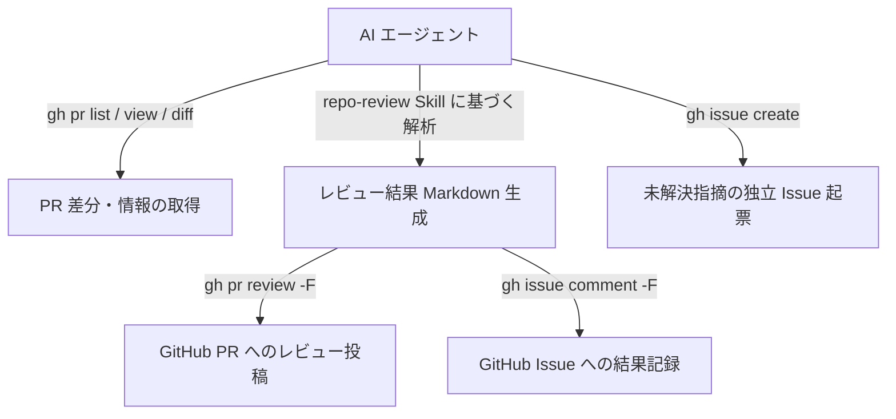
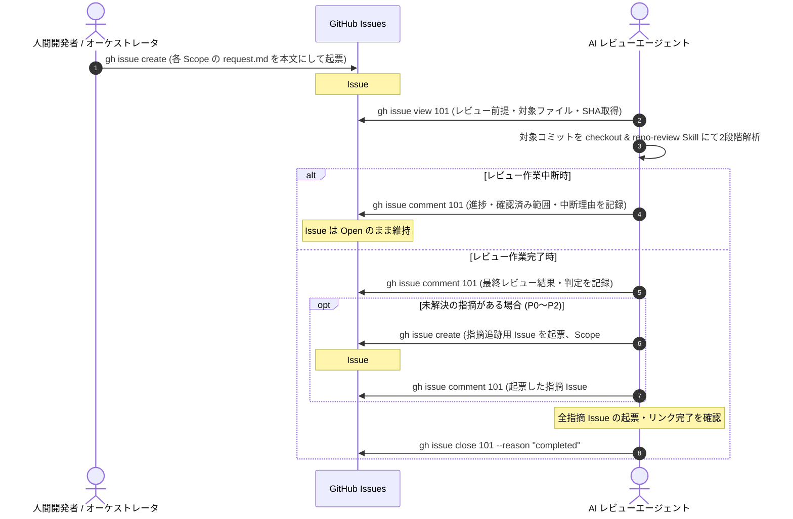
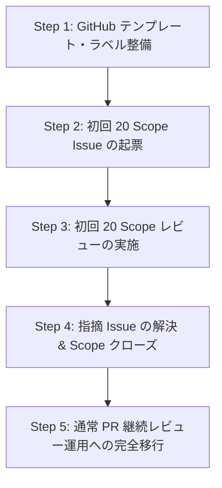

# 継続的コードレビュー基盤 簡素化アーキテクチャ設計書 (Continuous Review Simplified Design)

## 目次

- [1. 設計目的と非目的 (Purpose and Non-Goals)](#sec-1)
- [2. GitHub中心の推奨アーキテクチャ (GitHub-Centric Architecture)](#sec-2)
- [3. GitHub CLI（gh）を利用したAIエージェント運用 (Agent Operations via gh)](#sec-3)
- [4. 初回20 Scopeレビュー手順 (Initial 20-Scope Review Procedure)](#sec-4)
- [5. 継続的PRレビュー手順 (Continuous PR Review Procedure)](#sec-5)
- [6. レビュー結果・指摘の記録形式 (Standard Formats)](#sec-6)
- [7. GitHub PR / Issue テンプレート案 (Templates)](#sec-7)
- [8. レビューSkillとの連携 (Integration with Review Skills)](#sec-8)
- [9. 既存設計からの移行計画 (Migration Plan)](#sec-9)
- [10. 削除できる独自実装一覧 (Deprecated Mechanisms)](#sec-10)
- [11. 最小限の実装タスク (Minimal Implementation Tasks)](#sec-11)
- [12. 残存リスクと運用上の制約 (Risks and Operational Constraints)](#sec-12)

---

## 1. 設計目的と非目的 (Purpose and Non-Goals) {#sec-1}

### 1.1 背景と設計見直しの趣旨

当初策定された継続的レビュー設計書（[CONTINUOUS_REVIEW_DESIGN.md](CONTINUOUS_REVIEW_DESIGN.md)）では、分散環境での完全な不変性・追尾性を達成するため、以下のような高度な分散台帳機構が独自に設計された。

- 状態変更イベントログ（`EVENTS.md`）とインデックス（`INDEX.md`）のイベントソーシング
- 操作意図ファイル（`.pending-event.json`）によるトランザクション原子性とクラッシュ復旧
- 単一 Writer（`review-manager`）による排他ロック制御と更新集約
- Git コミット履歴の厳格な検証（Provenance証明、PR Files API による取り込み元直接結合、マージ方式別の真正性検証）
- コード差分とレビュー対象時点の鮮度格付け（`fresh` / `stale`）エンジン
- 複数ファイル間の相互バインド整合性検査と自己修復 CLI（`review:register`, `review:repair`, `review:check`）

これらの設計は理論的な一貫性と耐障害性を備えているものの、**「レビュー結果を記録し追跡する」という本来の目的に対して管理基盤が著しく肥大化・複雑化**していた。  
特に、開発者や AI エージェントの増加に伴う運用・教育コスト、独自 CLI の継続保守コスト、および Git 履歴検証の複雑性（11 回に及ぶ外部レビューでの指摘と修正対応）を考慮すると、長期的な持続可能性に重大な懸念があった。

本設計書（`CONTINUOUS_REVIEW_SIMPLIFIED_DESIGN.md`）は、**GitHub 標準機能（Pull Request / Issue / PR Review）および GitHub CLI（`gh`）を正本として最大限に活用し、独自台帳エンジンを撤廃してアーキテクチャを極限までシンプルに再定義**するものである。

### 1.2 最優先要件（目的に含めるもの）

本基盤の主目的は、**「過去のレビュー結果・指摘内容・修正対応を後から確実に追跡できること」**である。  
具体的には以下の 5 点を最優先要件として満たす。

1. **レビュー対象の特定**: どのコード・ブランチ・コミット（SHA）を対象にレビューしたかが一意に確認できること。
2. **指摘内容の明確性**: どのような指摘（重大度、分類、具体的な理由、該当箇所）があったかが確認できること。
3. **修正対応の追跡**: 指摘に対してどのような修正が行われたか、修正コミットや PR と紐づけて追跡できること。
4. **初回資産の継承**: [PLAN.md](PLAN.md) / [INDEX.md](INDEX.md) で定義された初回 20 Scope レビュー（R001〜R014、I001〜I005）の結果を確実に保存・追跡できること。
5. **品質基準の普遍性**: AI エージェント（Claude、Gemini、Codex 等）や開発者が変わっても、同一のレビュー品質基準（`repo-review` Skill）を継続適用できること。

### 1.3 非目的（必須要件から除外するもの）

以下の独自機構は、GitHub 標準機能で完全に代替可能、または保守コストが品質保証の便益を上回るため、**本設計の必須要件から完全に除外**する。

- **独自のイベントソーシング基盤**: `EVENTS.md` や状態追記ログによる動的な状態再構築
- **独自のトランザクション復旧機構**: `.pending-event.json` やクラッシュ時の末尾破損トリム・ロールバック処理
- **独自の履歴真正性証明**: Sub-patch Containment、マージ方式別（Squash/Rebase）の複雑なコミット結合照合
- **独自のレビュー鮮度管理エンジン**: コミットハッシュ比較による動的な stale/fresh 自動格付け
- **独自の台帳同期エンジン・Node.js CLI**: `review:register`, `review:repair`, `review:check` 等の専用 CLI ツールの開発・保守
- **外部データベースや常駐サービス**: SQLite、PostgreSQL、常駐デーモンプロセスの導入

---

## 2. GitHub中心の推奨アーキテクチャ (GitHub-Centric Architecture) {#sec-2}

### 2.1 情報と正本（Single Source of Truth）の対応

レビューに関するすべてのデータは GitHub を正本（Single Source of Truth）として管理し、ローカルの独自台帳ファイルとの二重管理を完全に排除する。

| レビュー情報種別               | 正本（Source of Truth）       | 管理単位・格納場所                      | 追跡・参照手段                      |
| ------------------------------ | ----------------------------- | --------------------------------------- | ----------------------------------- |
| **通常コードレビュー**         | **GitHub Pull Request**       | PR 会話タイムライン                     | PR 番号（`#123`）                   |
| **レビューコメント・承認履歴** | **GitHub PR Review**          | PR Files Changed タブ / Review History  | `APPROVED` / `CHANGES_REQUESTED`    |
| **初回 20 Scope レビュー**     | **GitHub Issues**             | Scope 単位の個別 Issue（20件）          | ラベル `scope-review`, Issue 番号   |
| **継続追跡する指摘（未解決）** | **GitHub Issues**             | 指摘単位の個別 Issue                    | ラベル `review-finding`, Issue 番号 |
| **指摘の修正履歴**             | **Git Commit / Pull Request** | コミットメッセージ・PR 差分             | `Fixes #123`, `Refs #123`           |
| **レビュー品質基準**           | **Skill 定義**                | `.agents/skills/repo-review/SKILL.md`   | リポジトリ内バージョン管理          |
| **レビュー手順・ガイドライン** | **Markdown 文書**             | `docs/herdr-agent-review-guidelines.md` | リポジトリ内バージョン管理          |

### 2.2 二重管理の排除方針

- 同一のレビュー情報（指摘内容、判定、ステータス）を「GitHub 上の PR/Issue」と「リポジトリ内の独自 Markdown 台帳」の双方に重複して記録・同期しない。
- リポジトリ内の Markdown（`PLAN.md` 等）は、**計画・対象 Scope の静的定義**としてのみ保持し、動的なレビュー実施結果やステータス更新の正本としては使用しない。

### 2.3 レビュー結果の長期保存メタデータ

GitHub 上で長期保存されるレビュー結果（PR Review 本文または Issue 本文・コメント）には、後からの追跡を保証するため以下のメタデータを標準記載する。

1. **レビュー対象コミット SHA**: Base Commit SHA および Target (Head) Commit SHA
2. **対象 Scope / ファイル一覧**: レビュー対象となったファイル群のパス
3. **総合判定**: `GO`（承認）、`要修正`（変更要求）、`NO-GO`（重大な問題あり）
4. **指摘一覧**: 各指摘の重大度（P0〜P3）、分類、Blocking 判定、根拠
5. **未実施検証・制約**: 今回のレビューで実施できなかったテストや環境制約

---

## 3. GitHub CLI（gh）を利用したAIエージェント運用 (Agent Operations via gh) {#sec-3}

### 3.1 環境前提と GitHub CLI の採用

- 実行環境（WSL / Linux）に標準導入済みの **GitHub CLI (`gh` version 2.102.0 以上)** を全面的に採用する。
- AI エージェント（および人間開発者）による GitHub 操作は、専用の独自 CLI や MCP サーバーを新規開発せず、原則として標準の `gh` コマンドを利用して行う。
- 標準コマンドで取得できない特殊なメタデータやバッチ処理が必要な場合のみ、`gh api` を利用する。

### 3.2 AI エージェントの標準操作コマンド



#### A. Pull Request 関連操作

```bash
# 1. オープン中の PR 一覧を確認
gh pr list --state open

# 2. PR のメタデータ（ベース・ヘッドの SHA、タイトル等）を取得
gh pr view <pr_number> --json number,title,baseRefName,headRefOid,commits

# 3. レビュー対象の差分を取得
gh pr diff <pr_number>

# 4. CI（GitHub Actions）の実行状況・成否を確認
gh pr checks <pr_number>

# 5. レビュー結果の投稿（原則として --comment で判定・指摘を投稿）
gh pr review <pr_number> --comment -F review-result.md
# ※運用ポリシーで許可されている場合のみ、Blocking 指摘時に変更要求を使用可能
# gh pr review <pr_number> --request-changes -F review-result.md
```

#### B. Issue（Scope レビュー・指摘追跡）関連操作

```bash
# 1. Scope レビュー用 Issue の起票
gh issue create \
  --title "[Scope Review] R001: 基盤・パス・エラー" \
  --body-file docs/reviews/R001-primitives/request.md \
  --label "scope-review,scope:unit"

# 2. レビュー結果・進捗のコメント追記
gh issue comment <issue_number> -F review-result.md

# 3. レビュー完了による Issue クローズ
gh issue close <issue_number> --reason "completed"

# 4. 後続追跡が必要な未解決指摘の Issue 起票
gh issue create \
  --title "[Finding] R001-F001: パス解決境界値での例外未ハンドリング" \
  --body-file finding-detail.md \
  --label "review-finding,severity:p2,blocking:no"
```

### 3.3 実行権限と安全制約（Guardrails）

AI エージェントの自律実行に伴う事故を防止するため、以下の安全境界を厳格に設定する。

| 操作種別                                                         | 実行権限                        | 安全制約・ガードレール                                                          |
| ---------------------------------------------------------------- | ------------------------------- | ------------------------------------------------------------------------------- |
| **読み取り** (`gh pr view`, `gh pr diff`, `gh issue list` 等)    | **完全自動**                    | 自由に実行可能                                                                  |
| **レビュー結果投稿** (`gh pr review --comment`)                  | **自動実行可能**                | 運用ポリシーに従い、指定の結果フォーマットを遵守                                |
| **Issue 起票・コメント** (`gh issue create`, `gh issue comment`) | **自動実行可能**                | 指定テンプレート・ラベル体系を遵守                                              |
| **変更要求** (`gh pr review --request-changes`)                  | **条件付き許可**                | 運用ポリシーで許可されている場合、Blocking 指摘時のみ使用                       |
| **PR 承認** (`gh pr review --approve`)                           | **AI 実行対象外（人間が実行）** | **初期段階では AI による正式承認は除外。GitHub 上の正式承認は人間が行う**（※1） |
| **PR マージ** (`gh pr merge`)                                    | **AI 実行厳禁**                 | **人間の明示的承認・操作を必須とする**                                          |
| **ブランチ削除** (`git push --delete`, `gh repo delete`)         | **AI 実行厳禁**                 | **完全禁止**                                                                    |

> ※1: GitHub では PR 作成者自身の承認は有効なレビュー承認として扱えず、また AI エージェントが開発者個人のアカウントで認証している場合、AI による承認と人間による承認を客観的に区別できない。そのため、AI は品質判定（GO / 要修正）の投稿に専念し、GitHub 上の正式承認（Approve）およびマージ（Merge）は人間が担当する。

---

## 4. 初回20 Scopeレビュー手順 (Initial 20-Scope Review Procedure) {#sec-4}

### 4.1 既存資産の継承

[PLAN.md](PLAN.md) および [INDEX.md](INDEX.md) にて計画・定義された初回 20 Scope レビューは、そのまま維持する。

- **個別レビュー（15タスク）**: R001〜R014（R006 は R006A, R006B の 2 分割）
- **結合レビュー（5タスク）**: I001〜I005

### 4.2 GitHub Issue による実施フロー



### 4.3 作業完了と指摘対応の分離

**「レビュー作業自体の完了」と「指摘された不具合の修正完了」を明確に区別する。**

1. **レビュー結果の記録と指摘 Issue の先行起票 (SIMP-01)**:
   - レビュー検証が完了したら、まず Scope Issue に詳細なレビュー結果と判定（GO / 要修正 / NO-GO）をコメントとして投稿する。
   - 未解決の指摘事項（特に P0〜P2）がある場合、**Scope Issue をクローズする前に**、個別の指摘追跡 Issue（`review-finding`）を `gh issue create` で起票する（本文内に `検出元: Scope Review #101` を記載）。
   - 起票した指摘 Issue 番号（例: `#105`）を Scope Issue のコメントにリンク追記し、相互参照を成立させる。
2. **安全な Scope Issue クローズ**:
   - すべての未解決指摘について Issue の起票とリンクが完了したことを確認した上で、最後に Scope Issue を `gh issue close --reason "completed"` でクローズする。
   - **途中失敗時の非破壊停止**: API 障害や通信断などで途中で失敗した場合は、Scope Issue を **Open のまま残して停止**する。これにより、未解決指摘の追跡漏れを防止する。
   - **再実行時の重複防止運用**: 再実行時は、既に作成済みの指摘 Issue（タイトルやラベル）を `gh issue list --label review-finding` 等で確認し、未作成の指摘のみ起票した上で Scope Issue をクローズする（独自の復旧エンジンやトランザクション機構は導入せず、シンプルな確認運用とする）。
3. **指摘事項の修正追跡**:
   - クローズされた Scope Issue とは独立して、各指摘 Issue は Open のまま残り、修正 PR（`Fixes #105`）がマージされた時点で個別にクローズされる。

---

## 5. 継続的PRレビュー手順 (Continuous PR Review Procedure) {#sec-5}

### 5.1 日常の開発・PR レビューフロー

初回 20 Scope レビューの完了後は、通常の Pull Request 単位での継続的レビューへ移行する。毎回 20 Scope 全体を再レビューするような過剰な運用は行わない。

1. **PR 作成**: 開発者が機能追加・バグ修正の PR を作成（PR テンプレートを適用）。
2. **AI レビュー実行**:
   - AI エージェントが PR の差分を取得（`gh pr diff <pr>`）。
   - 必要に応じてベースコミットおよびヘッドコミットのコードベースを確認。
   - `repo-review` Skill に従い、2 段階レビュー（仕様整合性 ＋ 批判的不具合探索）を実施。
3. **レビュー結果投稿**:
   - AI エージェントは原則として `gh pr review <pr> --comment -F result.md` でレビュー結果（総合判定: GO / 要修正 / NO-GO、指摘一覧、未実施検証）を投稿する。
   - 運用ポリシーで許可されている場合のみ、Blocking 指摘（P0/P1）存在時に `gh pr review <pr> --request-changes -F result.md` を使用可能とする。
4. **開発者による修正対応**:
   - 開発者が修正コミットを追加プッシュ。
5. **再レビュー**:
   - AI エージェントが前回の指摘事項に対する修正内容を確認。
   - 指摘が適切に解消されていることを確認後、再レビュー判定（判定: GO）を `gh pr review <pr> --comment -F result.md` で投稿する（初期段階では AI による `--approve` は実行しない）。
6. **人間の承認とマージ**:
   - **人間がコード変更および AI レビュー結果（GO 判定）を確認した上で、GitHub 上で正式なレビュー承認（Approve）を行う**。
   - CI チェック（自動テスト、静的解析）の全パス、およびリポジトリの保護ルール（Ruleset）が満たされていることを確認し、人間が PR をマージする（AI による自動マージは厳禁）。

### 5.2 PR 内で解決しない指摘の扱い

- リリーススケジュールや設計方針の都合上、当該 PR 内では修正せず後日対応と合意された指摘がある場合、**該当指摘を GitHub Issue として登録**し、PR 自体はマージ可能とする（ただし Blocking 指摘の扱いについては人間の承認を前提とする）。

---

## 6. レビュー結果・指摘の記録形式 (Standard Formats) {#sec-6}

### 6.1 GitHub PR Review コメント形式

PR レビュー投稿時（`gh pr review -F`）に使用する標準 Markdown 形式。

```markdown
## レビュー判定: 【 GO / 要修正 / NO-GO 】

- **対象 PR**: #123
- **Base Commit**: `a1b2c3d`
- **Head Commit**: `e5f6g7h`
- **レビュー実施日時**: 2026-10-14 16:00 (JST)
- **レビュアー**: AI Code Reviewer (`repo-review` Skill 準拠)

---

### 1. レビュー概要

（変更の目的、設計整合性、全体的な評価サマリーを簡潔に記載）

---

### 2. 指摘事項一覧 (Findings)

| 指摘ID | 重大度 | 分類     | Blocking | 概要                               | 該当ファイル・行         |
| ------ | ------ | -------- | -------- | ---------------------------------- | ------------------------ |
| F-001  | P1     | 競合条件 | Yes      | 状態更新時の排他ロック取得漏れ     | `src/operations.py:L120` |
| F-002  | P2     | 境界値   | No       | 引数 null 時のフォールバック未定義 | `src/utils.py:L45`       |

---

### 3. 指摘詳細

#### F-001: 状態更新時の排他ロック取得漏れ

- **重大度**: P1 (Blocking)
- **分類**: 競合条件・整合性
- **根拠・再現シナリオ**:
  並行して複数のリクエストが到達した場合、ロックを取得する前に状態を読み取っているため、Lost Update が発生する。
- **推奨修正案**:
  `acquire_lock()` のコンテキストマネージャ内で状態参照を行うよう修正してください。
- **反証確認**:
  単一スレッド動作環境であっても非同期タスク間で競合するため、不具合であると確認。

---

### 4. 未実施の検証・既知の制約

- 外部 API との通信モックによる単体テストは未実行。
- 1,000 件以上の大量データを用いた負荷テストは対象外。
```

### 6.2 GitHub Issue（指摘追跡）形式

PR 外で継続追跡する指摘事項を起票する標準 Markdown 形式。

```markdown
## 指摘概要

[F-001] 状態更新時の排他ロック取得漏れ

## メタデータ

- **検出元**: PR #123 (または Scope Review R001 #101)
- **検出コミット**: `e5f6g7h`
- **重大度**: P1 (Blocking)
- **分類**: 競合条件
- **対象ファイル**: `src/operations.py`

## 詳細内容

（問題の具体的な再現手順、影響範囲、該当コード箇所）

## 推奨される対応方針

（修正方針、修正案コード、参考情報）

## 是正完了条件

- [ ] 該当箇所に適切な排他制御が導入されていること。
- [ ] 並行テストを追加し、テストがパスすること。
- [ ] 修正 PR が作成され、マージされていること。
```

---

## 7. GitHub PR / Issue テンプレート案 (Templates) {#sec-7}

### 7.1 Pull Request テンプレート案 (`.github/pull_request_template.md`)

```markdown
## 概要

<!-- 変更の目的、背景、解決する課題を簡潔に記載してください -->

## 関連 Issue / PR

- Fixes #
- Refs #

## 変更内容

-

## レビュー時の重点確認事項

-

## セルフチェック項目

- [ ] コードが設計書・コーディング規約に準拠している
- [ ] ユニットテストを追加・更新し、全テストがパスしている（`npm run test:orchestrator` 等）
- [ ] ドキュメントやコメントが適切に更新されている
```

### 7.2 Scope レビュー用 Issue テンプレート案 (`.github/ISSUE_TEMPLATE/scope_review.md`)

```markdown
---
name: Scope Review Task
about: 初回 20 Scope のコードレビュー追跡用
title: "[Scope Review] <ScopeID>: <Scope名称>"
labels: ["scope-review"]
assignees: ""
---

## Scope 基本情報

- **Scope ID**:
- **種別**: 個別レビュー (Unit) / 結合レビュー (Integration)
- **主対象ファイル**:
- **対象コミット SHA**:

## レビューの目的・重点確認事項

-

## レビュー結果サマリー

<!-- レビュー完了時に記載 -->

- **判定**: 未判定 / GO / 要修正 / NO-GO
- **実施日**:
- **Blocking 指摘数**: 0
- **未解決指摘数**: 0

## レビュー詳細

<!-- レビューエージェントがコメントとして投稿 -->
```

### 7.3 推奨 GitHub ラベル体系

| カテゴリ     | ラベル名              | カラー    | 用途                           |
| ------------ | --------------------- | --------- | ------------------------------ |
| **Scope**    | `scope-review`        | `#0E8A16` | 初回 20 Scope レビューの Issue |
|              | `scope:unit`          | `#1D76DB` | 個別レビュー (R001〜R014)      |
|              | `scope:integration`   | `#5319E7` | 結合レビュー (I001〜I005)      |
| **Finding**  | `review-finding`      | `#B60205` | 継続追跡する指摘 Issue         |
| **Severity** | `severity:p0`         | `#D93F0B` | P0 (致命的・即時修正)          |
|              | `severity:p1`         | `#E99695` | P1 (重大・Blocking)            |
|              | `severity:p2`         | `#FBCA04` | P2 (通常・Non-blocking)        |
|              | `severity:p3`         | `#FEF2C0` | P3 (軽微・改善)                |
| **Status**   | `status:in-review`    | `#EDEDED` | レビュー中                     |
|              | `status:ready-to-fix` | `#C2E0C6` | 修正待ち                       |
|              | `status:verified`     | `#0E8A16` | 修正確認完了                   |

---

## 8. レビューSkillとの連携 (Integration with Review Skills) {#sec-8}

### 8.1 既存レビュー品質基準の 100% 維持

本アーキテクチャ刷新によって変更されるのは「レビュー結果の記録・管理方法」のみであり、[repo-review](../../.agents/skills/repo-review/SKILL.md) および [docs/herdr-agent-review-guidelines.md](../herdr-agent-review-guidelines.md) に定義された**レビュー品質基準は一切妥協せず 100% 維持**する。

1. **2 段階レビューの完全義務化**:
   - **第 1 段階（仕様・設計整合性）**: 要求仕様・設計書との合致を確認。
   - **第 2 段階（批判的不具合探索）**: 設計書と一致していることだけを理由に安易に GO とせず、境界条件、競合状態、エラー復旧、リソース管理等を批判的に探索する。
2. **客観的重大度評価と P1 過大評価防止**:
   - 根拠のない過度な P1 判定を排し、再現シナリオと影響範囲を客観的に提示する。
3. **反証確認（False Positive の排除）**:
   - 不具合と指摘する前に、コード内の既存ガードや上位層での保証がないかを必ず確認する。
4. **未実施検証の明示**:
   - 実施していないテスト（パフォーマンステスト、実機結合等）を結果に明記する。

### 8.2 GitHub 接続不能時・オフライン時のフォールバック

GitHub API の障害時やオフライン環境、認証エラーが発生した場合は、以下のフォールバック手順を実行する。

1. **ローカル Markdown 生成**:
   - レビュー結果をリポジトリ内のローカル一時ファイル（例: `.review-inbox/review-response.md`）に標準フォーマットで出力する。
2. **人間への通知・手動登録**:
   - エージェントは「GitHub への自動投稿に失敗したため、ローカルに結果を保存した」旨を報告し、人間が後から GitHub PR や Issue へコピー＆ペーストして登録できるようにする。

---

## 9. 既存設計からの移行計画 (Migration Plan) {#sec-9}

### 9.1 既存成果物の扱いと整理

- **維持する資産**:
  - `docs/reviews/PLAN.md`（初回 20 Scope の計画定義・スコープ一覧）
  - `docs/reviews/Rxxx/request.md` / `docs/reviews/Ixxx/request.md`（各 Scope のレビュー対象定義・観点）
  - `.agents/skills/repo-review/`（レビュー品質基準・ガイドライン）
- **移行・整理する資産**:
  - `docs/reviews/INDEX.md`: 動的台帳としての役目を終え、GitHub Issues へのリンク集または静的な完了記録として簡素化。
  - `docs/reviews/CONTINUOUS_REVIEW_DESIGN.md`: 独自台帳設計の検討履歴（アーカイブ）として保持し、本設計書（`CONTINUOUS_REVIEW_SIMPLIFIED_DESIGN.md`）を現行正本とする。

### 9.2 段階的移行ステップ



1. **Step 1: テンプレート・ラベル整備**:
   - `.github/pull_request_template.md` および `.github/ISSUE_TEMPLATE/` をリポジトリに配置。
   - `gh label create` により推奨ラベルを作成。
2. **Step 2: 初回 20 Scope Issue の起票**:
   - 各 `docs/reviews/{ScopeID}/request.md` の内容をもとに、20 件の GitHub Issue を起票。
3. **Step 3: 初回 20 Scope レビューの実施**:
   - AI エージェントが各 Issue を対象に順次レビューを実施し、結果をコメント記録。
4. **Step 4: 指摘 Issue の解決**:
   - 検出された未解決指摘を個別の `review-finding` Issue として切り出し、修正 PR で解決。
5. **Step 5: 通常 PR レビューへの完全移行**:
   - 以降の開発はすべて PR 単位での継続レビューに移行。

---

## 10. 削除できる独自実装一覧 (Deprecated Mechanisms) {#sec-10}

新旧アーキテクチャの比較と、廃止・削除できる独自機能の一覧を以下に示す。

### 10.1 新旧アーキテクチャ比較表

| 比較項目                    | 旧アーキテクチャ（CONTINUOUS_REVIEW_DESIGN）  | 新アーキテクチャ（SIMPLIFIED_DESIGN）                          | 改善効果                                   |
| --------------------------- | --------------------------------------------- | -------------------------------------------------------------- | ------------------------------------------ |
| **正本（Source of Truth）** | ローカル Markdown（`INDEX.md`, `EVENTS.md`）  | **GitHub（Pull Request, Issues, Reviews）**                    | 二重管理の完全排除、Web UI での可視化      |
| **操作インターフェース**    | 独自 Node.js CLI（`review:register` 等）      | **標準 GitHub CLI（`gh`）**                                    | CLI 開発・保守工数のゼロ化                 |
| **状態管理方式**            | 独自イベントソーシング（純粋追記ログ）        | **GitHub Issue / PR のネイティブ状態管理**                     | 独自状態管理エンジンの撤廃                 |
| **排他制御・同時実行**      | 単一 Writer（`review-manager`）排他ロック     | **GitHub の並行処理・競合制御**                                | ロック管理・デッドロックリスクの排除       |
| **障害復旧・原子性**        | `.pending-event.json` トランザクション復旧    | **各操作の成功確認と失敗時の安全停止（人間確認・再実行運用）** | 独自トランザクション機構・末尾トリムの撤廃 |
| **履歴真正性検証**          | マージ方式別（Squash/Rebase）の多層検証       | **GitHub PR マージ追跡（コミットリンク）**                     | 複雑な Git 履歴検証コードの撤廃            |
| **レビュー鮮度判定**        | コミットハッシュ・差分比較による stale 格付け | **PR 差分追尾（GitHub ネイティブ機能）**                       | 独自鮮度格付けエンジンの撤廃               |
| **開発言語・依存関係**      | Node.js, `@11ty/gray-matter`, 自作パーサー    | **GitHub 標準機能, `gh` (Bash/CLI)**                           | ランタイム依存の極小化                     |

### 10.2 完全に廃止・削除できる独自実装一覧

1. **独自管理ファイル群**:
   - `docs/reviews/EVENTS.md`（イベントログファイル）
   - `.pending-event.json`（操作意図永続化ファイル）
   - `docs/reviews/.review-manager.lock`（単一 Writer ロックファイル）
2. **独自 CLI コマンド群（開発不要）**:
   - `review:submit-proposal`
   - `review:register`
   - `review:repair`
   - `review:check`
   - `review:finding-update`
3. **独自アルゴリズム・複雑処理**:
   - 独自の Finding ID 採番エンジン（`gh issue` の Issue 番号 `#123` で完全代替）
   - 状態変更イベントの末尾破損検出・修復・ロールバック処理
   - Squash / Rebase Merge 時の Sub-patch Containment および PR Files API 結合検証処理
   - 複数 Markdown 正本ファイル間の相互バインド整合性チェック処理
   - レビュー鮮度判定（stale / fresh）自動格付け処理

---

## 11. 最小限の実装タスク (Minimal Implementation Tasks) {#sec-11}

本簡素化アーキテクチャの導入に伴い必要となる実装タスクは、**プログラミング言語による新規開発ではなく、GitHub 設定およびドキュメント整備のみ**となる。

| No         | タスク内容                         | 対象ファイル・成果物                                                                          | 種別           |
| ---------- | ---------------------------------- | --------------------------------------------------------------------------------------------- | -------------- |
| **Task 1** | **PR テンプレートの整備**          | `.github/pull_request_template.md`                                                            | 設定・Markdown |
| **Task 2** | **Issue テンプレートの整備**       | `.github/ISSUE_TEMPLATE/scope_review.md`, `.github/ISSUE_TEMPLATE/review_finding.md`          | 設定・Markdown |
| **Task 3** | **GitHub ラベル作成**              | ラベル作成用シェルスクリプトまたは手動設定手順                                                | 運用スクリプト |
| **Task 4** | **初回 20 Scope Issue 起票支援**   | `docs/reviews/*/request.md` をもとに `gh issue create` を呼び出すワンショットシェルスクリプト | 運用スクリプト |
| **Task 5** | **`repo-review` Skill の運用更新** | `.agents/skills/repo-review/SKILL.md` の成果物セクションを GitHub 連携手順へ更新              | ドキュメント   |

---

## 12. 残存リスクと運用上の制約 (Risks and Operational Constraints) {#sec-12}

### 12.1 GitHub サービス依存と障害対策

- **リスク**: GitHub サービスの停止、ネットワーク障害、または API レートリミットの枯渇により、一時的にレビュー記録・取得が行えなくなるリスク。
- **対策**: §8.2 のフォールバック方針に従い、障害時はローカル Markdown としてレビュー結果を保存し、復旧後に人間またはスクリプトで GitHub へ反映する。

### 12.2 ガバナンスとマージ権限の統制

- **リスク**: AI エージェントが誤って未完成の PR をマージしたり、管理ブランチを変更してしまうリスク。
- **対策**:
  - GitHub リポジトリの **Ruleset / Branch Protection** を設定し、`main` ブランチへの直接 push を禁止する。
  - AI エージェントに対して `gh pr merge` の実行を**ルール・プロンプトの両面で厳禁**とし、マージは必ず人間が CI パスおよびレビュー内容を確認した上で手動実行する。

### 12.3 検索性とトレーサビリティの担保

- **制約**: 独自台帳と異なり、GitHub Issue や PR の検索は GitHub の検索構文に依存する。
- **対策**:
  - 明確なラベル体系（`scope-review`, `review-finding`, `severity:p1` 等）を厳格に適用する。
  - すべての指摘 Issue および PR に、関連コミット SHA や関連 Issue 番号（`Fixes #123` 等）を必須記載することで、GitHub 上のタイムラインリンクを確実に維持する。

---

**本設計書の内容について利用者のレビューを受け、承認を得るまで Phase 2 以降の実装作業、Git コミット、Git プッシュは行わない。**
